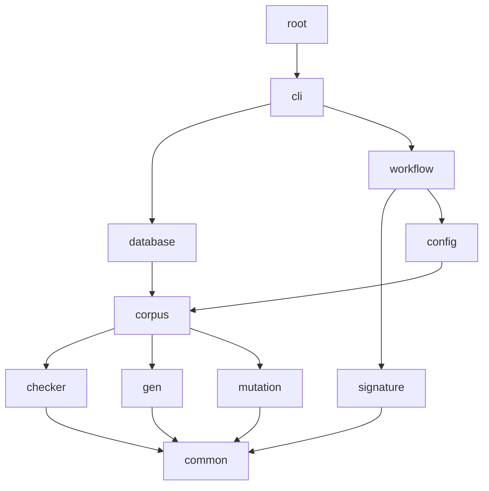

# FuzzTLA architecture atlas

Generated from commit [`e180a38`](https://github.com/tlaplus/model-checker-hardening/commit/e180a3892e661e5d7ba7636c4f24a6fca66ded14) by `make architecture` ([ADR 0022](https://github.com/tlaplus/model-checker-hardening/blob/e180a3892e661e5d7ba7636c4f24a6fca66ded14/docs/decisions/0022-architecture-atlas.md)). The [interactive explorer](https://tlaplus.github.io/model-checker-hardening/dev/) draws the same model.

## Modules

An arrow points from a module to a module it depends on. An arrow that a longer path implies is not drawn; the table lists every dependency. A red arrow is a dependency that `ArchModule` does not allow.

| Module | Summary | Types | Key types | Depends on |
|---|---|---|---|---|
| [common](modules/common.md) | Leaf utilities that every package may import: argument checks, cleanup, digests, file trees, expression counts, and the architecture annotations and layering of ADR 0022. | 16 | 5 |  |
| [checker](modules/checker.md) | Checker-independent results of a model-checker run: stable failure codes (ADR 0003) and exploration metrics (ADR 0008). | 5 | 3 | common |
| [gen](modules/gen.md) | Deterministic decoders from byte arrays to typed Apalache IR expressions and module declarations, with their limits and configuration. | 112 | 28 | common |
| [signature](modules/signature.md) | Known-defect signatures: patterns over the typed Apalache IR and the databases holding them. | 15 | 6 | common |
| [mutation](modules/mutation.md) | Byte-level mutation operators that derive new generator inputs from corpus entries. | 2 | 2 | common |
| [corpus](modules/corpus.md) | The on-disk corpus: its layout, CBOR formats, locking, stage transitions, and startup recovery, keyed by `CorpusStage` (ADR 0004). | 53 | 11 | common, checker, gen, mutation |
| [config](modules/config.md) | The `config.toml` of a corpus: its schema, strict TOML reading and writing, and the typed configuration of input generation and of every workflow stage. | 21 | 5 | common, gen, mutation, corpus |
| [database](modules/database.md) | Exports a corpus to a SQLite database for analysis, as ADR 0009 defines it. | 12 | 3 | common, checker, gen, mutation, corpus |
| [workflow](modules/workflow.md) | Runs a fuzzing campaign: the stage graph, the generation loop, checker backends, and corpus replay, under one CPU budget. | 117 | 60 | common, checker, gen, signature, mutation, corpus, config |
| [cli](modules/cli.md) | The `fuzztla` commands and their output: picocli wiring in the `*Command` classes, and renderers and progress displays that do not depend on picocli. | 34 | 10 | common, checker, gen, signature, mutation, corpus, config, database, workflow |
| [root](modules/root.md) | The `fuzztla` launcher: `Main` hands the command line to `cli`. | 1 | 1 | cli |

## Roles

| Role | Meaning | Types |
|---|---|---|
| entry point | a command or a process main | 11 |
| facade | the type other packages call | 18 |
| contract | an interface or base type that other types implement | 11 |
| process | a loop or orchestrator that owns threads or a lifecycle | 8 |
| adapter | wraps an external tool, process, or protocol | 11 |
| store | layout, locking, persistence | 5 |
| codec | a wire or storage format | 9 |
| policy | a decision rule | 18 |
| model | a domain value or enum | 32 |
| config | configuration and its schema | 7 |
| view | rendering and formatting | 3 |
| utility | a helper with no domain meaning | 7 |
| other | no `@ArchRole` | 248 |

## Relations

| Relation | Meaning |
|---|---|
| extends | a declared superclass, or a superinterface of an interface |
| implements | a declared superinterface of a class, enum, or record |
| has | an instance field or record component, possibly inside type arguments |
| uses | a constructor or method signature, or a static field |
| depends | only a method body, as jdeps reports it |
