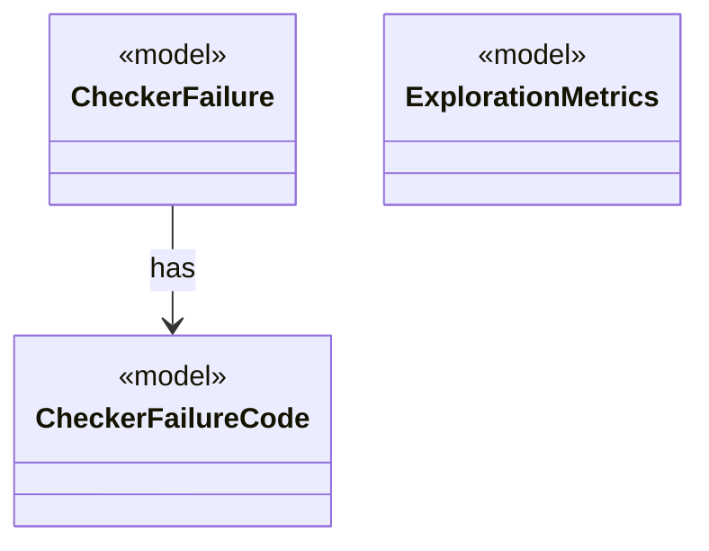

# Module `checker`

`io.github.tlaplus.hardening.checker` · [atlas](../README.md)

Checker-independent results of a model-checker run: stable failure codes (ADR 0003) and exploration metrics (ADR 0008).

**Depends on:** [common](common.md)  
**Used by:** [corpus](corpus.md), [database](database.md), [workflow](workflow.md), [cli](cli.md)

## `io.github.tlaplus.hardening.checker`

| Type | Kind | Role | Summary |
|---|---|---|---|
| [**CheckerFailure** ★](../types/io.github.tlaplus.hardening.checker.CheckerFailure.md) | record | model | A stable checker failure code with optional bounded diagnostic context. |
| [**CheckerFailureCode** ★](../types/io.github.tlaplus.hardening.checker.CheckerFailureCode.md) | enum | model | Stable failure codes shared by model-checker stages. |
| [ExplorationCount](../types/io.github.tlaplus.hardening.checker.ExplorationCount.md) | enum | other | A counted exploration metric. |
| [**ExplorationMetrics** ★](../types/io.github.tlaplus.hardening.checker.ExplorationMetrics.md) | record | model | What a model checker explored to reach its verdict, as ADR 0008 defines it. |
| [ExplorationPhase](../types/io.github.tlaplus.hardening.checker.ExplorationPhase.md) | enum | other | How far a model checker got before its verdict was fixed. |

## Decisions

- [ADR 0003: Shared model-checker failure codes](https://github.com/tlaplus/model-checker-hardening/blob/4df6a11e5b4bf93609393935c4cbeceec08cce0c/docs/decisions/0003-checker-failure-codes.md)
- [ADR 0008: Exploration metrics](https://github.com/tlaplus/model-checker-hardening/blob/4df6a11e5b4bf93609393935c4cbeceec08cce0c/docs/decisions/0008-exploration-metrics.md)
