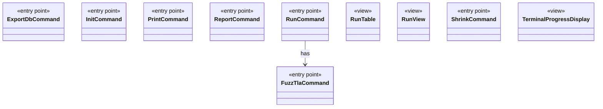

# Module `cli`

`io.github.tlaplus.hardening.cli` · [atlas](../README.md)

The `fuzztla` commands and their output: picocli wiring in the `*Command` classes, and renderers and progress displays that do not depend on picocli.

**Depends on:** [common](common.md), [checker](checker.md), [gen](gen.md), [signature](signature.md), [mutation](mutation.md), [corpus](corpus.md), [config](config.md), [database](database.md), [workflow](workflow.md)  
**Used by:** [root](root.md)

## `io.github.tlaplus.hardening.cli`

| Type | Kind | Role | Summary |
|---|---|---|---|
| [CommandDiagnostic](../types/io.github.tlaplus.hardening.cli.CommandDiagnostic.md) | class | other | Formats command failures without coupling diagnostics to picocli. |
| [DecodedInputRenderer](../types/io.github.tlaplus.hardening.cli.DecodedInputRenderer.md) | class | other | Renders a decoded input independently of picocli command wiring. |
| [EnvelopeReport](../types/io.github.tlaplus.hardening.cli.EnvelopeReport.md) | class | other | Renders a decoded corpus envelope and its expression as plain text. |
| [**ExportDbCommand** ★](../types/io.github.tlaplus.hardening.cli.ExportDbCommand.md) | class | entry point | `fuzztla export-db`: exports a corpus with `CorpusExport` (ADR 0009). |
| [ExportDbReport](../types/io.github.tlaplus.hardening.cli.ExportDbReport.md) | class | other | Renders the outcome of a corpus export. |
| [**FuzzTlaCommand** ★](../types/io.github.tlaplus.hardening.cli.FuzzTlaCommand.md) | class | entry point | The root `fuzztla` command: registers the subcommands and runs one command line. |
| [Glyphs](../types/io.github.tlaplus.hardening.cli.Glyphs.md) | enum | other | Characters for the live diagram and change markers. |
| [GraphReport](../types/io.github.tlaplus.hardening.cli.GraphReport.md) | class | other | Renders a graph module for triage (ADR 0023): the control graph, the target, the outcome the graph predicts, and the module the checkers see. |
| [HumanDuration](../types/io.github.tlaplus.hardening.cli.HumanDuration.md) | class | other | Formats nonnegative durations as compact day, hour, minute, and second parts. |
| [HumanNumber](../types/io.github.tlaplus.hardening.cli.HumanNumber.md) | class | other | Locale-independent numeric fields; compact counts occupy at most five columns. |
| [**InitCommand** ★](../types/io.github.tlaplus.hardening.cli.InitCommand.md) | class | entry point | `fuzztla init`: writes the default configuration of a new corpus and installs its libraries. |
| [KnownDefectReport](../types/io.github.tlaplus.hardening.cli.KnownDefectReport.md) | class | other | Renders the known-defect signatures that match one decoded input: each signature's id, description, and references, and the subexpression it matched first, as TLA+. |
| [Precision](../types/io.github.tlaplus.hardening.cli.Precision.md) | enum | other | How a reported value is rendered: exactly for scrollback, or bounded for live screens. |
| [**PrintCommand** ★](../types/io.github.tlaplus.hardening.cli.PrintCommand.md) | class | entry point | `fuzztla print`: decodes a payload or corpus envelope and renders it, with the known defects it matches. |
| [ProgressChanges](../types/io.github.tlaplus.hardening.cli.ProgressChanges.md) | class | other | Tracks changes and their direction for one refresh interval, using a caller-supplied monotonic clock. |
| [ProgressLayout](../types/io.github.tlaplus.hardening.cli.ProgressLayout.md) | class | other | Pure, size-bounded flow and table layouts for the same statistics and styles. |
| [ProgressScreen](../types/io.github.tlaplus.hardening.cli.ProgressScreen.md) | class | other | Owns the alternate screen: entering it, updating changed rows, and restoring scrollback. |
| [ProjectDirectory](../types/io.github.tlaplus.hardening.cli.ProjectDirectory.md) | class | other | Locates the FuzzTLA project directory that ships the signature databases and scripts. |
| [**ReportCommand** ★](../types/io.github.tlaplus.hardening.cli.ReportCommand.md) | class | entry point | `fuzztla report`: prints the instructions for writing a campaign report (ADR 0020). |
| [ReportInstructions](../types/io.github.tlaplus.hardening.cli.ReportInstructions.md) | class | other | The text of `fuzztla report`. |
| [RewriteReport](../types/io.github.tlaplus.hardening.cli.RewriteReport.md) | class | other | Renders a metamorphic pair for triage (ADR 0016 §8): which side the checkers explore, the rules applied in order, and both sides. |
| [**RunCommand** ★](../types/io.github.tlaplus.hardening.cli.RunCommand.md) | class | entry point | `fuzztla run`: reads a corpus configuration and runs `WorkflowRunner` with live progress output. |
| [RunMetric](../types/io.github.tlaplus.hardening.cli.RunMetric.md) | interface | other | Stable field identity, independent of screen coordinates or formatted text. |
| [RunOutput](../types/io.github.tlaplus.hardening.cli.RunOutput.md) | class | other | The output of one run: the command's configured writer and an optional live display in front of it. |
| [RunPalette](../types/io.github.tlaplus.hardening.cli.RunPalette.md) | record | other | Capability-aware styles on the terminal's own palette and default background. |
| [RunShutdownHook](../types/io.github.tlaplus.hardening.cli.RunShutdownHook.md) | class | other | Converts JVM shutdown into an interruption and waits for workflow exit persistence. |
| [**RunTable** ★](../types/io.github.tlaplus.hardening.cli.RunTable.md) | class | view | Complete, exact statistics grouped by stage; suitable for scrollback and redirected output. |
| [RunTerminal](../types/io.github.tlaplus.hardening.cli.RunTerminal.md) | class | other | Acquires the process stdout terminal for live progress when it is capable. |
| [RunText](../types/io.github.tlaplus.hardening.cli.RunText.md) | record | other | Shared field formatting; attributed text keeps terminal escapes out of width arithmetic. |
| [RunValue](../types/io.github.tlaplus.hardening.cli.RunValue.md) | interface | other | Unrounded, typed values used both for formatting and change comparison. |
| [**RunView** ★](../types/io.github.tlaplus.hardening.cli.RunView.md) | record | view | The statistics shared by live and final reports, without layout or terminal state. |
| [**ShrinkCommand** ★](../types/io.github.tlaplus.hardening.cli.ShrinkCommand.md) | class | entry point | `fuzztla shrink`: reduces a metamorphic counterexample with `MetamorphicShrinker` (ADR 0016). |
| [TerminalAcquisition](../types/io.github.tlaplus.hardening.cli.TerminalAcquisition.md) | interface | other | Acquires a live progress display for one run. |
| [**TerminalProgressDisplay** ★](../types/io.github.tlaplus.hardening.cli.TerminalProgressDisplay.md) | class | view | Terminal mechanics of live progress: snapshots, change highlighting, resizing, and screen restoration. |

## Decisions

- [ADR 0009: Corpus database](https://github.com/tlaplus/model-checker-hardening/blob/6bd7d927f1cffd7642029a3d925dff47091ddde9/docs/decisions/0009-corpus-database.md)
- [ADR 0016: Metamorphic testing](https://github.com/tlaplus/model-checker-hardening/blob/6bd7d927f1cffd7642029a3d925dff47091ddde9/docs/decisions/0016-metamorphic-testing.md)
- [ADR 0020: Campaign report](https://github.com/tlaplus/model-checker-hardening/blob/6bd7d927f1cffd7642029a3d925dff47091ddde9/docs/decisions/0020-campaign-report.md)
- [ADR 0023: Graph-based testing](https://github.com/tlaplus/model-checker-hardening/blob/6bd7d927f1cffd7642029a3d925dff47091ddde9/docs/decisions/0023-graph-based-testing.md)
