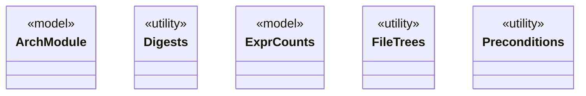

# Module `common`

`io.github.tlaplus.hardening.common` · [atlas](../README.md)

Leaf utilities that every package may import: argument checks, cleanup, digests, file trees, expression counts, and the architecture annotations and layering of ADR 0022.

**Depends on:** none  
**Used by:** [checker](checker.md), [gen](gen.md), [signature](signature.md), [mutation](mutation.md), [corpus](corpus.md), [config](config.md), [database](database.md), [workflow](workflow.md), [cli](cli.md)

## `io.github.tlaplus.hardening.common`

| Type | Kind | Role | Summary |
|---|---|---|---|
| [**ArchModule** ★](../types/io.github.tlaplus.hardening.common.ArchModule.md) | enum | model | The top-level packages of FuzzTLA and the modules each may depend on directly (ADR 0022). |
| [ArchRole](../types/io.github.tlaplus.hardening.common.ArchRole.md) | annotation | other | Declares the `Role` of a top-level type for the architecture atlas (ADR 0022). |
| [Cleanup](../types/io.github.tlaplus.hardening.common.Cleanup.md) | class | other | Best-effort I/O cleanup that retains the original failure and its suppressed diagnostics. |
| [Diagnostics](../types/io.github.tlaplus.hardening.common.Diagnostics.md) | class | other | Human-readable diagnostic formatting for failures. |
| [**Digests** ★](../types/io.github.tlaplus.hardening.common.Digests.md) | class | utility | SHA-256 identities for corpus payloads and external replay dependencies. |
| [EnumMaps](../types/io.github.tlaplus.hardening.common.EnumMaps.md) | class | other | Validated immutable copies of maps keyed by an enum, iterated in declaration order. |
| [**ExprCounts** ★](../types/io.github.tlaplus.hardening.common.ExprCounts.md) | record | model | The size of a piece of TLA+ code, the occurrences of each expression construct in it, and the occurrences of each edge between constructs. |
| [ExprEdge](../types/io.github.tlaplus.hardening.common.ExprEdge.md) | record | other | An edge of an expression tree between two constructs: `parent` applied to, or binding, an immediate subexpression that is the construct `child`. |
| [**FileTrees** ★](../types/io.github.tlaplus.hardening.common.FileTrees.md) | class | utility | File-tree operations shared by the corpus and by isolated worker processes. |
| [GeneratorAggregate](../types/io.github.tlaplus.hardening.common.GeneratorAggregate.md) | record | other | Immutable generation counters shared by persisted statistics and invocation summaries. |
| [Key](../types/io.github.tlaplus.hardening.common.Key.md) | annotation | other | Marks a top-level type as one of the few that carry its package, so that the architecture atlas draws it in the package views (ADR 0022). |
| [**Preconditions** ★](../types/io.github.tlaplus.hardening.common.Preconditions.md) | class | utility | Shared validation of method and constructor arguments. |
| [Role](../types/io.github.tlaplus.hardening.common.Role.md) | enum | other | What a type does in its package, as the architecture atlas shows it (ADR 0022). |
| [TemporaryDirectory](../types/io.github.tlaplus.hardening.common.TemporaryDirectory.md) | record | other | Owned temporary storage, removed on normal and exceptional completion. |
| [ThrowingConsumer](../types/io.github.tlaplus.hardening.common.ThrowingConsumer.md) | interface | other | An operation on one value that may fail with a checked exception. |
| [ThrowingRunnable](../types/io.github.tlaplus.hardening.common.ThrowingRunnable.md) | interface | other | An operation that takes no value and may fail with a checked exception. |

## Decisions

- [ADR 0022: Architecture atlas](https://github.com/tlaplus/model-checker-hardening/blob/5b16596dd480095d323ac67ff0f85eb85227b4b5/docs/decisions/0022-architecture-atlas.md)
