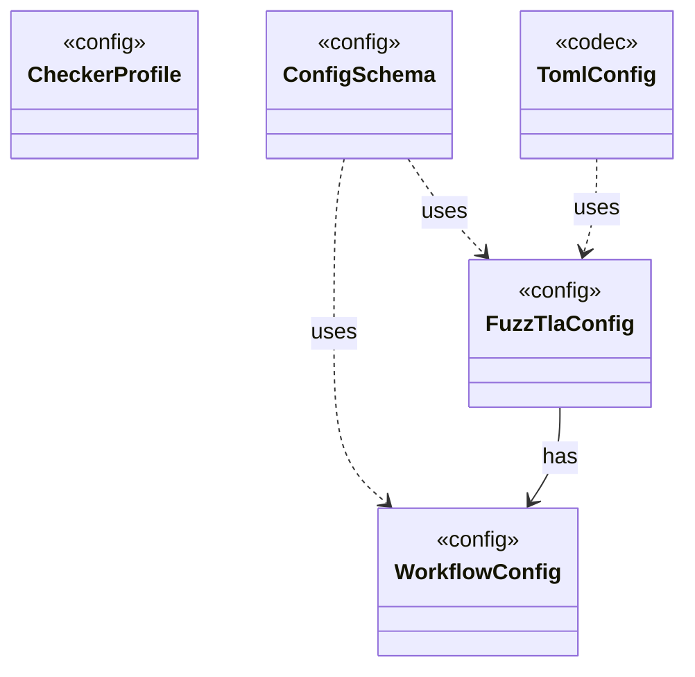

# Module `config`

`io.github.tlaplus.hardening.config` · [atlas](../README.md)

The `config.toml` of a corpus: its schema, strict TOML reading and writing, and the typed configuration of input generation and of every workflow stage.

**Depends on:** [common](common.md), [gen](gen.md), [mutation](mutation.md), [corpus](corpus.md)  
**Used by:** [workflow](workflow.md), [cli](cli.md)

## `io.github.tlaplus.hardening.config`

| Type | Kind | Role | Summary |
|---|---|---|---|
| [**CheckerProfile** ★](../types/io.github.tlaplus.hardening.config.CheckerProfile.md) | enum | config | What differs between the configured model checkers: the defaults of their resource settings and the documentation of the settings whose meaning follows from the worker lifecycle. |
| [CheckerStageConfig](../types/io.github.tlaplus.hardening.config.CheckerStageConfig.md) | record | other | Capacity and resource limits for one model-checker stage. |
| [ConfigException](../types/io.github.tlaplus.hardening.config.ConfigException.md) | class | other | Reports invalid contents in a FuzzTLA configuration file. |
| [ConfigPaths](../types/io.github.tlaplus.hardening.config.ConfigPaths.md) | class | other | Resolution of the file paths a configuration file names. |
| [**ConfigSchema** ★](../types/io.github.tlaplus.hardening.config.ConfigSchema.md) | class | config | The declaration of every key in `config.toml`: where it lives, what it means, how its value is read, and how it is written back. |
| [ConfigTableBuilder](../types/io.github.tlaplus.hardening.config.ConfigTableBuilder.md) | class | other | Registers typed keys in document order, then snapshots them as an immutable schema table. |
| [ConfigValueType](../types/io.github.tlaplus.hardening.config.ConfigValueType.md) | record | other | How the value of one configuration key is read from TOML and written back as TOML syntax. |
| [**FuzzTlaConfig** ★](../types/io.github.tlaplus.hardening.config.FuzzTlaConfig.md) | record | config | Complete configuration of input generation and workflow execution. |
| [GeneratorLimitSchema](../types/io.github.tlaplus.hardening.config.GeneratorLimitSchema.md) | class | other | Declares and assembles the expression and module limit keys in the generator table. |
| [InputStageConfig](../types/io.github.tlaplus.hardening.config.InputStageConfig.md) | record | other | The input stage's occupancy limit and the known-defect databases its admission consults. |
| [MetamorphicConfig](../types/io.github.tlaplus.hardening.config.MetamorphicConfig.md) | record | other | The `[metamorphic]` table (ADR 0016 §7, ADR 0017 §1): what a `--how=mt` run reads besides the generator settings. |
| [MutatorConfig](../types/io.github.tlaplus.hardening.config.MutatorConfig.md) | record | other | Generations, the quality gate's selection, and the mutator's share and operators (ADR 0010). |
| [OperatorLibraryConfig](../types/io.github.tlaplus.hardening.config.OperatorLibraryConfig.md) | record | other | Source-only library settings. |
| [ParserStageConfig](../types/io.github.tlaplus.hardening.config.ParserStageConfig.md) | record | other | Capacity and timeout limits for the parser stage. |
| [PbtConfig](../types/io.github.tlaplus.hardening.config.PbtConfig.md) | record | other | Limits and collection-richness controls for property-based input generation. |
| [QualityGateConfig](../types/io.github.tlaplus.hardening.config.QualityGateConfig.md) | record | other | What the quality gate keeps of a settled generation (ADR 0010, ADR 0013). |
| [RuleLibraryConfig](../types/io.github.tlaplus.hardening.config.RuleLibraryConfig.md) | record | config | A rule module and its weights (ADR 0017 §1), as `[metamorphic]` configures the rewrites of `--how=mt` and `[graph]` the tautological edge guards of ADR 0023 §6. |
| [RuleLibrarySchema](../types/io.github.tlaplus.hardening.config.RuleLibrarySchema.md) | class | other | Declares and assembles the `rules` and `weights` keys of a table that names a rule module (ADR 0017 §1), so every such table reads them alike. |
| [StageLimits](../types/io.github.tlaplus.hardening.config.StageLimits.md) | interface | other | The limits every configured tool stage takes: its result capacity and a per-input time limit. |
| [**TomlConfig** ★](../types/io.github.tlaplus.hardening.config.TomlConfig.md) | class | codec | Reads and writes the strict `config.toml` format used by a corpus. |
| [**WorkflowConfig** ★](../types/io.github.tlaplus.hardening.config.WorkflowConfig.md) | record | config | Global and per-stage limits for the implemented fuzzing workflow. |

## Decisions

- [ADR 0010: Generational mutation](https://github.com/tlaplus/model-checker-hardening/blob/ad025d7ad6f7113910ce3a79cf6e18839b06eb5a/docs/decisions/0010-mutation.md)
- [ADR 0013: Behaviour archive and operator-edge coverage](https://github.com/tlaplus/model-checker-hardening/blob/ad025d7ad6f7113910ce3a79cf6e18839b06eb5a/docs/decisions/0013-behaviour-archive-and-operator-coverage.md)
- [ADR 0016: Metamorphic testing](https://github.com/tlaplus/model-checker-hardening/blob/ad025d7ad6f7113910ce3a79cf6e18839b06eb5a/docs/decisions/0016-metamorphic-testing.md)
- [ADR 0017: Rewrite rules as a TLA+ library](https://github.com/tlaplus/model-checker-hardening/blob/ad025d7ad6f7113910ce3a79cf6e18839b06eb5a/docs/decisions/0017-rewrite-rule-library.md)
- [ADR 0023: Graph-based testing](https://github.com/tlaplus/model-checker-hardening/blob/ad025d7ad6f7113910ce3a79cf6e18839b06eb5a/docs/decisions/0023-graph-based-testing.md)
