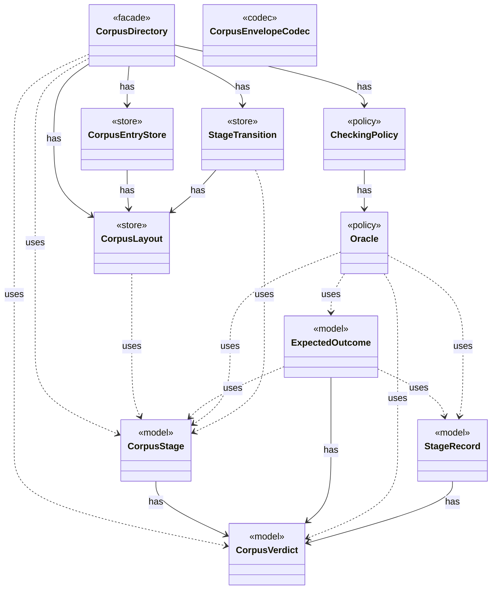

# Module `corpus`

`io.github.tlaplus.hardening.corpus` · [atlas](../README.md)

The on-disk corpus: its layout, CBOR formats, locking, stage transitions, and startup recovery, keyed by `CorpusStage` (ADR 0004).

**Depends on:** [common](common.md), [checker](checker.md), [gen](gen.md), [mutation](mutation.md)  
**Used by:** [config](config.md), [database](database.md), [workflow](workflow.md), [cli](cli.md)

## `io.github.tlaplus.hardening.corpus`

| Type | Kind | Role | Summary |
|---|---|---|---|
| [AggregationInput](../types/io.github.tlaplus.hardening.corpus.AggregationInput.md) | record | other | A logical corpus entry whose non-crash checker results are ready for aggregation. |
| [AggregationRecovery](../types/io.github.tlaplus.hardening.corpus.AggregationRecovery.md) | class | other | Recovers aggregate commits and inventories the aggregator's result directories. |
| [AggregationTransition](../types/io.github.tlaplus.hardening.corpus.AggregationTransition.md) | class | other | Joins the checker copies of one logical input into one durable aggregator result. |
| [CborMapWriter](../types/io.github.tlaplus.hardening.corpus.CborMapWriter.md) | class | other | Collects the fields of one CBOR map so that its definite length is derived from what is written rather than maintained beside it. |
| [CborReader](../types/io.github.tlaplus.hardening.corpus.CborReader.md) | class | other | Reads one CBOR document of a corpus, checking its shape as it goes. |
| [CheckerSet](../types/io.github.tlaplus.hardening.corpus.CheckerSet.md) | record | other | The checker branches a corpus runs: a non-empty set of checking stages, in stage order. |
| [**CheckingPolicy** ★](../types/io.github.tlaplus.hardening.corpus.CheckingPolicy.md) | record | policy | Which checkers a workflow run feeds and how the aggregator judges their verdicts. |
| [CorpusCbor](../types/io.github.tlaplus.hardening.corpus.CorpusCbor.md) | class | other | The Jackson wiring shared by every codec of the corpus CBOR formats. |
| [**CorpusDirectory** ★](../types/io.github.tlaplus.hardening.corpus.CorpusDirectory.md) | class | facade | Owns the on-disk layout and integrity checks for one FuzzTLA corpus. |
| [CorpusEntries](../types/io.github.tlaplus.hardening.corpus.CorpusEntries.md) | class | other | Reads corpus entries and states what makes one valid: a decodable CBOR envelope holding an expression, a name that matches its payload digest, a payload the caller's validator accepts, and stage metadata consistent with the directory the entry sits in. |
| [**CorpusEntryStore** ★](../types/io.github.tlaplus.hardening.corpus.CorpusEntryStore.md) | class | store | Admits generated payloads to the input stage and preserves the ones that broke the generator. |
| [CorpusEntryValidator](../types/io.github.tlaplus.hardening.corpus.CorpusEntryValidator.md) | interface | other | Checks that a stored input is still one this FuzzTLA build can use. |
| [CorpusEnvelope](../types/io.github.tlaplus.hardening.corpus.CorpusEnvelope.md) | record | other | Supported fields decoded from one corpus input envelope. |
| [**CorpusEnvelopeCodec** ★](../types/io.github.tlaplus.hardening.corpus.CorpusEnvelopeCodec.md) | class | codec | Reads and rewrites the `stages` metadata of a corpus envelope. |
| [CorpusException](../types/io.github.tlaplus.hardening.corpus.CorpusException.md) | class | other | Reports an invalid corpus layout or corpus entry. |
| [CorpusFormatException](../types/io.github.tlaplus.hardening.corpus.CorpusFormatException.md) | class | other | Reports stored corpus data that does not follow the documented CBOR format. |
| [CorpusInput](../types/io.github.tlaplus.hardening.corpus.CorpusInput.md) | record | other | The required fields of one encoded corpus input. |
| [CorpusInputCodec](../types/io.github.tlaplus.hardening.corpus.CorpusInputCodec.md) | class | other | Encodes and decodes an input's kind, generator payload, and admission metadata. |
| [CorpusInventory](../types/io.github.tlaplus.hardening.corpus.CorpusInventory.md) | record | other | Immutable startup inventory used to seed stage queues and capacities. |
| [**CorpusLayout** ★](../types/io.github.tlaplus.hardening.corpus.CorpusLayout.md) | class | store | Where one corpus keeps its files, how an entry is named, and how a file is written into it. |
| [CorpusLock](../types/io.github.tlaplus.hardening.corpus.CorpusLock.md) | class | other | An exclusive corpus lock and its backing file channel, released together. |
| [CorpusPath](../types/io.github.tlaplus.hardening.corpus.CorpusPath.md) | enum | other | A fixed path in the on-disk corpus layout. |
| [CorpusRunStatistics](../types/io.github.tlaplus.hardening.corpus.CorpusRunStatistics.md) | record | other | Durable cumulative statistics that cannot be recovered cheaply from corpus entries. |
| [CorpusRunStatisticsCodec](../types/io.github.tlaplus.hardening.corpus.CorpusRunStatisticsCodec.md) | class | other | Encodes and decodes the aggregate workflow-statistics CBOR document. |
| [**CorpusStage** ★](../types/io.github.tlaplus.hardening.corpus.CorpusStage.md) | enum | model | One implemented stage of the fuzzing pipeline, and the corpus directories it owns. |
| [**CorpusVerdict** ★](../types/io.github.tlaplus.hardening.corpus.CorpusVerdict.md) | enum | model | A verdict supported by the implemented corpus stages. |
| [EntryName](../types/io.github.tlaplus.hardening.corpus.EntryName.md) | record | other | The identity of one logical corpus entry: the file name it keeps in every stage directory it passes through. |
| [EntryOrigin](../types/io.github.tlaplus.hardening.corpus.EntryOrigin.md) | enum | other | Which candidate source admitted an entry, as its generation metadata records it (ADR 0010, ADR 0016 §6). |
| [EntryProgress](../types/io.github.tlaplus.hardening.corpus.EntryProgress.md) | record | other | How far one logical entry has moved through the pipeline, and the single definition of the two questions generation scheduling asks of it (ADR 0010). |
| [**ExpectedOutcome** ★](../types/io.github.tlaplus.hardening.corpus.ExpectedOutcome.md) | record | model | The checker verdict an input predicts, independently of any checker (ADR 0023 §4): a graph input predicts a counterexample of known length when its target is reachable within the step bound, and a pass otherwise. |
| [ExpectedOutcomes](../types/io.github.tlaplus.hardening.corpus.ExpectedOutcomes.md) | interface | contract | Predicts the outcome of one stored input, typically by replaying it through the generator (ADR 0023 §5). |
| [GenerationMetadata](../types/io.github.tlaplus.hardening.corpus.GenerationMetadata.md) | record | other | Admission-time facts about one corpus input: the generation that admitted it, its PBT cohort and collection-richness score, and, for a mutant, the parent and operators it was derived from. |
| [GeneratorCrashRecording](../types/io.github.tlaplus.hardening.corpus.GeneratorCrashRecording.md) | interface | other | Result of trying to preserve a payload that crashed its generator. |
| [InputAnalysis](../types/io.github.tlaplus.hardening.corpus.InputAnalysis.md) | interface | other | Counts the evaluated nodes, expression constructs and construct edges of one stored input, and names the rewrite rules it applied, typically by replaying it through the generator. |
| [InventoryScan](../types/io.github.tlaplus.hardening.corpus.InventoryScan.md) | class | other | The second pass of startup recovery: validates every entry of a corpus in which no transition is half-finished, and reports what it holds. |
| [Mutation](../types/io.github.tlaplus.hardening.corpus.Mutation.md) | record | other | How a mutated input was derived: the digest of the parent it was mutated from and the operators applied to the parent, in order. |
| [**Oracle** ★](../types/io.github.tlaplus.hardening.corpus.Oracle.md) | enum | policy | How the aggregator judges the checker results of one entry (fuzzing-workflows.md §1.3, ADR 0016 §4, ADR 0019, ADR 0023 §5). |
| [Ranking](../types/io.github.tlaplus.hardening.corpus.Ranking.md) | enum | policy | How the quality gate ranks the admissible entries of a generation, best first: the components of its key, compared lexicographically, higher first. |
| [ReplayedInput](../types/io.github.tlaplus.hardening.corpus.ReplayedInput.md) | record | other | What replaying one stored input shows beyond its envelope. |
| [ShallowPattern](../types/io.github.tlaplus.hardening.corpus.ShallowPattern.md) | enum | other | A way in which a TLC run explored almost nothing, as the calibration table of ADR 0008 defines it. |
| [StageEntryCounts](../types/io.github.tlaplus.hardening.corpus.StageEntryCounts.md) | record | other | How many entries one stage has produced under each verdict. |
| [StageMetadata](../types/io.github.tlaplus.hardening.corpus.StageMetadata.md) | record | other | Metadata recorded when one workflow stage finishes processing an input. |
| [**StageRecord** ★](../types/io.github.tlaplus.hardening.corpus.StageRecord.md) | record | model | What a stage records about one input: its verdict, when it worked on the input, its failure classification when it classifies failures, and what it explored when it measures exploration. |
| [StageResult](../types/io.github.tlaplus.hardening.corpus.StageResult.md) | record | other | What one stage decided about one input, and the tool output kept for triage. |
| [StageScratch](../types/io.github.tlaplus.hardening.corpus.StageScratch.md) | class | other | Corpus-owned transient storage for one stage during one workflow invocation. |
| [StageScratchSet](../types/io.github.tlaplus.hardening.corpus.StageScratchSet.md) | class | other | The transient scratch directories of every stage that needs one, created and removed together. |
| [**StageTransition** ★](../types/io.github.tlaplus.hardening.corpus.StageTransition.md) | class | store | Moves one entry from a stage's input directory to the directory its verdict names. |
| [StoreResult](../types/io.github.tlaplus.hardening.corpus.StoreResult.md) | enum | other | Result of attempting to add an input to a corpus. |
| [StoredEntry](../types/io.github.tlaplus.hardening.corpus.StoredEntry.md) | record | other | An entry file in one of the corpus's entry directories, listed but not read. |
| [Technique](../types/io.github.tlaplus.hardening.corpus.Technique.md) | enum | other | The fuzzing technique a corpus runs: `[workflow] technique`, which `fuzztla init --how` sets (ADR 0025 §1), so every run and every replay decodes and judges its entries the same way. |
| [TransitionRecovery](../types/io.github.tlaplus.hardening.corpus.TransitionRecovery.md) | class | other | The first pass of startup recovery: finishes the durable transitions an interrupted run left behind. |
| [VerdictTally](../types/io.github.tlaplus.hardening.corpus.VerdictTally.md) | class | other | A mutable per-verdict count, built up while scanning a corpus and read as `StageEntryCounts`. |

## Decisions

- [ADR 0004: Stage identity](https://github.com/tlaplus/model-checker-hardening/blob/5b16596dd480095d323ac67ff0f85eb85227b4b5/docs/decisions/0004-stage-identity.md)
- [ADR 0008: Exploration metrics](https://github.com/tlaplus/model-checker-hardening/blob/5b16596dd480095d323ac67ff0f85eb85227b4b5/docs/decisions/0008-exploration-metrics.md)
- [ADR 0010: Generational mutation](https://github.com/tlaplus/model-checker-hardening/blob/5b16596dd480095d323ac67ff0f85eb85227b4b5/docs/decisions/0010-mutation.md)
- [ADR 0013: Behaviour archive and operator-edge coverage](https://github.com/tlaplus/model-checker-hardening/blob/5b16596dd480095d323ac67ff0f85eb85227b4b5/docs/decisions/0013-behaviour-archive-and-operator-coverage.md)
- [ADR 0016: Metamorphic testing](https://github.com/tlaplus/model-checker-hardening/blob/5b16596dd480095d323ac67ff0f85eb85227b4b5/docs/decisions/0016-metamorphic-testing.md)
- [ADR 0019: State-count agreement of completed searches](https://github.com/tlaplus/model-checker-hardening/blob/5b16596dd480095d323ac67ff0f85eb85227b4b5/docs/decisions/0019-state-count-agreement.md)
- [ADR 0023: Graph-based testing](https://github.com/tlaplus/model-checker-hardening/blob/5b16596dd480095d323ac67ff0f85eb85227b4b5/docs/decisions/0023-graph-based-testing.md)
- [ADR 0025: Self-contained corpora, chosen at `init`](https://github.com/tlaplus/model-checker-hardening/blob/5b16596dd480095d323ac67ff0f85eb85227b4b5/docs/decisions/0025-self-contained-corpora.md)
