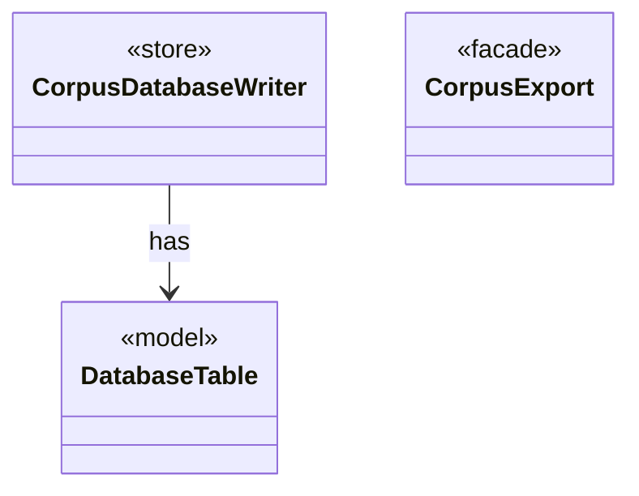

# Module `database`

`io.github.tlaplus.hardening.database` · [atlas](../README.md)

Exports a corpus to a SQLite database for analysis, as ADR 0009 defines it.

**Depends on:** [common](common.md), [checker](checker.md), [gen](gen.md), [mutation](mutation.md), [corpus](corpus.md)  
**Used by:** [cli](cli.md)

## `io.github.tlaplus.hardening.database`

| Type | Kind | Role | Summary |
|---|---|---|---|
| [Column](../types/io.github.tlaplus.hardening.database.Column.md) | record | other | A column of a database table. |
| [CorpusDatabaseException](../types/io.github.tlaplus.hardening.database.CorpusDatabaseException.md) | class | other | Reports that the corpus database cannot be written. |
| [CorpusDatabaseSchema](../types/io.github.tlaplus.hardening.database.CorpusDatabaseSchema.md) | class | other | The schema of the corpus database, as the corpus-database manual documents it. |
| [**CorpusDatabaseWriter** ★](../types/io.github.tlaplus.hardening.database.CorpusDatabaseWriter.md) | class | store | Writes the rows of one export into a new SQLite file, in a single transaction. |
| [**CorpusExport** ★](../types/io.github.tlaplus.hardening.database.CorpusExport.md) | class | facade | Exports a corpus to a new SQLite database, as ADR 0009 defines it. |
| [DatabaseColumns](../types/io.github.tlaplus.hardening.database.DatabaseColumns.md) | class | other | The columns of the database tables. |
| [**DatabaseTable** ★](../types/io.github.tlaplus.hardening.database.DatabaseTable.md) | enum | model | A table of the corpus database: its name, columns and keys. |
| [EntryBatchExporter](../types/io.github.tlaplus.hardening.database.EntryBatchExporter.md) | class | other | Exports listed entry files in chunks. |
| [EntryRows](../types/io.github.tlaplus.hardening.database.EntryRows.md) | record | other | The rows that one decoded corpus entry contributes: its `entry` row, followed by the rows that reference it: one `knownDefect` row per signature, one `mutationOperator` row per operator, one `stage` row per stage record, one `expr` row per expression construct of its replayed input and one `exprEdge` row per edge between constructs. |
| [ReplayOutcome](../types/io.github.tlaplus.hardening.database.ReplayOutcome.md) | interface | other | The result of analysing one input: what its replay shows, or why it could not be replayed. |
| [Row](../types/io.github.tlaplus.hardening.database.Row.md) | class | other | The values of one row, set by column. |
| [SqlType](../types/io.github.tlaplus.hardening.database.SqlType.md) | enum | other | A SQLite storage class, with the Java type a row stores for it. |

## Decisions

- [ADR 0009: Corpus database](https://github.com/tlaplus/model-checker-hardening/blob/6bbf8b66c375696d1798f7b7a061b81573a3f42a/docs/decisions/0009-corpus-database.md)
