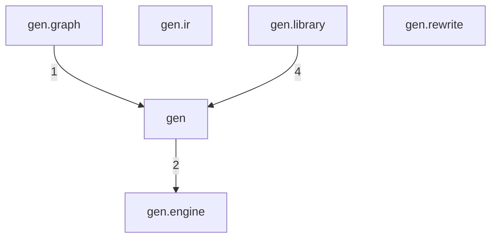
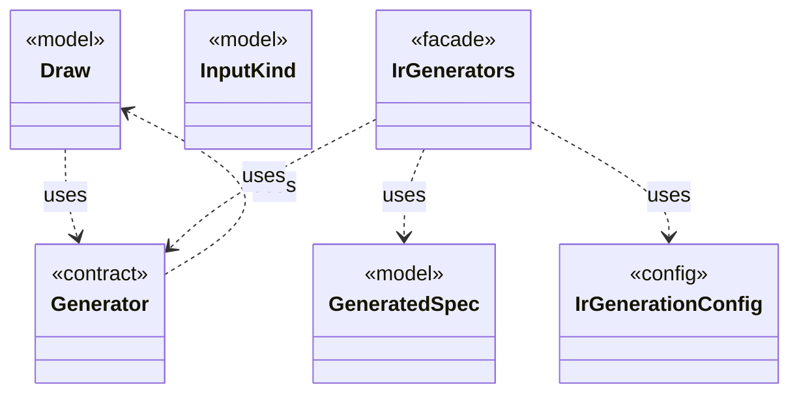
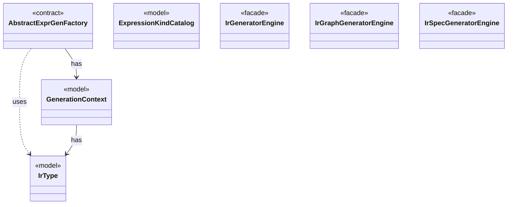
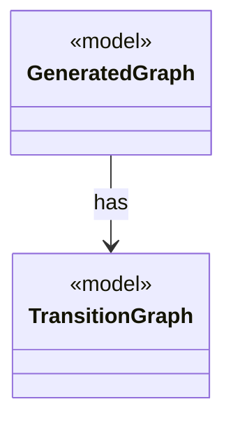
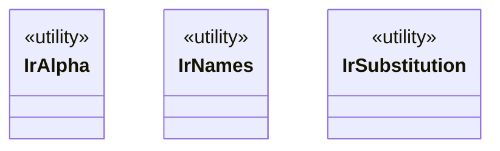
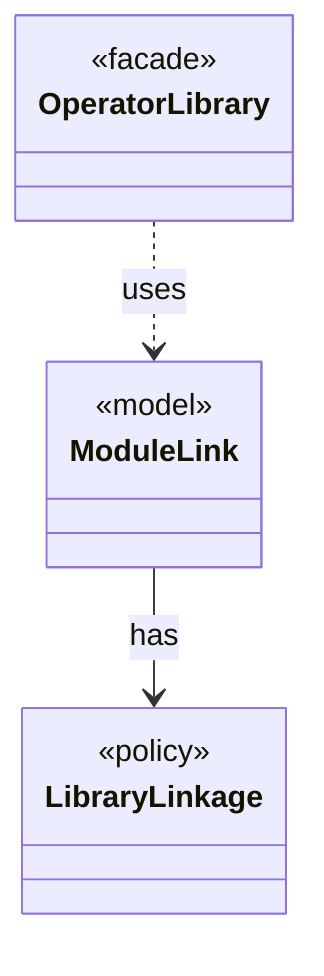
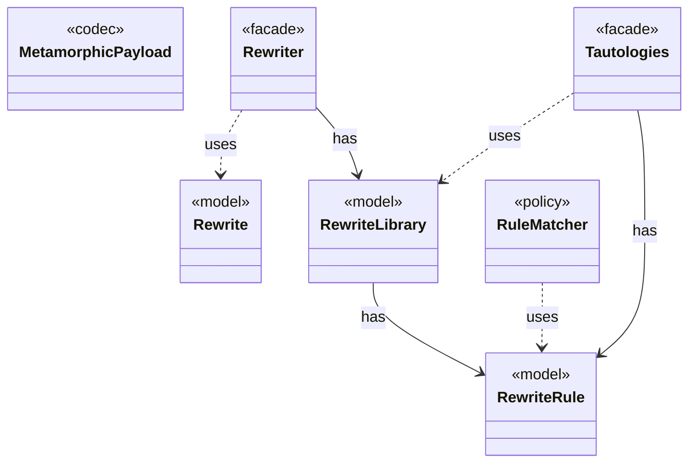

# Module `gen`

`io.github.tlaplus.hardening.gen` · [atlas](../README.md)

Deterministic decoders from byte arrays to typed Apalache IR expressions and module declarations, with their limits and configuration.

**Depends on:** [common](common.md)  
**Used by:** [corpus](corpus.md), [config](config.md), [database](database.md), [workflow](workflow.md), [cli](cli.md)

## Packages

An arrow counts the relations other than `depends` from one package to another. An arrow that a longer path implies is not drawn.

## `io.github.tlaplus.hardening.gen`

| Type | Kind | Role | Summary |
|---|---|---|---|
| [ActionEffect](../types/io.github.tlaplus.hardening.gen.ActionEffect.md) | class | other | Nonempty, duplicate-free effect in variable declaration order, with set-style identity. |
| [ActionLimits](../types/io.github.tlaplus.hardening.gen.ActionLimits.md) | record | other | Bounds on action definitions and next-state disjuncts, independent of expression limits. |
| [BasicGenerators](../types/io.github.tlaplus.hardening.gen.BasicGenerators.md) | class | other | Factory methods for basic generators that compose through a shared `Draw`. |
| [CollectionLimits](../types/io.github.tlaplus.hardening.gen.CollectionLimits.md) | record | other | Sizes of generated collection values (ADR 0011). |
| [**Draw** ★](../types/io.github.tlaplus.hardening.gen.Draw.md) | class | model | A forward-only deterministic cursor that decodes structured choices from an unstructured byte array. |
| [ExpressionCategory](../types/io.github.tlaplus.hardening.gen.ExpressionCategory.md) | enum | other | A user-facing category assigned to generated expression forms. |
| [ExpressionLimits](../types/io.github.tlaplus.hardening.gen.ExpressionLimits.md) | record | other | Bounds on recursive construction and variable-size payloads within one expression. |
| [GeneratedActionOperator](../types/io.github.tlaplus.hardening.gen.GeneratedActionOperator.md) | record | other | One generated action operator: a definition the next-state action may apply. |
| [GeneratedOperator](../types/io.github.tlaplus.hardening.gen.GeneratedOperator.md) | interface | other | A generated definition, stored once in module declaration order. |
| [**GeneratedSpec** ★](../types/io.github.tlaplus.hardening.gen.GeneratedSpec.md) | record | model | The declarations one generated module consists of. |
| [**Generator** ★](../types/io.github.tlaplus.hardening.gen.Generator.md) | interface | contract | A composable recipe for decoding a value from a shared `Draw` cursor. |
| [GraphLimits](../types/io.github.tlaplus.hardening.gen.GraphLimits.md) | record | config | Bounds on the control graph of one graph input (ADR 0023 §3). |
| [**InputKind** ★](../types/io.github.tlaplus.hardening.gen.InputKind.md) | enum | model | What a generator payload decodes to. |
| [InputRejectedException](../types/io.github.tlaplus.hardening.gen.InputRejectedException.md) | class | other | Indicates that the current input cannot be decoded into a valid value. |
| [IntegerLimits](../types/io.github.tlaplus.hardening.gen.IntegerLimits.md) | record | other | Integer literals and the closed integer terminal. |
| [IntegerLiteralMode](../types/io.github.tlaplus.hardening.gen.IntegerLiteralMode.md) | enum | other | How an integer literal decodes its value (ADR 0012). |
| [**IrGenerationConfig** ★](../types/io.github.tlaplus.hardening.gen.IrGenerationConfig.md) | record | config | Settings for generated TLA+ expressions and modules. |
| [**IrGenerators** ★](../types/io.github.tlaplus.hardening.gen.IrGenerators.md) | class | facade | Factory methods for deterministic generators of type-checked Apalache IR expressions. |
| [ModuleLimits](../types/io.github.tlaplus.hardening.gen.ModuleLimits.md) | record | other | Declaration, action and exploration bounds on one module. |
| [TemporalProperty](../types/io.github.tlaplus.hardening.gen.TemporalProperty.md) | record | other | The temporal property of a generated module and the fairness that constrains it. |

## `io.github.tlaplus.hardening.gen.engine`

The type-directed generation engine behind `IrGenerators`: per-family expression factories, the catalog of expression kinds, and the generation context.

| Type | Kind | Role | Summary |
|---|---|---|---|
| [**AbstractExprGenFactory** ★](../types/io.github.tlaplus.hardening.gen.engine.AbstractExprGenFactory.md) | class | contract | Shared access to the state and recursive factories used by expression generator families. |
| [ActionGenFactory](../types/io.github.tlaplus.hardening.gen.engine.ActionGenFactory.md) | class | other | Module-level action assembly: Init, operator definitions, bounded parameters, guards, Next and the unconditional step update. |
| [ActionShapeGenFactory](../types/io.github.tlaplus.hardening.gen.engine.ActionShapeGenFactory.md) | class | other | Recursive, complete action shapes. |
| [ApplicativeExprGenFactory](../types/io.github.tlaplus.hardening.gen.engine.ApplicativeExprGenFactory.md) | class | other | Constructs reads, updates and domains of records, tuples and sequences. |
| [ApplicativeExpressionKind](../types/io.github.tlaplus.hardening.gen.engine.ApplicativeExpressionKind.md) | enum | other | Reads, updates and domains of records, tuples and sequences. |
| [BooleanExprGenFactory](../types/io.github.tlaplus.hardening.gen.engine.BooleanExprGenFactory.md) | class | other | Constructs Boolean-valued expression generators. |
| [BooleanExpressionKind](../types/io.github.tlaplus.hardening.gen.engine.BooleanExpressionKind.md) | enum | other | Boolean-valued expression forms. |
| [BoundaryInteger](../types/io.github.tlaplus.hardening.gen.engine.BoundaryInteger.md) | enum | other | Integer values at which checker arithmetic changes behaviour (ADR 0012). |
| [BuilderArrays](../types/io.github.tlaplus.hardening.gen.engine.BuilderArrays.md) | class | other | Array conversions for the builder's generic varargs APIs. |
| [ConstantType](../types/io.github.tlaplus.hardening.gen.engine.ConstantType.md) | record | other | Model-value type. |
| [CustomExpressionKind](../types/io.github.tlaplus.hardening.gen.engine.CustomExpressionKind.md) | record | other | One configured operator kind; its type scheme comes from the immutable prepared library. |
| [EdgeGuards](../types/io.github.tlaplus.hardening.gen.engine.EdgeGuards.md) | interface | contract | Draws the tautological guards that a graph module conjoins to its edges (ADR 0023 §6). |
| [ExpressionKind](../types/io.github.tlaplus.hardening.gen.engine.ExpressionKind.md) | interface | other | A selectable expression form grouped by the component that constructs it. |
| [**ExpressionKindCatalog** ★](../types/io.github.tlaplus.hardening.gen.engine.ExpressionKindCatalog.md) | class | model | The catalog of every expression form, in decoder order. |
| [Field](../types/io.github.tlaplus.hardening.gen.engine.Field.md) | record | other | Named component of a record or variant type. |
| [FunctionType](../types/io.github.tlaplus.hardening.gen.engine.FunctionType.md) | record | other | Function type. |
| [GeneralExprGenFactory](../types/io.github.tlaplus.hardening.gen.engine.GeneralExprGenFactory.md) | class | other | Constructs terminal and type-polymorphic expression generators. |
| [GeneralExpressionKind](../types/io.github.tlaplus.hardening.gen.engine.GeneralExpressionKind.md) | enum | other | Type-polymorphic and terminal expression forms. |
| [**GenerationContext** ★](../types/io.github.tlaplus.hardening.gen.engine.GenerationContext.md) | class | model | Mutable semantic state shared by every component of one generation run. |
| [GraphSection](../types/io.github.tlaplus.hardening.gen.engine.GraphSection.md) | enum | other | The independent parts of a graph input after its header, each decoded from its own contiguous range of bytes (ADR 0023 §3), as `ModuleSection` does for a module input. |
| [ImportedTypes](../types/io.github.tlaplus.hardening.gen.engine.ImportedTypes.md) | class | other | Converts concrete imported type terms at the private generator boundary. |
| [IndexedValues](../types/io.github.tlaplus.hardening.gen.engine.IndexedValues.md) | class | other | The byte-free k-th value of a value type, from which collection terminals take distinct elements (ADR 0011). |
| [IntegerExprGenFactory](../types/io.github.tlaplus.hardening.gen.engine.IntegerExprGenFactory.md) | class | other | Constructs integer-valued expression generators. |
| [IntegerExpressionKind](../types/io.github.tlaplus.hardening.gen.engine.IntegerExpressionKind.md) | enum | other | Integer-valued expression forms. |
| [IrExprGenFactory](../types/io.github.tlaplus.hardening.gen.engine.IrExprGenFactory.md) | class | other | Factory for deferred, type-directed expression generators within one generation run. |
| [**IrGeneratorEngine** ★](../types/io.github.tlaplus.hardening.gen.engine.IrGeneratorEngine.md) | class | facade | Reusable coordinator for type-directed IR-expression generation. |
| [**IrGraphGeneratorEngine** ★](../types/io.github.tlaplus.hardening.gen.engine.IrGraphGeneratorEngine.md) | class | facade | Reusable decoder of graph inputs (ADR 0023 §2, §3): a control graph whose nodes carry assignment-only actions, tracked by the variable `pc`, and the invariant `pc /= k`. |
| [**IrSpecGeneratorEngine** ★](../types/io.github.tlaplus.hardening.gen.engine.IrSpecGeneratorEngine.md) | class | facade | Reusable coordinator for generating the declarations of one TLA+ module. |
| [**IrType** ★](../types/io.github.tlaplus.hardening.gen.engine.IrType.md) | interface | model | Internal type model used to direct checked expression construction. |
| [IrTypeGenFactory](../types/io.github.tlaplus.hardening.gen.engine.IrTypeGenFactory.md) | class | other | Factory for deferred generators of internal types within the configured remaining-depth budget. |
| [Level](../types/io.github.tlaplus.hardening.gen.engine.Level.md) | enum | other | The TLA+ level of the formula an expression form builds, as Specifying Systems defines it and SANY checks it. |
| [LevelContext](../types/io.github.tlaplus.hardening.gen.engine.LevelContext.md) | enum | other | The levels an expression request may produce, which `GenerationContext` keeps as a dynamic ceiling while a body is drawn. |
| [ModulePrelude](../types/io.github.tlaplus.hardening.gen.engine.ModulePrelude.md) | class | other | The declarations every generated module begins with: its state variables and its state-free auxiliary definitions. |
| [ModuleSection](../types/io.github.tlaplus.hardening.gen.engine.ModuleSection.md) | enum | other | The independent parts of a module input, each decoded from its own contiguous range of bytes. |
| [NameScope](../types/io.github.tlaplus.hardening.gen.engine.NameScope.md) | class | other | Exception-safe dynamic view over a persistent lexical-scope list. |
| [OperandGenerator](../types/io.github.tlaplus.hardening.gen.engine.OperandGenerator.md) | class | other | Draws expressions for a rewrite that leaves an operand open (ADR 0017 §3), and for the parameters of an edge guard of a graph module (ADR 0023 §6): an operand is drawn by the ordinary expression factory, at its type, in the lexical scope of the rewritten node or the edge, and in the state-level context, so an operand adds no prime. |
| [OperatorType](../types/io.github.tlaplus.hardening.gen.engine.OperatorType.md) | record | other | Operator type. |
| [OtherExprGenFactory](../types/io.github.tlaplus.hardening.gen.engine.OtherExprGenFactory.md) | class | other | Constructs expression generators not covered by the dedicated form families. |
| [OtherExpressionKind](../types/io.github.tlaplus.hardening.gen.engine.OtherExpressionKind.md) | enum | other | Expression forms not covered by the dedicated type and general families. |
| [PrimitiveType](../types/io.github.tlaplus.hardening.gen.engine.PrimitiveType.md) | enum | other | Primitive expression result types. |
| [PropertyGenFactory](../types/io.github.tlaplus.hardening.gen.engine.PropertyGenFactory.md) | class | other | Module-level temporal property: the property formula and its fairness conditions. |
| [RecordType](../types/io.github.tlaplus.hardening.gen.engine.RecordType.md) | record | other | Record type. |
| [ScopedName](../types/io.github.tlaplus.hardening.gen.engine.ScopedName.md) | record | other | A typed name visible while recursively generating a lexical body. |
| [ScopedNameKind](../types/io.github.tlaplus.hardening.gen.engine.ScopedNameKind.md) | enum | other | Semantic role of a name visible during expression generation. |
| [SequenceExprGenFactory](../types/io.github.tlaplus.hardening.gen.engine.SequenceExprGenFactory.md) | class | other | Constructs sequence-valued expression generators. |
| [SequenceExpressionKind](../types/io.github.tlaplus.hardening.gen.engine.SequenceExpressionKind.md) | enum | other | Sequence-valued expression forms. |
| [SequenceType](../types/io.github.tlaplus.hardening.gen.engine.SequenceType.md) | record | other | Sequence type. |
| [SetExprGenFactory](../types/io.github.tlaplus.hardening.gen.engine.SetExprGenFactory.md) | class | other | Constructs set-valued expression generators. |
| [SetExpressionKind](../types/io.github.tlaplus.hardening.gen.engine.SetExpressionKind.md) | enum | other | Set-valued expression forms. |
| [SetType](../types/io.github.tlaplus.hardening.gen.engine.SetType.md) | record | other | Set type. |
| [TaggedVariant](../types/io.github.tlaplus.hardening.gen.engine.TaggedVariant.md) | record | other | A variant type with one of its tags selected, such as the tag whose payload a read extracts. |
| [TemporalActionExpressionKind](../types/io.github.tlaplus.hardening.gen.engine.TemporalActionExpressionKind.md) | enum | other | The temporal formulas over an action that Specifying Systems defines: an action occurs in a temporal formula only through them and through fairness. |
| [TupleType](../types/io.github.tlaplus.hardening.gen.engine.TupleType.md) | record | other | Tuple type. |
| [TypeInstantiation](../types/io.github.tlaplus.hardening.gen.engine.TypeInstantiation.md) | record | other | Byte-free feasibility analysis followed by bounded, deferred completion of a type term. |
| [ValueAtomBudget](../types/io.github.tlaplus.hardening.gen.engine.ValueAtomBudget.md) | class | other | Bounds the elements of one generated collection value over all nesting levels (ADR 0011). |
| [VariantType](../types/io.github.tlaplus.hardening.gen.engine.VariantType.md) | record | other | Variant type. |
| [VisibleActionOperators](../types/io.github.tlaplus.hardening.gen.engine.VisibleActionOperators.md) | class | other | Immutable operator prefix; candidates retain declaration order for byte selection. |
| [WeightedSlices](../types/io.github.tlaplus.hardening.gen.engine.WeightedSlices.md) | class | other | Divides the remaining bytes of a cursor into contiguous slices of proportional length. |

## `io.github.tlaplus.hardening.gen.graph`

The control graph of a graph input and the module decoded from it, with the outcome the graph predicts (ADR 0023).

| Type | Kind | Role | Summary |
|---|---|---|---|
| [**GeneratedGraph** ★](../types/io.github.tlaplus.hardening.gen.graph.GeneratedGraph.md) | record | model | A module decoded from a graph input (ADR 0023 §2), with the graph it encodes and the target its invariant `pc /= target` names. |
| [**TransitionGraph** ★](../types/io.github.tlaplus.hardening.gen.graph.TransitionGraph.md) | record | model | A directed graph over the nodes `0..N-1`, the control structure of a graph module (ADR 0023 §2). |

## `io.github.tlaplus.hardening.gen.ir`

Operations on typed Apalache IR: alpha-equivalence, binding layout, renaming, substitution, and type tags.

| Type | Kind | Role | Summary |
|---|---|---|---|
| [**IrAlpha** ★](../types/io.github.tlaplus.hardening.gen.ir.IrAlpha.md) | class | utility | Alpha-equivalence of typed IR: two expressions are equivalent when they differ only in the names of the variables and definitions they bind. |
| [IrBinding](../types/io.github.tlaplus.hardening.gen.ir.IrBinding.md) | enum | other | Where an operator binds names: which of its arguments introduce bound names, and which arguments see them. |
| [**IrNames** ★](../types/io.github.tlaplus.hardening.gen.ir.IrNames.md) | class | utility | Names in typed IR: injective renaming and the names an expression reads from its context. |
| [**IrSubstitution** ★](../types/io.github.tlaplus.hardening.gen.ir.IrSubstitution.md) | class | utility | Substitution and beta-reduction of typed IR. |
| [IrTypes](../types/io.github.tlaplus.hardening.gen.ir.IrTypes.md) | class | other | Type tags of typed IR. |

## `io.github.tlaplus.hardening.gen.library`

Prepared custom-operator libraries: the operators they export, their types and syntax, and how their modules link into rendered TLA+ (ADR 0014, ADR 0015).

| Type | Kind | Role | Summary |
|---|---|---|---|
| [InstanceAlias](../types/io.github.tlaplus.hardening.gen.library.InstanceAlias.md) | record | other | A library name the TLA+ source defines as `name(p1, ..., pn) == I!Operator(p1, ..., pn)`, where `I` is the named instance of `sourceModule`: the target's module, or the separate TLC module of a diff-linked one. |
| [LibraryExpressions](../types/io.github.tlaplus.hardening.gen.library.LibraryExpressions.md) | class | other | Lexical dependency analysis of library IR. |
| [**LibraryLinkage** ★](../types/io.github.tlaplus.hardening.gen.library.LibraryLinkage.md) | enum | policy | How a custom module's definitions reach the TLA+ source of the parser and TLC. |
| [LibrarySyntax](../types/io.github.tlaplus.hardening.gen.library.LibrarySyntax.md) | enum | other | Supported imported IR syntax and its capabilities; `IrBinding` gives its binding layout. |
| [LibraryTypes](../types/io.github.tlaplus.hardening.gen.library.LibraryTypes.md) | class | other | Structural inspection of imported type terms, including row variables. |
| [**ModuleLink** ★](../types/io.github.tlaplus.hardening.gen.library.ModuleLink.md) | record | model | How one custom module is linked, and the module that its TLA+ source aliases instantiate: the module itself unless the linkage names a separate TLC module. |
| [OperatorId](../types/io.github.tlaplus.hardening.gen.library.OperatorId.md) | record | other | Case-sensitive identity of an exported operator, independent of its generated name. |
| [**OperatorLibrary** ★](../types/io.github.tlaplus.hardening.gen.library.OperatorLibrary.md) | class | facade | Immutable prepared library. |
| [SourceLink](../types/io.github.tlaplus.hardening.gen.library.SourceLink.md) | record | other | The module the parser and TLC evaluate, and the aliases its renderer must define through named instances. |

## `io.github.tlaplus.hardening.gen.rewrite`

The rewrite rules and rewriter of metamorphic testing: rule modules, matching, instantiation, and the payload of a metamorphic pair (ADR 0016, ADR 0017).

| Type | Kind | Role | Summary |
|---|---|---|---|
| [AssignmentFacts](../types/io.github.tlaplus.hardening.gen.rewrite.AssignmentFacts.md) | record | other | What a rule does to the checkers' assignments (ADR 0017 §5.3). |
| [LabelPlacement](../types/io.github.tlaplus.hardening.gen.rewrite.LabelPlacement.md) | class | other | Where a rule's replacement may not carry a label of the node it rewrites. |
| [LetSpecialization](../types/io.github.tlaplus.hardening.gen.rewrite.LetSpecialization.md) | class | other | Specializes every LET definition of a rule's replacement to the types at which the replacement applies it. |
| [**MetamorphicPayload** ★](../types/io.github.tlaplus.hardening.gen.rewrite.MetamorphicPayload.md) | class | codec | The layout of a metamorphic input (ADR 0016 §1): |
| [Orientation](../types/io.github.tlaplus.hardening.gen.rewrite.Orientation.md) | enum | other | Which side of a metamorphic pair the checker explores (ADR 0016 §3). |
| [**Rewrite** ★](../types/io.github.tlaplus.hardening.gen.rewrite.Rewrite.md) | record | model | A decoded metamorphic pair: the base the payload's base part decodes to, its rewrite, the orientation, and the rules applied in order. |
| [**RewriteLibrary** ★](../types/io.github.tlaplus.hardening.gen.rewrite.RewriteLibrary.md) | class | model | The rules of one rule module, in declaration order (ADR 0017 §1). |
| [RewriteLimits](../types/io.github.tlaplus.hardening.gen.rewrite.RewriteLimits.md) | record | other | Bounds of one rewrite (ADR 0016 §2, §7). |
| [RewritePositions](../types/io.github.tlaplus.hardening.gen.rewrite.RewritePositions.md) | class | other | Where the rewriter may apply a rule. |
| [**RewriteRule** ★](../types/io.github.tlaplus.hardening.gen.rewrite.RewriteRule.md) | record | model | One rewrite rule `F(p1, ..., pn) == A = B` or `A &lt;=&gt; B` of a rule module (ADR 0017 §2): the rewriter replaces an instance of `pattern` (A) with the same instance of ` replacement` (B). |
| [**Rewriter** ★](../types/io.github.tlaplus.hardening.gen.rewrite.Rewriter.md) | class | facade | Decodes a rewrite payload into a rewrite of a base (ADR 0016 §2). |
| [RuleContract](../types/io.github.tlaplus.hardening.gen.rewrite.RuleContract.md) | class | other | Reads one rule definition and checks the parts of the rule contract that the loader can decide (ADR 0017 §2, §3, §5): the shape `A = B` or `A &lt;=&gt; B`, the parameter classes, level preservation and closedness. |
| [RuleInstantiation](../types/io.github.tlaplus.hardening.gen.rewrite.RuleInstantiation.md) | class | other | Builds the instance of a rule (ADR 0017 §4): the rule's replacement for a match, or its whole formula for an edge guard (ADR 0023 §6). |
| [RuleMatch](../types/io.github.tlaplus.hardening.gen.rewrite.RuleMatch.md) | record | other | A rule's pattern matched at one node. |
| [**RuleMatcher** ★](../types/io.github.tlaplus.hardening.gen.rewrite.RuleMatcher.md) | class | policy | Matches a rule's pattern at one node (ADR 0017 §4). |
| [RuleOperands](../types/io.github.tlaplus.hardening.gen.rewrite.RuleOperands.md) | class | other | Draws what instantiating a rule needs beyond a match (ADR 0017 §3): a concrete type for every type variable the match leaves open, then a value for each drawn parameter at its type. |
| [RuleParameter](../types/io.github.tlaplus.hardening.gen.rewrite.RuleParameter.md) | record | other | One formal parameter of a rewrite rule, classified by where it occurs (ADR 0017 §3). |
| [**Tautologies** ★](../types/io.github.tlaplus.hardening.gen.rewrite.Tautologies.md) | class | facade | Draws edge guards of a graph module from a rule library (ADR 0023 §6): a guard is the formula `A = B` or `A &lt;=&gt; B` of a rule, with every parameter drawn at its type. |

## Decisions

- [ADR 0007: Levels and temporal properties](https://github.com/tlaplus/model-checker-hardening/blob/21262d9d0cc07b5ae4c47c4ee511217c9b88b561/docs/decisions/0007-levels-and-temporal-properties.md)
- [ADR 0011: Collection base size](https://github.com/tlaplus/model-checker-hardening/blob/21262d9d0cc07b5ae4c47c4ee511217c9b88b561/docs/decisions/0011-collection-base-size.md)
- [ADR 0012: Integer terminal and boundary literals](https://github.com/tlaplus/model-checker-hardening/blob/21262d9d0cc07b5ae4c47c4ee511217c9b88b561/docs/decisions/0012-integer-literals.md)
- [ADR 0014: Per-checker linking of instance-linked libraries](https://github.com/tlaplus/model-checker-hardening/blob/21262d9d0cc07b5ae4c47c4ee511217c9b88b561/docs/decisions/0014-per-checker-library-linking.md)
- [ADR 0015: Diff-linked libraries for recursion testing](https://github.com/tlaplus/model-checker-hardening/blob/21262d9d0cc07b5ae4c47c4ee511217c9b88b561/docs/decisions/0015-diff-linked-libraries.md)
- [ADR 0016: Metamorphic testing](https://github.com/tlaplus/model-checker-hardening/blob/21262d9d0cc07b5ae4c47c4ee511217c9b88b561/docs/decisions/0016-metamorphic-testing.md)
- [ADR 0017: Rewrite rules as a TLA+ library](https://github.com/tlaplus/model-checker-hardening/blob/21262d9d0cc07b5ae4c47c4ee511217c9b88b561/docs/decisions/0017-rewrite-rule-library.md)
- [ADR 0023: Graph-based testing](https://github.com/tlaplus/model-checker-hardening/blob/21262d9d0cc07b5ae4c47c4ee511217c9b88b561/docs/decisions/0023-graph-based-testing.md)
