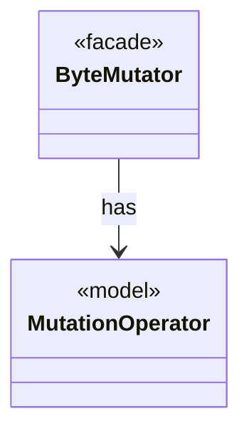

# Module `mutation`

`io.github.tlaplus.hardening.mutation` · [atlas](../README.md)

Byte-level mutation operators that derive new generator inputs from corpus entries.

**Depends on:** [common](common.md)  
**Used by:** [corpus](corpus.md), [config](config.md), [database](database.md), [workflow](workflow.md), [cli](cli.md)

## `io.github.tlaplus.hardening.mutation`

| Type | Kind | Role | Summary |
|---|---|---|---|
| [**ByteMutator** ★](../types/io.github.tlaplus.hardening.mutation.ByteMutator.md) | class | facade | Derives one mutant from a parent by stacking weighted operator edits. |
| [**MutationOperator** ★](../types/io.github.tlaplus.hardening.mutation.MutationOperator.md) | enum | model | One byte-level edit of a generator input, as ADR 0010 defines it. |

## Decisions

- [ADR 0010: Generational mutation](https://github.com/tlaplus/model-checker-hardening/blob/ad025d7ad6f7113910ce3a79cf6e18839b06eb5a/docs/decisions/0010-mutation.md)
- [ADR 0016: Metamorphic testing](https://github.com/tlaplus/model-checker-hardening/blob/ad025d7ad6f7113910ce3a79cf6e18839b06eb5a/docs/decisions/0016-metamorphic-testing.md)
