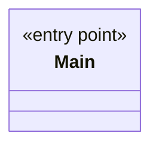

# Module `root`

`io.github.tlaplus.hardening` · [atlas](../README.md)

The `fuzztla` launcher: `Main` hands the command line to `cli`.

**Depends on:** [cli](cli.md)  
**Used by:** none

## `io.github.tlaplus.hardening`

| Type | Kind | Role | Summary |
|---|---|---|---|
| [**Main** ★](../types/io.github.tlaplus.hardening.Main.md) | class | entry point | The process entry point of `fuzztla`: runs `FuzzTlaCommand` and exits with its status. |

