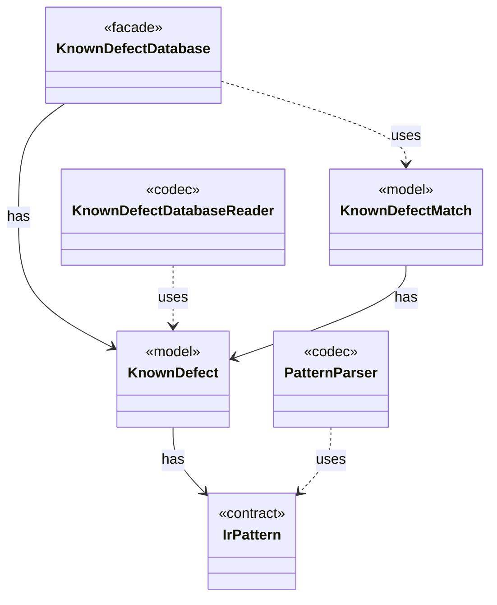

# Module `signature`

`io.github.tlaplus.hardening.signature` · [atlas](../README.md)

Known-defect signatures: patterns over the typed Apalache IR and the databases holding them.

**Depends on:** [common](common.md)  
**Used by:** [workflow](workflow.md), [cli](cli.md)

## `io.github.tlaplus.hardening.signature`

| Type | Kind | Role | Summary |
|---|---|---|---|
| [Bindings](../types/io.github.tlaplus.hardening.signature.Bindings.md) | class | other | The metavariables and type variables one pattern alternative has bound so far. |
| [IrExprCounts](../types/io.github.tlaplus.hardening.signature.IrExprCounts.md) | class | other | Counts the size and constructs of the code the tools evaluate, over the walk that signatures match against. |
| [**IrPattern** ★](../types/io.github.tlaplus.hardening.signature.IrPattern.md) | interface | contract | One pattern over the typed Apalache IR, as parsed by `PatternParser`. |
| [IrTree](../types/io.github.tlaplus.hardening.signature.IrTree.md) | class | other | The subexpressions a signature is tried against: those the tools evaluate. |
| [**KnownDefect** ★](../types/io.github.tlaplus.hardening.signature.KnownDefect.md) | class | model | One known-defect signature: a documented tool defect and the IR shapes that trigger it. |
| [**KnownDefectDatabase** ★](../types/io.github.tlaplus.hardening.signature.KnownDefectDatabase.md) | class | facade | The known-defect signatures of one invocation, in database order. |
| [KnownDefectDatabaseException](../types/io.github.tlaplus.hardening.signature.KnownDefectDatabaseException.md) | class | other | A known-defect database that cannot be read, or that does not follow the database format. |
| [**KnownDefectDatabaseReader** ★](../types/io.github.tlaplus.hardening.signature.KnownDefectDatabaseReader.md) | class | codec | Reads one database file: a TOML document of `[[signature]]` tables with exactly the keys `id`, `references`, `description`, and `match`. |
| [**KnownDefectMatch** ★](../types/io.github.tlaplus.hardening.signature.KnownDefectMatch.md) | record | model | A signature that matches a module, and the outermost subexpression it matched first. |
| [OperatorNames](../types/io.github.tlaplus.hardening.signature.OperatorNames.md) | class | other | The operators a pattern may name, keyed by `TlaOper.name`. |
| [PatternException](../types/io.github.tlaplus.hardening.signature.PatternException.md) | class | other | A pattern that does not follow the pattern syntax, located by a one-based column. |
| [**PatternParser** ★](../types/io.github.tlaplus.hardening.signature.PatternParser.md) | class | codec | Parses the S-expression pattern syntax that the known-defect manual specifies: |
| [PredefinedSet](../types/io.github.tlaplus.hardening.signature.PredefinedSet.md) | enum | other | The predefined sets a pattern names by their TLA+ spelling. |
| [Type1Syntax](../types/io.github.tlaplus.hardening.signature.Type1Syntax.md) | class | other | Parses Apalache's type syntax, the syntax of the `type` fields in its IR JSON. |
| [TypePattern](../types/io.github.tlaplus.hardening.signature.TypePattern.md) | record | other | A type in Apalache's syntax whose type variables are wildcards. |

## Decisions

- [ADR 0006: Known-defect signatures](https://github.com/tlaplus/model-checker-hardening/blob/918f7db91890f302587d25c76dc7ac189db3d023/docs/decisions/0006-known-defect-signatures.md)
