# Module `workflow`

`io.github.tlaplus.hardening.workflow` · [atlas](../README.md)

Runs a fuzzing campaign: the stage graph, the generation loop, checker backends, and corpus replay, under one CPU budget.

**Depends on:** [common](common.md), [checker](checker.md), [gen](gen.md), [signature](signature.md), [mutation](mutation.md), [corpus](corpus.md), [config](config.md)  
**Used by:** [cli](cli.md)

## Packages

An arrow counts the relations other than `depends` from one package to another. An arrow that a longer path implies is not drawn.

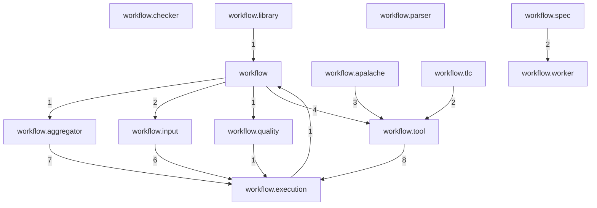

## `io.github.tlaplus.hardening.workflow`

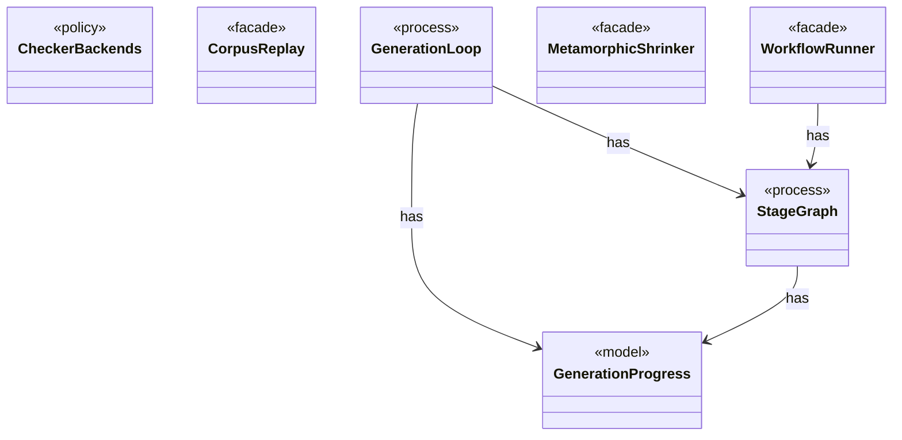

| Type | Kind | Role | Summary |
|---|---|---|---|
| [AdoptableBase](../types/io.github.tlaplus.hardening.workflow.AdoptableBase.md) | class | other | The base corpus of a metamorphic run (ADR 0016 §6). |
| [**CheckerBackends** ★](../types/io.github.tlaplus.hardening.workflow.CheckerBackends.md) | class | policy | How each model-checker stage builds its backend for one invocation. |
| [CorpusRecords](../types/io.github.tlaplus.hardening.workflow.CorpusRecords.md) | class | other | The corpus records a run repeats on every later run (ADR 0016 §1, §5, ADR 0017 §6): the technique, the checker set and the rewrite rules. |
| [**CorpusReplay** ★](../types/io.github.tlaplus.hardening.workflow.CorpusReplay.md) | class | facade | Decodes a corpus's entries as they were admitted: with the decoders of the technique the corpus records, and only while the libraries they load match the corpus's manifests. |
| [**GenerationLoop** ★](../types/io.github.tlaplus.hardening.workflow.GenerationLoop.md) | class | process | Runs the generations of one workflow invocation over a single stage graph (ADR 0010). |
| [**GenerationProgress** ★](../types/io.github.tlaplus.hardening.workflow.GenerationProgress.md) | class | model | Where every generation of a run stands, tracked from stage events instead of a corpus rescan (ADR 0010). |
| [GenerationTargets](../types/io.github.tlaplus.hardening.workflow.GenerationTargets.md) | class | other | Which target ordinals of one generation are already spoken for, and which source fills the rest (ADR 0010, ADR 0016 §6). |
| [**MetamorphicShrinker** ★](../types/io.github.tlaplus.hardening.workflow.MetamorphicShrinker.md) | class | facade | Reduces a metamorphic counterexample for triage (ADR 0016 §8). |
| [OccupancyLimits](../types/io.github.tlaplus.hardening.workflow.OccupancyLimits.md) | class | other | Checks an invocation and a recovered corpus against the configured capacity limits. |
| [ReplayRecord](../types/io.github.tlaplus.hardening.workflow.ReplayRecord.md) | record | other | Replay policy for one corpus record: a run may proceed only when the record says what the run would write. |
| [RunStatisticsOnExit](../types/io.github.tlaplus.hardening.workflow.RunStatisticsOnExit.md) | class | other | Stops the invocation clock and saves its aggregate while the corpus lock is still held. |
| [**StageGraph** ★](../types/io.github.tlaplus.hardening.workflow.StageGraph.md) | class | process | The stages that run one workflow invocation, wired to their queues, result capacities, and shared collaborators, and the order in which they start and stop. |
| [WorkflowException](../types/io.github.tlaplus.hardening.workflow.WorkflowException.md) | class | other | Reports an infrastructure or lifecycle failure in a fuzzing workflow. |
| [WorkflowProgress](../types/io.github.tlaplus.hardening.workflow.WorkflowProgress.md) | record | other | Best-effort snapshot of cumulative corpus statistics and current pending work. |
| [WorkflowRunSummary](../types/io.github.tlaplus.hardening.workflow.WorkflowRunSummary.md) | record | other | Cumulative corpus statistics and stopping reason after one complete workflow invocation. |
| [**WorkflowRunner** ★](../types/io.github.tlaplus.hardening.workflow.WorkflowRunner.md) | class | facade | Runs generation, parsing, TLC, Apalache, conformance aggregation and the quality gate under one CPU budget. |

## `io.github.tlaplus.hardening.workflow.aggregator`

Conformance aggregation of completed checker branches.

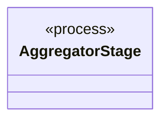

| Type | Kind | Role | Summary |
|---|---|---|---|
| [**AggregatorStage** ★](../types/io.github.tlaplus.hardening.workflow.aggregator.AggregatorStage.md) | class | process | Joins completed TLC and Apalache results with one in-process worker. |

## `io.github.tlaplus.hardening.workflow.apalache`

Persistent Apalache tool invocation, classification, and checker-backend integration.

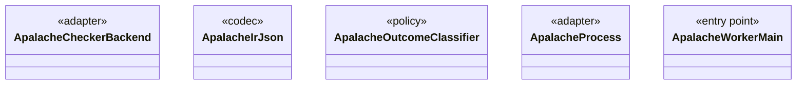

| Type | Kind | Role | Summary |
|---|---|---|---|
| [ApalacheArguments](../types/io.github.tlaplus.hardening.workflow.apalache.ApalacheArguments.md) | class | other | The Apalache command line for one checked module. |
| [**ApalacheCheckerBackend** ★](../types/io.github.tlaplus.hardening.workflow.apalache.ApalacheCheckerBackend.md) | class | adapter | Adapts persistent Apalache tool workers to the shared tool stage. |
| [ApalacheDistribution](../types/io.github.tlaplus.hardening.workflow.apalache.ApalacheDistribution.md) | class | other | Locates the pinned Apalache release JAR staged beside FuzzTLA's build output. |
| [ApalacheFailureDetail](../types/io.github.tlaplus.hardening.workflow.apalache.ApalacheFailureDetail.md) | class | other | Extracts bounded human-readable context from Apalache diagnostics. |
| [**ApalacheIrJson** ★](../types/io.github.tlaplus.hardening.workflow.apalache.ApalacheIrJson.md) | class | codec | Renders an assembled module as the typed Apalache IR JSON that Apalache consumes. |
| [**ApalacheOutcomeClassifier** ★](../types/io.github.tlaplus.hardening.workflow.apalache.ApalacheOutcomeClassifier.md) | class | policy | Maps Apalache tool exit statuses to shared workflow outcomes. |
| [**ApalacheProcess** ★](../types/io.github.tlaplus.hardening.workflow.apalache.ApalacheProcess.md) | class | adapter | Starts one persistent isolated Apalache JVM, which serves inputs until a crash retires it. |
| [ApalacheTraceLength](../types/io.github.tlaplus.hardening.workflow.apalache.ApalacheTraceLength.md) | class | other | Reads the length of the counterexample Apalache wrote for one check. |
| [**ApalacheWorkerMain** ★](../types/io.github.tlaplus.hardening.workflow.apalache.ApalacheWorkerMain.md) | class | entry point | Persistent child process that invokes Apalache's `Tool.run` sequentially. |

## `io.github.tlaplus.hardening.workflow.checker`

Result routing shared by the independently implemented model-checker stages.

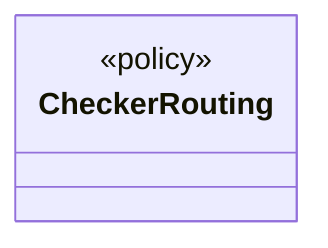

| Type | Kind | Role | Summary |
|---|---|---|---|
| [**CheckerRouting** ★](../types/io.github.tlaplus.hardening.workflow.checker.CheckerRouting.md) | class | policy | Routes a model checker's results. |

## `io.github.tlaplus.hardening.workflow.execution`

Concurrency, lifecycle, capacity, and progress primitives shared by workflow stages.

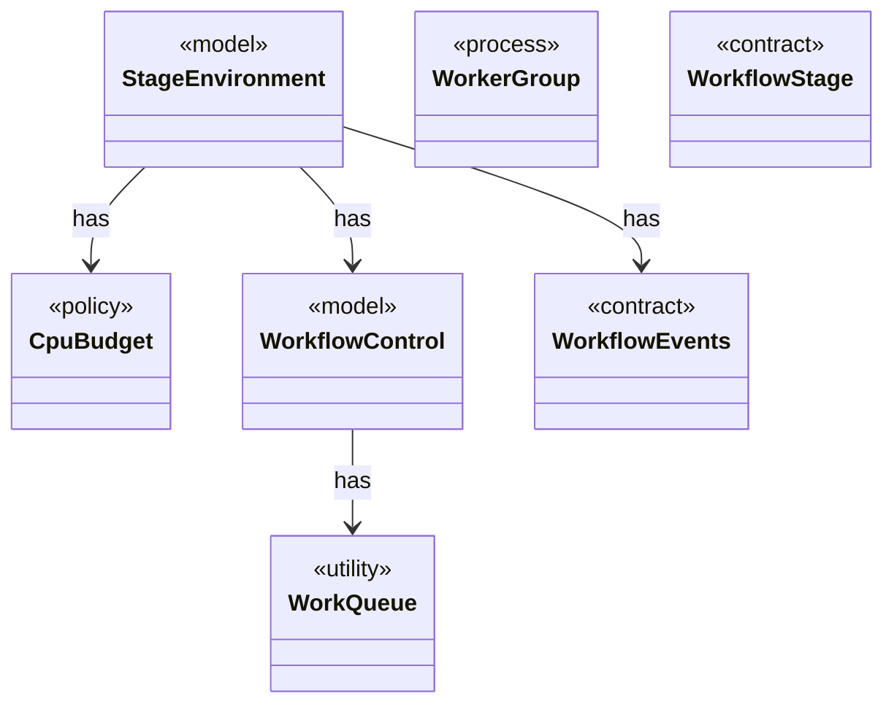

| Type | Kind | Role | Summary |
|---|---|---|---|
| [**CpuBudget** ★](../types/io.github.tlaplus.hardening.workflow.execution.CpuBudget.md) | class | policy | Priority-aware logical CPU budget shared by all stage workers. |
| [ElapsedTimeAccumulator](../types/io.github.tlaplus.hardening.workflow.execution.ElapsedTimeAccumulator.md) | class | other | Accumulates active intervals across workers using a monotonic clock. |
| [GeneratorStatistics](../types/io.github.tlaplus.hardening.workflow.execution.GeneratorStatistics.md) | class | other | Cumulative input-generation counters shared by the generator workers. |
| [GeneratorSummary](../types/io.github.tlaplus.hardening.workflow.execution.GeneratorSummary.md) | record | other | Cumulative generation statistics decorated with invocation-facing replay and timing fields. |
| [OccupancyGate](../types/io.github.tlaplus.hardening.workflow.execution.OccupancyGate.md) | class | other | Bounds the current occupancy of one stage's result directories across its workers. |
| [StageClocks](../types/io.github.tlaplus.hardening.workflow.execution.StageClocks.md) | class | other | One elapsed-time accumulator per corpus stage, seeded from the corpus's durable statistics. |
| [StageCounters](../types/io.github.tlaplus.hardening.workflow.execution.StageCounters.md) | class | other | Verdict counters for one stage, seeded from the corpus and updated by its workers. |
| [**StageEnvironment** ★](../types/io.github.tlaplus.hardening.workflow.execution.StageEnvironment.md) | record | model | The collaborators every stage of one workflow invocation shares: the corpus it reads and writes, the decoder each stored input kind is regenerated through, the CPU budget it competes for, and the stop state it observes and reports to. |
| [StageJobLoop](../types/io.github.tlaplus.hardening.workflow.execution.StageJobLoop.md) | class | other | Claims queued items on behalf of one stage worker under the shared CPU budget. |
| [StageVerdictSummary](../types/io.github.tlaplus.hardening.workflow.execution.StageVerdictSummary.md) | record | other | Cumulative verdict counters and summed worker elapsed time for one stage. |
| [StageWorker](../types/io.github.tlaplus.hardening.workflow.execution.StageWorker.md) | class | other | Runs one stage worker, turning its interruption or failure into shared stop state. |
| [**WorkQueue** ★](../types/io.github.tlaplus.hardening.workflow.execution.WorkQueue.md) | class | utility | A close-aware multi-producer, multi-consumer queue; optionally ordered by priority. |
| [**WorkerGroup** ★](../types/io.github.tlaplus.hardening.workflow.execution.WorkerGroup.md) | class | process | Owns the common lifecycle of a fixed group of stage worker threads. |
| [**WorkflowControl** ★](../types/io.github.tlaplus.hardening.workflow.execution.WorkflowControl.md) | class | model | Shared stop state for independently running stages. |
| [**WorkflowEvents** ★](../types/io.github.tlaplus.hardening.workflow.execution.WorkflowEvents.md) | interface | contract | Durable admission and stage transitions, reported to whatever schedules generations (ADR 0010). |
| [WorkflowMetrics](../types/io.github.tlaplus.hardening.workflow.execution.WorkflowMetrics.md) | class | other | The cumulative statistics of one workflow invocation: how long each stage has been busy, what input generation has produced, and the total elapsed time carried over from earlier runs. |
| [WorkflowProgressMonitor](../types/io.github.tlaplus.hardening.workflow.execution.WorkflowProgressMonitor.md) | class | other | Periodically publishes serialized workflow snapshots without delaying stage workers. |
| [**WorkflowStage** ★](../types/io.github.tlaplus.hardening.workflow.execution.WorkflowStage.md) | interface | contract | An independently scheduled workflow stage that owns its worker threads. |

## `io.github.tlaplus.hardening.workflow.input`

Property-based input generation, size sampling, and corpus admission policy.

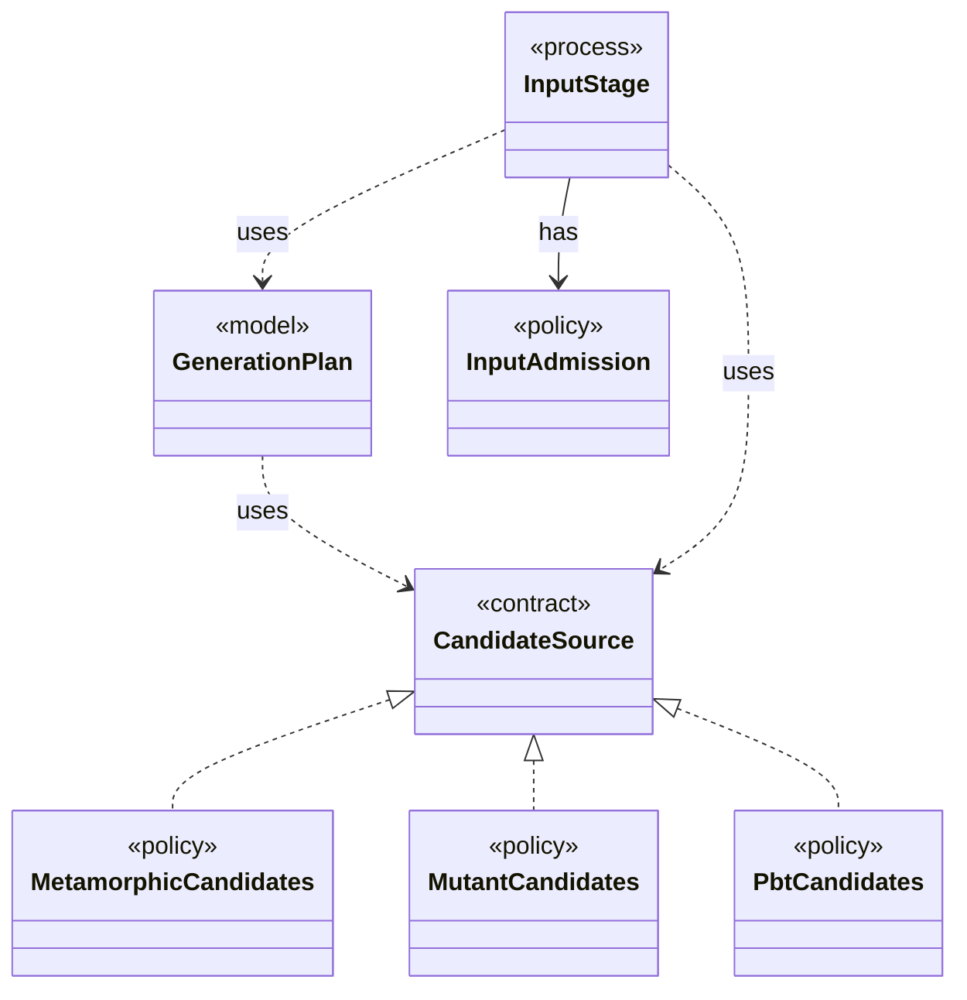

| Type | Kind | Role | Summary |
|---|---|---|---|
| [**CandidateSource** ★](../types/io.github.tlaplus.hardening.workflow.input.CandidateSource.md) | interface | contract | Where the candidates for a target entry of the input stage come from: property-based generation or mutation of a selected parent (ADR 0010). |
| [CollectionRichness](../types/io.github.tlaplus.hardening.workflow.input.CollectionRichness.md) | class | other | Scores the explicit collection literals contained in generated TLA+ expressions. |
| [**GenerationPlan** ★](../types/io.github.tlaplus.hardening.workflow.input.GenerationPlan.md) | record | model | One contiguous range of target entries the input stage admits: which input kind, for which generation, from which seed, how many entries from each candidate source, and with at most how many workers. |
| [**InputAdmission** ★](../types/io.github.tlaplus.hardening.workflow.input.InputAdmission.md) | class | policy | Decides whether a decoded candidate enters `00-inputs`, and where a known defect goes. |
| [InputHandoff](../types/io.github.tlaplus.hardening.workflow.input.InputHandoff.md) | record | other | How the input stage hands entries to the parser: the parser's queue, and the `00-inputs` slots that bound how many entries wait in it. |
| [InputLengthSampler](../types/io.github.tlaplus.hardening.workflow.input.InputLengthSampler.md) | class | other | Samples bounded lengths from uniformly selected logarithmic size buckets. |
| [**InputStage** ★](../types/io.github.tlaplus.hardening.workflow.input.InputStage.md) | class | process | Concurrent input stage: admits reserved target ranges from adjacent generations. |
| [KnownDefectQuarantine](../types/io.github.tlaplus.hardening.workflow.input.KnownDefectQuarantine.md) | class | other | Keeps at most a fixed number of quarantined candidates per primary known-defect signature in `00-known-defects`; past the cap, a match is counted by the caller and discarded here. |
| [**MetamorphicCandidates** ★](../types/io.github.tlaplus.hardening.workflow.input.MetamorphicCandidates.md) | class | policy | Adopts elite conformance entries (ADR 0016 §6): every candidate is the payload of a uniformly drawn parent of a pbt corpus behind the metamorphic header, followed by random rewrite bytes. |
| [**MutantCandidates** ★](../types/io.github.tlaplus.hardening.workflow.input.MutantCandidates.md) | class | policy | Mutants of the parent pool (ADR 0010): every candidate mutates a uniformly drawn parent, keeps its cohort, and is rejected as a clone when it renders to the parent's module. |
| [ParentPool](../types/io.github.tlaplus.hardening.workflow.input.ParentPool.md) | class | other | The entries of `04quality-pass` that a generation mutates or adopts: those of the kind the run generates, read once when the generation starts. |
| [**PbtCandidates** ★](../types/io.github.tlaplus.hardening.workflow.input.PbtCandidates.md) | class | policy | Property-based candidates (ADR 0002): a target draws one richness cohort, and every candidate for it is a uniformly random byte array of a length from `InputLengthSampler`. |

## `io.github.tlaplus.hardening.workflow.library`

Prepares the custom-operator and rewrite-rule libraries of a run once, before decoding: installs them into the corpus, typechecks them, and probes their sources (ADR 0014, ADR 0015, ADR 0017).

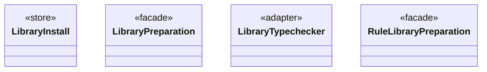

| Type | Kind | Role | Summary |
|---|---|---|---|
| [**LibraryInstall** ★](../types/io.github.tlaplus.hardening.workflow.library.LibraryInstall.md) | class | store | Copies a library's classpath into a corpus, so that the corpus keeps the release it was initialized with. |
| [LibraryJson](../types/io.github.tlaplus.hardening.workflow.library.LibraryJson.md) | class | other | Prunes typechecker JSON to the operator declarations reachable from the selected operators. |
| [LibraryManifest](../types/io.github.tlaplus.hardening.workflow.library.LibraryManifest.md) | class | other | Replay policy for external source snapshots. |
| [**LibraryPreparation** ★](../types/io.github.tlaplus.hardening.workflow.library.LibraryPreparation.md) | class | facade | Prepares custom libraries once before decoding; no importer/typechecker Maven dependency. |
| [LibrarySourceProbe](../types/io.github.tlaplus.hardening.workflow.library.LibrarySourceProbe.md) | class | other | Parses every source alias of a prepared library once, with the classpath the parser and TLC workers receive (ADR 0015). |
| [LibrarySources](../types/io.github.tlaplus.hardening.workflow.library.LibrarySources.md) | class | other | Materializes an ordered module search path as one source-only snapshot for SANY. |
| [**LibraryTypechecker** ★](../types/io.github.tlaplus.hardening.workflow.library.LibraryTypechecker.md) | class | adapter | Finite, isolated Snowcat invocation producing a typed module rather than a checker verdict. |
| [**RuleLibraryPreparation** ★](../types/io.github.tlaplus.hardening.workflow.library.RuleLibraryPreparation.md) | class | facade | Loads a rule module once, before decoding (ADR 0017 §1, §6): the rewrites of a metamorphic run or the edge guards of graph inputs (ADR 0023 §6). |
| [RuleModuleDefinitions](../types/io.github.tlaplus.hardening.workflow.library.RuleModuleDefinitions.md) | class | other | Names the top-level definitions of a rule module itself, in declaration order, with the weight each one's comments annotate (ADR 0017 §1). |

## `io.github.tlaplus.hardening.workflow.parser`

The parser backend, its fan-out routing, and the isolated SANY worker entry point.

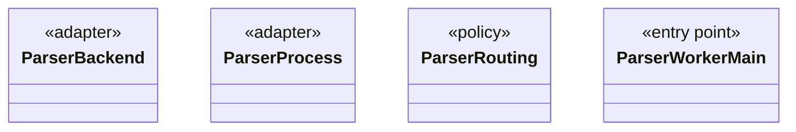

| Type | Kind | Role | Summary |
|---|---|---|---|
| [**ParserBackend** ★](../types/io.github.tlaplus.hardening.workflow.parser.ParserBackend.md) | class | adapter | Runs SANY in persistent isolated JVMs, one per stage worker, each replaced after a crash. |
| [**ParserProcess** ★](../types/io.github.tlaplus.hardening.workflow.parser.ParserProcess.md) | class | adapter | Starts one persistent isolated SANY JVM; the common process handle owns requests and closing. |
| [**ParserRouting** ★](../types/io.github.tlaplus.hardening.workflow.parser.ParserRouting.md) | class | policy | Routes parser results. |
| [**ParserWorkerMain** ★](../types/io.github.tlaplus.hardening.workflow.parser.ParserWorkerMain.md) | class | entry point | Child-process entry point for persistent isolated SANY requests. |

## `io.github.tlaplus.hardening.workflow.quality`

The quality gate of ADR 0010, which selects the parents of the next generation.

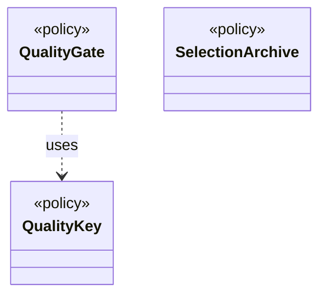

| Type | Kind | Role | Summary |
|---|---|---|---|
| [CoverageFeature](../types/io.github.tlaplus.hardening.workflow.quality.CoverageFeature.md) | interface | other | One operator-coverage feature of an entry's evaluated code (ADR 0013): a construct or an edge between constructs, with the hit-count bucket of its occurrences. |
| [QualityCell](../types/io.github.tlaplus.hardening.workflow.quality.QualityCell.md) | record | other | The behaviour cell of an admissible entry (ADR 0013): its TLC verdict and the components of its `QualityKey`, each after its bucket. |
| [**QualityGate** ★](../types/io.github.tlaplus.hardening.workflow.quality.QualityGate.md) | class | policy | Selects the parents of the next generation from one settled generation (ADR 0010, ADR 0013). |
| [**QualityKey** ★](../types/io.github.tlaplus.hardening.workflow.quality.QualityKey.md) | class | policy | The order in which the quality gate ranks admissible entries, best first (ADR 0010). |
| [**SelectionArchive** ★](../types/io.github.tlaplus.hardening.workflow.quality.SelectionArchive.md) | class | policy | The behaviour cells and coverage features of the entries the gate has kept (ADR 0013), and the rule that decides whether one more entry is kept. |

## `io.github.tlaplus.hardening.workflow.spec`

Construction and rendering of the generated expression-input specification.

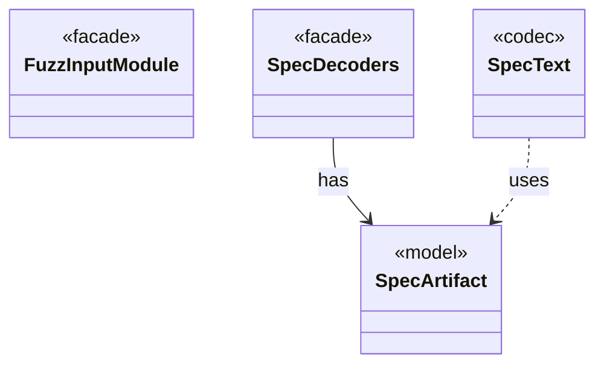

| Type | Kind | Role | Summary |
|---|---|---|---|
| [EvaluatedExprs](../types/io.github.tlaplus.hardening.workflow.spec.EvaluatedExprs.md) | class | other | Replays a stored input and counts the expression constructs of the code the checkers evaluate: the definitions reachable from `SpecArtifact.entryPoints`. |
| [**FuzzInputModule** ★](../types/io.github.tlaplus.hardening.workflow.spec.FuzzInputModule.md) | class | facade | Assembles the module checked by the parser and model-checker stages. |
| [GeneratedInputPreparation](../types/io.github.tlaplus.hardening.workflow.spec.GeneratedInputPreparation.md) | class | other | Regenerates and renders one tool input while preserving generator-crash artifacts. |
| [GraphOutcomes](../types/io.github.tlaplus.hardening.workflow.spec.GraphOutcomes.md) | class | adapter | Predicts the outcome of a graph entry by replaying it through the decoders (ADR 0023 §4): a counterexample of the target's distance when a behaviour reaches the target within the step bound, and a pass otherwise. |
| [**SpecArtifact** ★](../types/io.github.tlaplus.hardening.workflow.spec.SpecArtifact.md) | class | model | One assembled module, what its checkers are asked about it, and what its decoder produced. |
| [**SpecDecoders** ★](../types/io.github.tlaplus.hardening.workflow.spec.SpecDecoders.md) | class | facade | Immutable registry of the decoders that turn stored payloads into checkable modules. |
| [**SpecText** ★](../types/io.github.tlaplus.hardening.workflow.spec.SpecText.md) | class | codec | Renders an assembled module as the TLA+ source that the parser and TLC consume. |

## `io.github.tlaplus.hardening.workflow.tlc`

TLC-stage orchestration and the isolated TLC worker entry point.

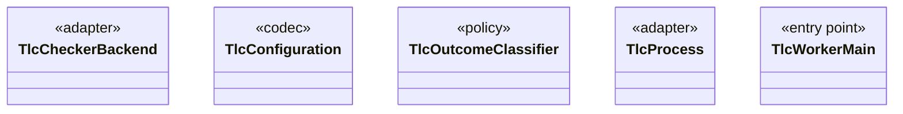

| Type | Kind | Role | Summary |
|---|---|---|---|
| [**TlcCheckerBackend** ★](../types/io.github.tlaplus.hardening.workflow.tlc.TlcCheckerBackend.md) | class | adapter | Adapts fresh isolated TLC invocations to the shared tool stage. |
| [**TlcConfiguration** ★](../types/io.github.tlaplus.hardening.workflow.tlc.TlcConfiguration.md) | class | codec | The TLC configuration file for one checked module. |
| [TlcExplorationMetrics](../types/io.github.tlaplus.hardening.workflow.tlc.TlcExplorationMetrics.md) | class | other | Measures one TLC run and attaches the result to its classified outcome (ADR 0008). |
| [TlcFailureDetail](../types/io.github.tlaplus.hardening.workflow.tlc.TlcFailureDetail.md) | class | other | Extracts bounded human-readable context from TLC diagnostics. |
| [TlcMessageMetrics](../types/io.github.tlaplus.hardening.workflow.tlc.TlcMessageMetrics.md) | class | other | Follows the messages TLC prints, which say when its initial states are complete and which states its error trace consists of. |
| [**TlcOutcomeClassifier** ★](../types/io.github.tlaplus.hardening.workflow.tlc.TlcOutcomeClassifier.md) | class | policy | Maps TLC's internal error constants to workflow outcomes. |
| [**TlcProcess** ★](../types/io.github.tlaplus.hardening.workflow.tlc.TlcProcess.md) | class | adapter | Runs one TLC request in a fresh isolated JVM. |
| [TlcStateMetrics](../types/io.github.tlaplus.hardening.workflow.tlc.TlcStateMetrics.md) | class | other | Measures the state graph TLC explores, through the state-writer callbacks TLC makes for every initial state and every generated transition. |
| [TlcValueShape](../types/io.github.tlaplus.hardening.workflow.tlc.TlcValueShape.md) | class | other | The shape of the values of one state: how many value nodes they hold, their largest collection, and their deepest nesting. |
| [**TlcWorkerMain** ★](../types/io.github.tlaplus.hardening.workflow.tlc.TlcWorkerMain.md) | class | entry point | One-shot TLC child process. |

## `io.github.tlaplus.hardening.workflow.tool`

The stage loop shared by the parser and the model checkers, and the tool and routing it runs.

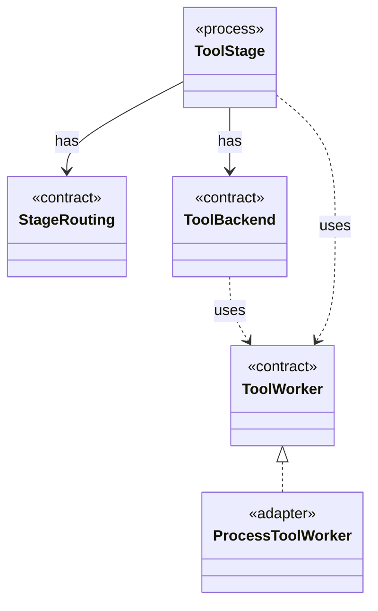

| Type | Kind | Role | Summary |
|---|---|---|---|
| [**ProcessToolWorker** ★](../types/io.github.tlaplus.hardening.workflow.tool.ProcessToolWorker.md) | class | adapter | A tool worker served by one isolated child process until a crash verdict retires it. |
| [**StageRouting** ★](../types/io.github.tlaplus.hardening.workflow.tool.StageRouting.md) | interface | contract | Where a `ToolStage` takes its inputs from, how it bounds its result directories, and where a recorded result goes next. |
| [**ToolBackend** ★](../types/io.github.tlaplus.hardening.workflow.tool.ToolBackend.md) | interface | contract | Tool-specific behavior injected into the shared `ToolStage`. |
| [**ToolStage** ★](../types/io.github.tlaplus.hardening.workflow.tool.ToolStage.md) | class | process | One stage that runs an external tool over corpus entries: the parser, TLC, or Apalache. |
| [**ToolWorker** ★](../types/io.github.tlaplus.hardening.workflow.tool.ToolWorker.md) | interface | contract | Worker-local tool state used for one or more sequential inputs. |

## `io.github.tlaplus.hardening.workflow.worker`

Child-JVM supervision, binary protocol, results, and diagnostics shared by tool stages.

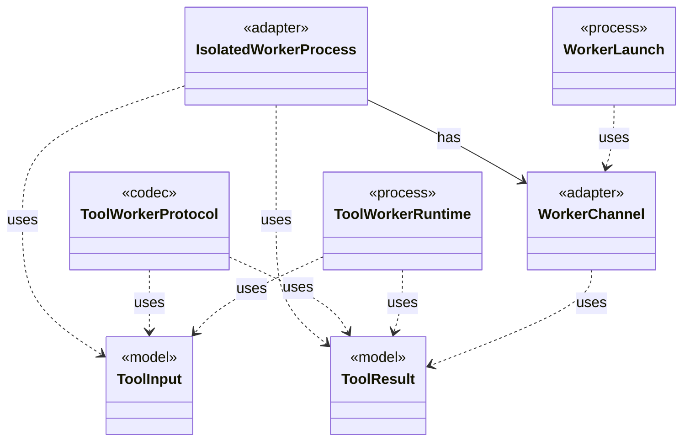

| Type | Kind | Role | Summary |
|---|---|---|---|
| [BoundedOutputCapture](../types/io.github.tlaplus.hardening.workflow.worker.BoundedOutputCapture.md) | class | other | Continuously drains a process stream while retaining only a bounded prefix. |
| [BoundedTextOutputStream](../types/io.github.tlaplus.hardening.workflow.worker.BoundedTextOutputStream.md) | class | other | Retains a bounded UTF-8 byte prefix while discarding subsequent output. |
| [CheckRequest](../types/io.github.tlaplus.hardening.workflow.worker.CheckRequest.md) | record | other | What a checker is asked about one assembled module. |
| [ChildJvm](../types/io.github.tlaplus.hardening.workflow.worker.ChildJvm.md) | record | other | The resources and options of one child JVM. |
| [**IsolatedWorkerProcess** ★](../types/io.github.tlaplus.hardening.workflow.worker.IsolatedWorkerProcess.md) | class | adapter | Parent-side supervisor for one isolated Java tool worker. |
| [JavaLaunch](../types/io.github.tlaplus.hardening.workflow.worker.JavaLaunch.md) | class | other | How this project spells a child JVM launch, so every caller spells it the same way. |
| [OneShotTool](../types/io.github.tlaplus.hardening.workflow.worker.OneShotTool.md) | class | other | A finite CLI invocation, unlike protocol workers which serve a sequence of per-input requests. |
| [StageOutcome](../types/io.github.tlaplus.hardening.workflow.worker.StageOutcome.md) | enum | other | Common result of processing one input in a checking stage. |
| [StandardModuleResources](../types/io.github.tlaplus.hardening.workflow.worker.StandardModuleResources.md) | class | other | Verifies that generated specifications can resolve their packaged standard modules. |
| [**ToolInput** ★](../types/io.github.tlaplus.hardening.workflow.worker.ToolInput.md) | record | model | One rendered specification and what the receiving checker is asked about it. |
| [**ToolResult** ★](../types/io.github.tlaplus.hardening.workflow.worker.ToolResult.md) | record | model | One request result returned by an isolated tool worker. |
| [ToolThreadStacks](../types/io.github.tlaplus.hardening.workflow.worker.ToolThreadStacks.md) | class | other | The stacks of the threads a stopped worker was working on, for the diagnostic of a timeout (ADR 0021). |
| [ToolWorkerConnection](../types/io.github.tlaplus.hardening.workflow.worker.ToolWorkerConnection.md) | class | other | Child-side connection to the parent's private worker-protocol listener. |
| [**ToolWorkerProtocol** ★](../types/io.github.tlaplus.hardening.workflow.worker.ToolWorkerProtocol.md) | class | codec | Binary framing shared by isolated parser and model-checker workers. |
| [**ToolWorkerRuntime** ★](../types/io.github.tlaplus.hardening.workflow.worker.ToolWorkerRuntime.md) | class | process | The part of a child worker that is the same for every tool: report an escaped failure by exiting non-zero, announce itself to the parent, serve inputs until the parent stops asking, write each input where the tool reads it, and keep a bounded record of what the tool printed. |
| [**WorkerChannel** ★](../types/io.github.tlaplus.hardening.workflow.worker.WorkerChannel.md) | class | adapter | The parent's end of one worker's control channel: message framing, and the deadline every read runs under. |
| [WorkerDiagnostics](../types/io.github.tlaplus.hardening.workflow.worker.WorkerDiagnostics.md) | class | other | Diagnostic formatting shared by isolated tool entry points. |
| [**WorkerLaunch** ★](../types/io.github.tlaplus.hardening.workflow.worker.WorkerLaunch.md) | class | process | Brings one isolated worker up: private scratch storage, a private loopback listener, the child JVM, and an authenticated control connection. |
| [WorkerOutput](../types/io.github.tlaplus.hardening.workflow.worker.WorkerOutput.md) | class | other | Everything a child process says outside the control channel, and the scratch tree it says it in. |
| [WorkerSpec](../types/io.github.tlaplus.hardening.workflow.worker.WorkerSpec.md) | record | other | How to launch one isolated tool worker: where it may write, how long it may take to come up, which class it runs, what goes in front of this JVM's class path, the child JVM it runs in, and what to call it in diagnostics. |

## Decisions

- [ADR 0002: PBT collection-richness score](https://github.com/tlaplus/model-checker-hardening/blob/47a7fcfd71d20c6a404ebf5a8a3e7d9a0e250e9b/docs/decisions/0002-pbt-richness-score.md)
- [ADR 0008: Exploration metrics](https://github.com/tlaplus/model-checker-hardening/blob/47a7fcfd71d20c6a404ebf5a8a3e7d9a0e250e9b/docs/decisions/0008-exploration-metrics.md)
- [ADR 0010: Generational mutation](https://github.com/tlaplus/model-checker-hardening/blob/47a7fcfd71d20c6a404ebf5a8a3e7d9a0e250e9b/docs/decisions/0010-mutation.md)
- [ADR 0013: Behaviour archive and operator-edge coverage](https://github.com/tlaplus/model-checker-hardening/blob/47a7fcfd71d20c6a404ebf5a8a3e7d9a0e250e9b/docs/decisions/0013-behaviour-archive-and-operator-coverage.md)
- [ADR 0014: Per-checker linking of instance-linked libraries](https://github.com/tlaplus/model-checker-hardening/blob/47a7fcfd71d20c6a404ebf5a8a3e7d9a0e250e9b/docs/decisions/0014-per-checker-library-linking.md)
- [ADR 0015: Diff-linked libraries for recursion testing](https://github.com/tlaplus/model-checker-hardening/blob/47a7fcfd71d20c6a404ebf5a8a3e7d9a0e250e9b/docs/decisions/0015-diff-linked-libraries.md)
- [ADR 0016: Metamorphic testing](https://github.com/tlaplus/model-checker-hardening/blob/47a7fcfd71d20c6a404ebf5a8a3e7d9a0e250e9b/docs/decisions/0016-metamorphic-testing.md)
- [ADR 0017: Rewrite rules as a TLA+ library](https://github.com/tlaplus/model-checker-hardening/blob/47a7fcfd71d20c6a404ebf5a8a3e7d9a0e250e9b/docs/decisions/0017-rewrite-rule-library.md)
- [ADR 0021: Diagnostics of a timed-out worker](https://github.com/tlaplus/model-checker-hardening/blob/47a7fcfd71d20c6a404ebf5a8a3e7d9a0e250e9b/docs/decisions/0021-timeout-diagnostics.md)
- [ADR 0023: Graph-based testing](https://github.com/tlaplus/model-checker-hardening/blob/47a7fcfd71d20c6a404ebf5a8a3e7d9a0e250e9b/docs/decisions/0023-graph-based-testing.md)
