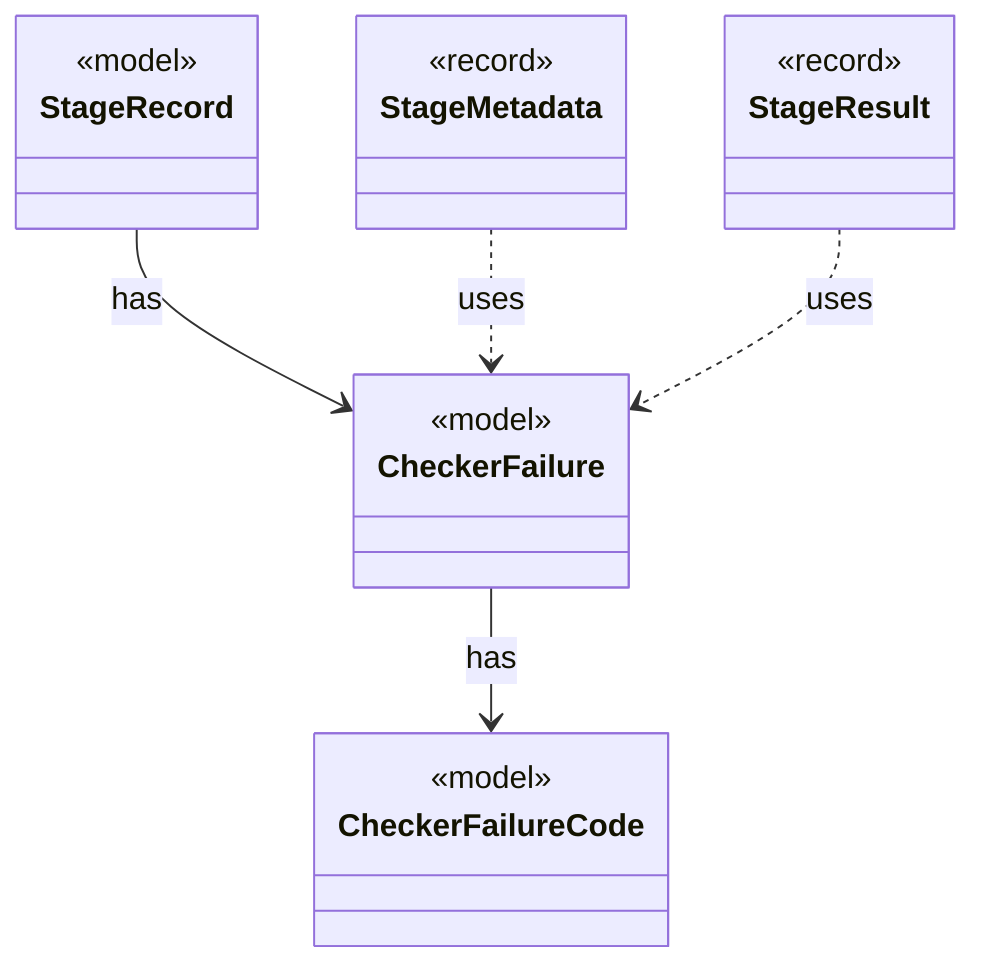

# `CheckerFailure`

`io.github.tlaplus.hardening.checker` · record · model · key · [source](https://github.com/tlaplus/model-checker-hardening/blob/0b7c167b636088dd43d36713d157e22f7ebd4f79/src/main/java/io/github/tlaplus/hardening/checker/CheckerFailure.java#L12) · module [checker](../modules/checker.md)

A stable checker failure code with optional bounded diagnostic context.

The diagram draws 4 of 11 relations; the table lists them all.

| Direction | Relation | Type | Summary |
|---|---|---|---|
| → | has | [CheckerFailureCode](io.github.tlaplus.hardening.checker.CheckerFailureCode.md) | Stable failure codes shared by model-checker stages. |
| ← | has | [StageRecord](io.github.tlaplus.hardening.corpus.StageRecord.md) | What a stage records about one input: its verdict, when it worked on the input, its failure classification when it classifies failures, and what it explored when it measures exploration. |
| ← | uses | [StageMetadata](io.github.tlaplus.hardening.corpus.StageMetadata.md) | Metadata recorded when one workflow stage finishes processing an input. |
| ← | uses | [StageResult](io.github.tlaplus.hardening.corpus.StageResult.md) | What one stage decided about one input, and the tool output kept for triage. |
| → | depends | [Preconditions](io.github.tlaplus.hardening.common.Preconditions.md) | Shared validation of method and constructor arguments. |
| ← | depends | [EnvelopeReport](io.github.tlaplus.hardening.cli.EnvelopeReport.md) | Renders a decoded corpus envelope and its expression as plain text. |
| ← | depends | [CorpusEnvelopeCodec](io.github.tlaplus.hardening.corpus.CorpusEnvelopeCodec.md) | Reads and rewrites the `stages` metadata of a corpus envelope. |
| ← | depends | [EntryRows](io.github.tlaplus.hardening.database.EntryRows.md) | The rows that one decoded corpus entry contributes: its `entry` row, followed by the rows that reference it: one `knownDefect` row per signature, one `mutationOperator` row per operator, one `stage` row per stage record, one `expr` row per expression construct of its replayed input and one `exprEdge` row per edge between constructs. |
| ← | depends | [ApalacheFailureDetail](io.github.tlaplus.hardening.workflow.apalache.ApalacheFailureDetail.md) | Extracts bounded human-readable context from Apalache diagnostics. |
| ← | depends | [TlcFailureDetail](io.github.tlaplus.hardening.workflow.tlc.TlcFailureDetail.md) | Extracts bounded human-readable context from TLC diagnostics. |
| ← | depends | [ToolStage](io.github.tlaplus.hardening.workflow.tool.ToolStage.md) | One stage that runs an external tool over corpus entries: the parser, TLC, or Apalache. |
