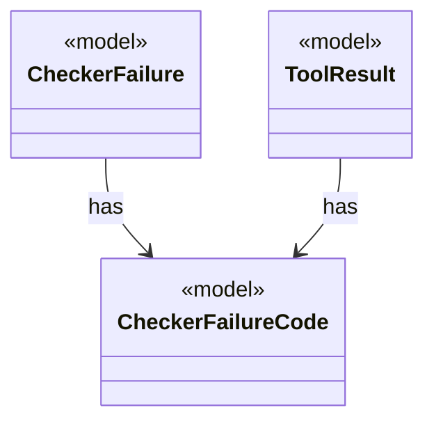

# `CheckerFailureCode`

`io.github.tlaplus.hardening.checker` · enum · model · key · [source](https://github.com/tlaplus/model-checker-hardening/blob/47a7fcfd71d20c6a404ebf5a8a3e7d9a0e250e9b/src/main/java/io/github/tlaplus/hardening/checker/CheckerFailureCode.java#L8) · module [checker](../modules/checker.md)

Stable failure codes shared by model-checker stages.

The diagram draws 2 of 9 relations; the table lists them all.

| Direction | Relation | Type | Summary |
|---|---|---|---|
| ← | has | [CheckerFailure](io.github.tlaplus.hardening.checker.CheckerFailure.md) | A stable checker failure code with optional bounded diagnostic context. |
| ← | has | [ToolResult](io.github.tlaplus.hardening.workflow.worker.ToolResult.md) | One request result returned by an isolated tool worker. |
| ← | depends | [EnvelopeReport](io.github.tlaplus.hardening.cli.EnvelopeReport.md) | Renders a decoded corpus envelope and its expression as plain text. |
| ← | depends | [CorpusEnvelopeCodec](io.github.tlaplus.hardening.corpus.CorpusEnvelopeCodec.md) | Reads and rewrites the `stages` metadata of a corpus envelope. |
| ← | depends | [EntryRows](io.github.tlaplus.hardening.database.EntryRows.md) | The rows that one decoded corpus entry contributes: its `entry` row, followed by the rows that reference it: one `knownDefect` row per signature, one `mutationOperator` row per operator, one `stage` row per stage record, one `expr` row per expression construct of its replayed input and one `exprEdge` row per edge between constructs. |
| ← | depends | [ApalacheOutcomeClassifier](io.github.tlaplus.hardening.workflow.apalache.ApalacheOutcomeClassifier.md) | Maps Apalache tool exit statuses to shared workflow outcomes. |
| ← | depends | [TlcOutcomeClassifier](io.github.tlaplus.hardening.workflow.tlc.TlcOutcomeClassifier.md) | Maps TLC's internal error constants to workflow outcomes. |
| ← | depends | [ToolStage](io.github.tlaplus.hardening.workflow.tool.ToolStage.md) | One stage that runs an external tool over corpus entries: the parser, TLC, or Apalache. |
| ← | depends | [ToolWorkerProtocol](io.github.tlaplus.hardening.workflow.worker.ToolWorkerProtocol.md) | Binary framing shared by isolated parser and model-checker workers. |
