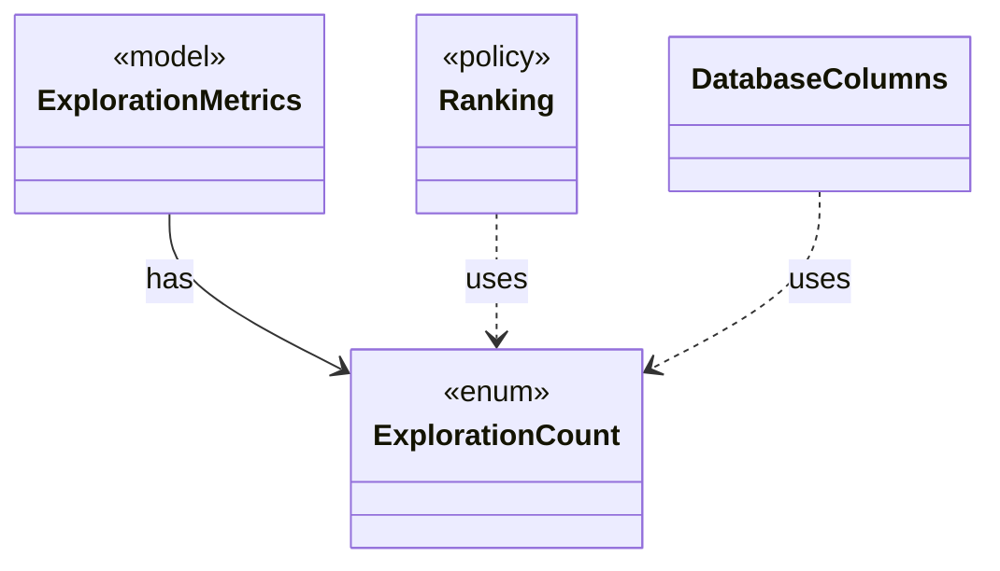

# `ExplorationCount`

`io.github.tlaplus.hardening.checker` · enum · other · [source](https://github.com/tlaplus/model-checker-hardening/blob/b96eff75a5bbf8a60b15ad020d6e84735c75a47c/src/main/java/io/github/tlaplus/hardening/checker/ExplorationCount.java#L9) · module [checker](../modules/checker.md)

A counted exploration metric.

The diagram draws 3 of 15 relations; the table lists them all.

| Direction | Relation | Type | Summary |
|---|---|---|---|
| ← | has | [ExplorationMetrics](io.github.tlaplus.hardening.checker.ExplorationMetrics.md) | What a model checker explored to reach its verdict, as ADR 0008 defines it. |
| ← | uses | [Ranking](io.github.tlaplus.hardening.corpus.Ranking.md) | How the quality gate ranks the admissible entries of a generation, best first: the components of its key, compared lexicographically, higher first. |
| ← | uses | [DatabaseColumns](io.github.tlaplus.hardening.database.DatabaseColumns.md) | The columns of the database tables. |
| ← | depends | [EnvelopeReport](io.github.tlaplus.hardening.cli.EnvelopeReport.md) | Renders a decoded corpus envelope and its expression as plain text. |
| ← | depends | [CorpusEnvelopeCodec](io.github.tlaplus.hardening.corpus.CorpusEnvelopeCodec.md) | Reads and rewrites the `stages` metadata of a corpus envelope. |
| ← | depends | [ExpectedOutcome](io.github.tlaplus.hardening.corpus.ExpectedOutcome.md) | The checker verdict an input predicts, independently of any checker (ADR 0023 §4): a graph input predicts a counterexample of known length when its target is reachable within the step bound, and a pass otherwise. |
| ← | depends | [Oracle](io.github.tlaplus.hardening.corpus.Oracle.md) | How the aggregator judges the checker results of one entry (fuzzing-workflows.md §1.3, ADR 0016 §4, ADR 0019, ADR 0023 §5). |
| ← | depends | [ShallowPattern](io.github.tlaplus.hardening.corpus.ShallowPattern.md) | A way in which a TLC run explored almost nothing, as the calibration table of ADR 0008 defines it. |
| ← | depends | [StageRecord](io.github.tlaplus.hardening.corpus.StageRecord.md) | What a stage records about one input: its verdict, when it worked on the input, its failure classification when it classifies failures, and what it explored when it measures exploration. |
| ← | depends | [CorpusDatabaseSchema](io.github.tlaplus.hardening.database.CorpusDatabaseSchema.md) | The schema of the corpus database, as the corpus-database manual documents it. |
| ← | depends | [EntryRows](io.github.tlaplus.hardening.database.EntryRows.md) | The rows that one decoded corpus entry contributes: its `entry` row, followed by the rows that reference it: one `knownDefect` row per signature, one `mutationOperator` row per operator, one `stage` row per stage record, one `expr` row per expression construct of its replayed input and one `exprEdge` row per edge between constructs. |
| ← | depends | [ApalacheWorkerMain](io.github.tlaplus.hardening.workflow.apalache.ApalacheWorkerMain.md) | Persistent child process that invokes Apalache's `Tool.run` sequentially. |
| ← | depends | [TlcExplorationMetrics](io.github.tlaplus.hardening.workflow.tlc.TlcExplorationMetrics.md) | Measures one TLC run and attaches the result to its classified outcome (ADR 0008). |
| ← | depends | [TlcStateMetrics](io.github.tlaplus.hardening.workflow.tlc.TlcStateMetrics.md) | Measures the state graph TLC explores, through the state-writer callbacks TLC makes for every initial state and every generated transition. |
| ← | depends | [ToolWorkerProtocol](io.github.tlaplus.hardening.workflow.worker.ToolWorkerProtocol.md) | Binary framing shared by isolated parser and model-checker workers. |
