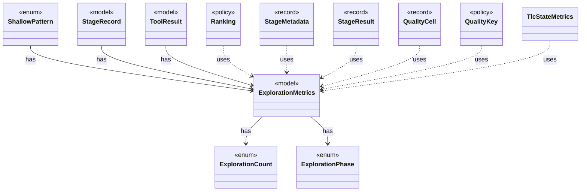

# `ExplorationMetrics`

`io.github.tlaplus.hardening.checker` · record · model · key · [source](https://github.com/tlaplus/model-checker-hardening/blob/12d0a3fd62c72add470e6ee06490c4e3591f490e/src/main/java/io/github/tlaplus/hardening/checker/ExplorationMetrics.java#L25) · module [checker](../modules/checker.md)

What a model checker explored to reach its verdict, as ADR 0008 defines it.

**Decisions:** [ADR 0008: Exploration metrics](https://github.com/tlaplus/model-checker-hardening/blob/12d0a3fd62c72add470e6ee06490c4e3591f490e/docs/decisions/0008-exploration-metrics.md)

The diagram draws 11 of 21 relations; the table lists them all.

| Direction | Relation | Type | Summary |
|---|---|---|---|
| → | has | [ExplorationCount](io.github.tlaplus.hardening.checker.ExplorationCount.md) | A counted exploration metric. |
| → | has | [ExplorationPhase](io.github.tlaplus.hardening.checker.ExplorationPhase.md) | How far a model checker got before its verdict was fixed. |
| ← | has | [ShallowPattern](io.github.tlaplus.hardening.corpus.ShallowPattern.md) | A way in which a TLC run explored almost nothing, as the calibration table of ADR 0008 defines it. |
| ← | has | [StageRecord](io.github.tlaplus.hardening.corpus.StageRecord.md) | What a stage records about one input: its verdict, when it worked on the input, its failure classification when it classifies failures, and what it explored when it measures exploration. |
| ← | has | [ToolResult](io.github.tlaplus.hardening.workflow.worker.ToolResult.md) | One request result returned by an isolated tool worker. |
| ← | uses | [Ranking](io.github.tlaplus.hardening.corpus.Ranking.md) | How the quality gate ranks the admissible entries of a generation, best first: the components of its key, compared lexicographically, higher first. |
| ← | uses | [StageMetadata](io.github.tlaplus.hardening.corpus.StageMetadata.md) | Metadata recorded when one workflow stage finishes processing an input. |
| ← | uses | [StageResult](io.github.tlaplus.hardening.corpus.StageResult.md) | What one stage decided about one input, and the tool output kept for triage. |
| ← | uses | [QualityCell](io.github.tlaplus.hardening.workflow.quality.QualityCell.md) | The behaviour cell of an admissible entry (ADR 0013): its TLC verdict and the components of the gate's `Ranking`, each after its bucket. |
| ← | uses | [QualityKey](io.github.tlaplus.hardening.workflow.quality.QualityKey.md) | The order in which the quality gate ranks admissible entries, best first (ADR 0010, ADR 0024 §2). |
| ← | uses | [TlcStateMetrics](io.github.tlaplus.hardening.workflow.tlc.TlcStateMetrics.md) | Measures the state graph TLC explores, through the state-writer callbacks TLC makes for every initial state and every generated transition. |
| → | depends | [Preconditions](io.github.tlaplus.hardening.common.Preconditions.md) | Shared validation of method and constructor arguments. |
| ← | depends | [EnvelopeReport](io.github.tlaplus.hardening.cli.EnvelopeReport.md) | Renders a decoded corpus envelope and its expression as plain text. |
| ← | depends | [CorpusEnvelopeCodec](io.github.tlaplus.hardening.corpus.CorpusEnvelopeCodec.md) | Reads and rewrites the `stages` metadata of a corpus envelope. |
| ← | depends | [ExpectedOutcome](io.github.tlaplus.hardening.corpus.ExpectedOutcome.md) | The checker verdict an input predicts, independently of any checker (ADR 0023 §4): a graph input predicts a counterexample of known length when its target is reachable within the step bound, and a pass otherwise. |
| ← | depends | [Oracle](io.github.tlaplus.hardening.corpus.Oracle.md) | How the aggregator judges the checker results of one entry (fuzzing-workflows.md §1.3, ADR 0016 §4, ADR 0019, ADR 0023 §5). |
| ← | depends | [EntryRows](io.github.tlaplus.hardening.database.EntryRows.md) | The rows that one decoded corpus entry contributes: its `entry` row, followed by the rows that reference it: one `knownDefect` row per signature, one `mutationOperator` row per operator, one `stage` row per stage record, one `expr` row per expression construct of its replayed input and one `exprEdge` row per edge between constructs. |
| ← | depends | [ApalacheWorkerMain](io.github.tlaplus.hardening.workflow.apalache.ApalacheWorkerMain.md) | Persistent child process that invokes Apalache's `Tool.run` sequentially. |
| ← | depends | [QualityGate](io.github.tlaplus.hardening.workflow.quality.QualityGate.md) | Selects the parents of the next generation from one settled generation (ADR 0010, ADR 0013). |
| ← | depends | [TlcExplorationMetrics](io.github.tlaplus.hardening.workflow.tlc.TlcExplorationMetrics.md) | Measures one TLC run and attaches the result to its classified outcome (ADR 0008). |
| ← | depends | [ToolWorkerProtocol](io.github.tlaplus.hardening.workflow.worker.ToolWorkerProtocol.md) | Binary framing shared by isolated parser and model-checker workers. |
