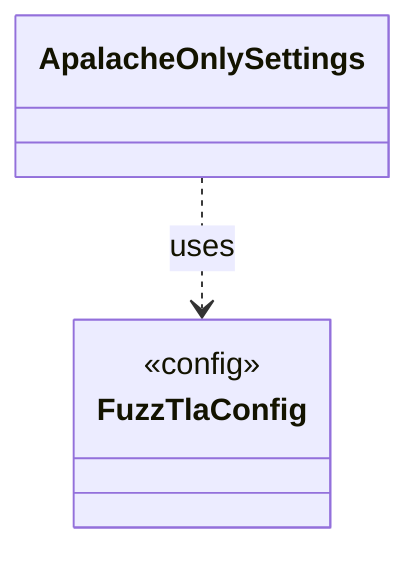

# `ApalacheOnlySettings`

`io.github.tlaplus.hardening.cli` · class · other · [source](https://github.com/tlaplus/model-checker-hardening/blob/da386b24fc0ea1f5a200a0d74df0b119a27ca0ba/src/main/java/io/github/tlaplus/hardening/cli/ApalacheOnlySettings.java#L16) · module [cli](../modules/cli.md)

Settings that `fuzztla init` writes only for a corpus that checks with Apalache (ADR 0029 §3), found in a corpus that does not.

**Decisions:** [ADR 0029: Apalache in temporal metamorphic testing](https://github.com/tlaplus/model-checker-hardening/blob/da386b24fc0ea1f5a200a0d74df0b119a27ca0ba/docs/decisions/0029-apalache-temporal-metamorphic-testing.md)

The diagram draws 1 of 10 relations; the table lists them all.

| Direction | Relation | Type | Summary |
|---|---|---|---|
| → | uses | [FuzzTlaConfig](io.github.tlaplus.hardening.config.FuzzTlaConfig.md) | Complete configuration of input generation and workflow execution. |
| → | depends | [InitialConfig](io.github.tlaplus.hardening.cli.InitialConfig.md) | The configuration `fuzztla init` writes (ADR 0025 §1): the defaults, the shipped known-defect database, the settings that follow from the technique, and fresh seeds (ADR 0026). |
| → | depends | [InputStageConfig](io.github.tlaplus.hardening.config.InputStageConfig.md) | The input stage's occupancy limit and the known-defect databases its admission consults. |
| → | depends | [MetamorphicConfig](io.github.tlaplus.hardening.config.MetamorphicConfig.md) | The `[metamorphic]` table (ADR 0016 §7, ADR 0017 §1, ADR 0027 §1): what an `mt` corpus reads besides the generator settings. |
| → | depends | [RuleLibraryConfig](io.github.tlaplus.hardening.config.RuleLibraryConfig.md) | A rule module and its weights (ADR 0017 §1), as `[metamorphic]` configures the rewrites of `mt` corpora and `[graph]` the tautological edge guards of ADR 0023 §6. |
| → | depends | [WorkflowConfig](io.github.tlaplus.hardening.config.WorkflowConfig.md) | Global and per-stage limits for the implemented fuzzing workflow. |
| → | depends | [CheckerSet](io.github.tlaplus.hardening.corpus.CheckerSet.md) | The checker branches a corpus runs: a non-empty set of checking stages, in stage order. |
| → | depends | [CorpusStage](io.github.tlaplus.hardening.corpus.CorpusStage.md) | One implemented stage of the fuzzing pipeline, and the corpus directories it owns. |
| → | depends | [KnownDefectDatabase](io.github.tlaplus.hardening.signature.KnownDefectDatabase.md) | The known-defect signatures of one invocation, in database order. |
| ← | depends | [RunCommand](io.github.tlaplus.hardening.cli.RunCommand.md) | `fuzztla run`: reads a corpus configuration and runs `WorkflowRunner` with live progress output. |
