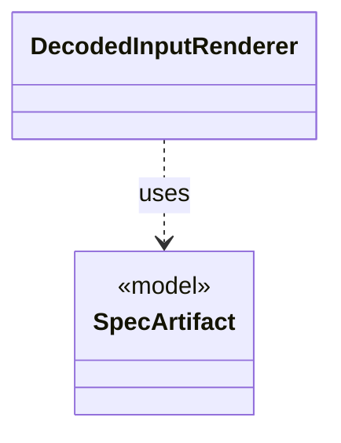

# `DecodedInputRenderer`

`io.github.tlaplus.hardening.cli` · class · other · [source](https://github.com/tlaplus/model-checker-hardening/blob/fd29bdb142d5d87538f91aeddca09d5ac3d7d0a7/src/main/java/io/github/tlaplus/hardening/cli/DecodedInputRenderer.java#L9) · module [cli](../modules/cli.md)

Renders a decoded input independently of picocli command wiring.

The diagram draws 1 of 9 relations; the table lists them all.

| Direction | Relation | Type | Summary |
|---|---|---|---|
| → | uses | [SpecArtifact](io.github.tlaplus.hardening.workflow.spec.SpecArtifact.md) | One assembled module, what its checkers are asked about it, and what its decoder produced. |
| → | depends | [EnvelopeReport](io.github.tlaplus.hardening.cli.EnvelopeReport.md) | Renders a decoded corpus envelope and its expression as plain text. |
| → | depends | [GraphReport](io.github.tlaplus.hardening.cli.GraphReport.md) | Renders a graph module for triage (ADR 0023): the control graph, the target, the outcome the graph predicts, and the module the checkers see. |
| → | depends | [RewriteReport](io.github.tlaplus.hardening.cli.RewriteReport.md) | Renders a metamorphic pair for triage (ADR 0016 §8): which side the checkers explore, the rules applied in order, and both sides. |
| → | depends | [GeneratedGraph](io.github.tlaplus.hardening.gen.graph.GeneratedGraph.md) | A module decoded from a graph input (ADR 0023 §2), with the graph it encodes and the target its invariant `pc /= target` names. |
| → | depends | [Rewrite](io.github.tlaplus.hardening.gen.rewrite.Rewrite.md) | A decoded metamorphic pair: the base the payload's base part decodes to, its rewrite, the orientation, and the rules applied in order. |
| → | depends | [ApalacheIrJson](io.github.tlaplus.hardening.workflow.apalache.ApalacheIrJson.md) | Renders an assembled module as the typed Apalache IR JSON that Apalache consumes. |
| → | depends | [SpecText](io.github.tlaplus.hardening.workflow.spec.SpecText.md) | Renders an assembled module as the TLA+ source that the parser and TLC consume. |
| ← | depends | [PrintCommand](io.github.tlaplus.hardening.cli.PrintCommand.md) | `fuzztla print`: decodes a payload or corpus envelope and renders it, with the known defects it matches. |
