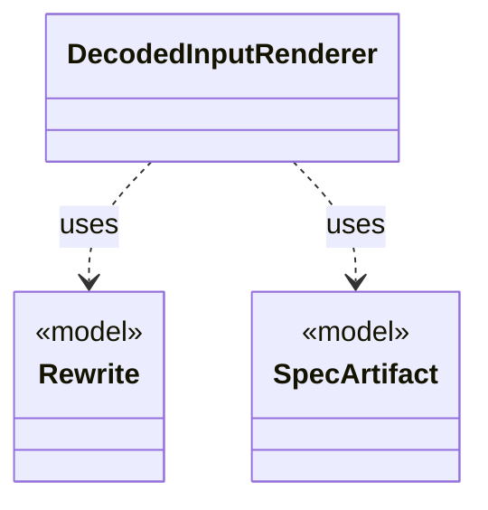

# `DecodedInputRenderer`

`io.github.tlaplus.hardening.cli` · class · other · [source](https://github.com/tlaplus/model-checker-hardening/blob/21262d9d0cc07b5ae4c47c4ee511217c9b88b561/src/main/java/io/github/tlaplus/hardening/cli/DecodedInputRenderer.java#L22) · module [cli](../modules/cli.md)

Renders a decoded input independently of picocli command wiring.

The diagram draws 2 of 14 relations; the table lists them all.

| Direction | Relation | Type | Summary |
|---|---|---|---|
| → | uses | [Rewrite](io.github.tlaplus.hardening.gen.rewrite.Rewrite.md) | A decoded metamorphic pair: the base the payload's base part decodes to, its rewrite, the orientation, and the rules applied in order. |
| → | uses | [SpecArtifact](io.github.tlaplus.hardening.workflow.spec.SpecArtifact.md) | One assembled module, what its checkers are asked about it, and what its decoder produced. |
| → | depends | [EnvelopeReport](io.github.tlaplus.hardening.cli.EnvelopeReport.md) | Renders a decoded corpus envelope and its expression as plain text. |
| → | depends | [CorpusVerdict](io.github.tlaplus.hardening.corpus.CorpusVerdict.md) | A verdict supported by the implemented corpus stages. |
| → | depends | [ExpectedOutcome](io.github.tlaplus.hardening.corpus.ExpectedOutcome.md) | The checker verdict an input predicts, independently of any checker (ADR 0023 §4): a graph input predicts a counterexample of known length when its target is reachable within the step bound, and a pass otherwise. |
| → | depends | [GeneratedSpec](io.github.tlaplus.hardening.gen.GeneratedSpec.md) | The declarations one generated module consists of. |
| → | depends | [GeneratedGraph](io.github.tlaplus.hardening.gen.graph.GeneratedGraph.md) | A module decoded from a graph input (ADR 0023 §2), with the graph it encodes and the target its invariant `pc /= target` names. |
| → | depends | [TransitionGraph](io.github.tlaplus.hardening.gen.graph.TransitionGraph.md) | A directed graph over the nodes `0..N-1`, the control structure of a graph module (ADR 0023 §2). |
| → | depends | [Orientation](io.github.tlaplus.hardening.gen.rewrite.Orientation.md) | Which side of a metamorphic pair the checker explores (ADR 0016 §3). |
| → | depends | [ApalacheIrJson](io.github.tlaplus.hardening.workflow.apalache.ApalacheIrJson.md) | Renders an assembled module as the typed Apalache IR JSON that Apalache consumes. |
| → | depends | [FuzzInputModule](io.github.tlaplus.hardening.workflow.spec.FuzzInputModule.md) | Assembles the module checked by the parser and model-checker stages. |
| → | depends | [GraphOutcomes](io.github.tlaplus.hardening.workflow.spec.GraphOutcomes.md) | Predicts the outcome of a graph entry by replaying it through the decoders (ADR 0023 §4): a counterexample of the target's distance when a behaviour reaches the target within the step bound, and a pass otherwise. |
| → | depends | [SpecText](io.github.tlaplus.hardening.workflow.spec.SpecText.md) | Renders an assembled module as the TLA+ source that the parser and TLC consume. |
| ← | depends | [PrintCommand](io.github.tlaplus.hardening.cli.PrintCommand.md) | `fuzztla print`: decodes a payload or corpus envelope and renders it, with the known defects it matches. |
