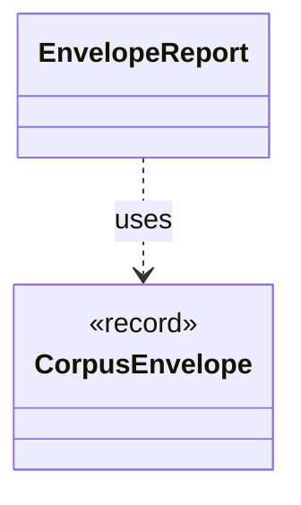

# `EnvelopeReport`

`io.github.tlaplus.hardening.cli` · class · other · [source](https://github.com/tlaplus/model-checker-hardening/blob/918f7db91890f302587d25c76dc7ac189db3d023/src/main/java/io/github/tlaplus/hardening/cli/EnvelopeReport.java#L20) · module [cli](../modules/cli.md)

Renders a decoded corpus envelope and its expression as plain text.

The diagram draws 1 of 18 relations; the table lists them all.

| Direction | Relation | Type | Summary |
|---|---|---|---|
| → | uses | [CorpusEnvelope](io.github.tlaplus.hardening.corpus.CorpusEnvelope.md) | Supported fields decoded from one corpus input envelope. |
| → | depends | [CheckerFailure](io.github.tlaplus.hardening.checker.CheckerFailure.md) | A stable checker failure code with optional bounded diagnostic context. |
| → | depends | [CheckerFailureCode](io.github.tlaplus.hardening.checker.CheckerFailureCode.md) | Stable failure codes shared by model-checker stages. |
| → | depends | [ExplorationCount](io.github.tlaplus.hardening.checker.ExplorationCount.md) | A counted exploration metric. |
| → | depends | [ExplorationMetrics](io.github.tlaplus.hardening.checker.ExplorationMetrics.md) | What a model checker explored to reach its verdict, as ADR 0008 defines it. |
| → | depends | [ExplorationPhase](io.github.tlaplus.hardening.checker.ExplorationPhase.md) | How far a model checker got before its verdict was fixed. |
| → | depends | [HumanDuration](io.github.tlaplus.hardening.cli.HumanDuration.md) | Formats nonnegative durations as compact day, hour, minute, and second parts. |
| → | depends | [CorpusInput](io.github.tlaplus.hardening.corpus.CorpusInput.md) | The required fields of one encoded corpus input. |
| → | depends | [CorpusVerdict](io.github.tlaplus.hardening.corpus.CorpusVerdict.md) | A verdict supported by the implemented corpus stages. |
| → | depends | [GenerationMetadata](io.github.tlaplus.hardening.corpus.GenerationMetadata.md) | Admission-time facts about one corpus input: the generation that admitted it, its PBT cohort and collection-richness score, and, for a mutant, the parent and operators it was derived from. |
| → | depends | [Mutation](io.github.tlaplus.hardening.corpus.Mutation.md) | How a mutated input was derived: the digest of the parent it was mutated from and the operators applied to the parent, in order. |
| → | depends | [StageMetadata](io.github.tlaplus.hardening.corpus.StageMetadata.md) | Metadata recorded when one workflow stage finishes processing an input. |
| → | depends | [InputKind](io.github.tlaplus.hardening.gen.InputKind.md) | What a generator payload decodes to. |
| → | depends | [MutationOperator](io.github.tlaplus.hardening.mutation.MutationOperator.md) | One byte-level edit of a generator input, as ADR 0010 defines it. |
| ← | depends | [DecodedInputRenderer](io.github.tlaplus.hardening.cli.DecodedInputRenderer.md) | Renders a decoded input independently of picocli command wiring. |
| ← | depends | [KnownDefectReport](io.github.tlaplus.hardening.cli.KnownDefectReport.md) | Renders the known-defect signatures that match one decoded input: each signature's id, description, and references, and the subexpression it matched first, as TLA+. |
| ← | depends | [PrintCommand](io.github.tlaplus.hardening.cli.PrintCommand.md) | `fuzztla print`: decodes a payload or corpus envelope and renders it, with the known defects it matches. |
| ← | depends | [RewriteReport](io.github.tlaplus.hardening.cli.RewriteReport.md) | Renders a metamorphic pair for triage (ADR 0016 §8): which side the checkers explore, the rules applied in order, and both sides. |
