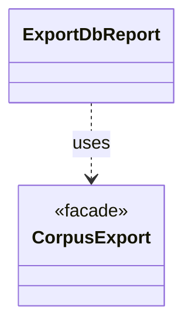

# `ExportDbReport`

`io.github.tlaplus.hardening.cli` · class · other · [source](https://github.com/tlaplus/model-checker-hardening/blob/918f7db91890f302587d25c76dc7ac189db3d023/src/main/java/io/github/tlaplus/hardening/cli/ExportDbReport.java#L7) · module [cli](../modules/cli.md)

Renders the outcome of a corpus export.

The diagram draws 1 of 2 relations; the table lists them all.

| Direction | Relation | Type | Summary |
|---|---|---|---|
| → | uses | [CorpusExport](io.github.tlaplus.hardening.database.CorpusExport.md) | Exports a corpus to a new SQLite database, as ADR 0009 defines it. |
| ← | depends | [ExportDbCommand](io.github.tlaplus.hardening.cli.ExportDbCommand.md) | `fuzztla export-db`: exports a corpus with `CorpusExport` (ADR 0009). |
