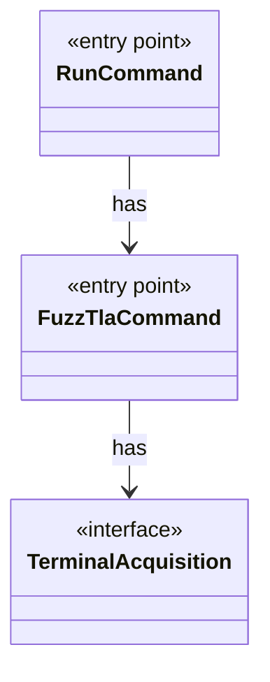

# `FuzzTlaCommand`

`io.github.tlaplus.hardening.cli` · class · entry point · key · [source](https://github.com/tlaplus/model-checker-hardening/blob/3df8c8564b58e946b95079b671788c8315f98831/src/main/java/io/github/tlaplus/hardening/cli/FuzzTlaCommand.java#L14) · module [cli](../modules/cli.md)

The root `fuzztla` command: registers the subcommands and runs one command line.

The diagram draws 2 of 5 relations; the table lists them all.

| Direction | Relation | Type | Summary |
|---|---|---|---|
| → | has | [TerminalAcquisition](io.github.tlaplus.hardening.cli.TerminalAcquisition.md) | Acquires a live progress display for one run. |
| ← | has | [RunCommand](io.github.tlaplus.hardening.cli.RunCommand.md) | `fuzztla run`: reads a corpus configuration and runs `WorkflowRunner` with live progress output. |
| → | depends | [RunTerminal](io.github.tlaplus.hardening.cli.RunTerminal.md) | Acquires the process stdout terminal for live progress when it is capable. |
| ← | depends | [Main](io.github.tlaplus.hardening.Main.md) | The process entry point of `fuzztla`: runs `FuzzTlaCommand` and exits with its status. |
| ← | depends | [ExportDbCommand](io.github.tlaplus.hardening.cli.ExportDbCommand.md) | `fuzztla export-db`: exports a corpus with `CorpusExport` (ADR 0009). |
