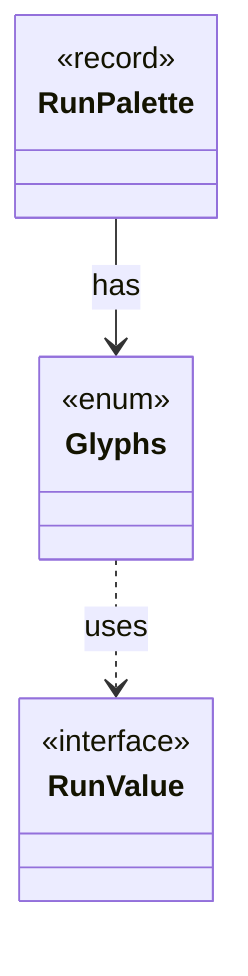

# `Glyphs`

`io.github.tlaplus.hardening.cli` · enum · other · [source](https://github.com/tlaplus/model-checker-hardening/blob/47a7fcfd71d20c6a404ebf5a8a3e7d9a0e250e9b/src/main/java/io/github/tlaplus/hardening/cli/Glyphs.java#L10) · module [cli](../modules/cli.md)

Characters for the live diagram and change markers.

The diagram draws 2 of 4 relations; the table lists them all.

| Direction | Relation | Type | Summary |
|---|---|---|---|
| ← | has | [RunPalette](io.github.tlaplus.hardening.cli.RunPalette.md) | Capability-aware styles on the terminal's own palette and default background. |
| → | uses | [RunValue](io.github.tlaplus.hardening.cli.RunValue.md) | Unrounded, typed values used both for formatting and change comparison. |
| ← | depends | [ProgressLayout](io.github.tlaplus.hardening.cli.ProgressLayout.md) | Pure, size-bounded flow and table layouts for the same statistics and styles. |
| ← | depends | [RunText](io.github.tlaplus.hardening.cli.RunText.md) | Shared field formatting; attributed text keeps terminal escapes out of width arithmetic. |
