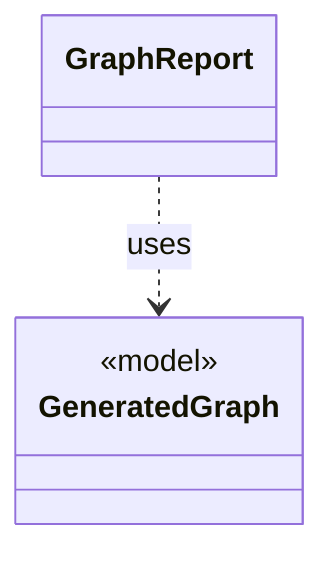

# `GraphReport`

`io.github.tlaplus.hardening.cli` · class · other · [source](https://github.com/tlaplus/model-checker-hardening/blob/af09a9e32eb710979ef0c76f29507ce1ffe85a15/src/main/java/io/github/tlaplus/hardening/cli/GraphReport.java#L14) · module [cli](../modules/cli.md)

Renders a graph module for triage (ADR 0023): the control graph, the target, the outcome the graph predicts, and the module the checkers see.

**Decisions:** [ADR 0023: Graph-based testing](https://github.com/tlaplus/model-checker-hardening/blob/af09a9e32eb710979ef0c76f29507ce1ffe85a15/docs/decisions/0023-graph-based-testing.md)

The diagram draws 1 of 7 relations; the table lists them all.

| Direction | Relation | Type | Summary |
|---|---|---|---|
| → | uses | [GeneratedGraph](io.github.tlaplus.hardening.gen.graph.GeneratedGraph.md) | A module decoded from a graph input (ADR 0023 §2), with the graph it encodes and the target its invariant `pc /= target` names. |
| → | depends | [CorpusVerdict](io.github.tlaplus.hardening.corpus.CorpusVerdict.md) | A verdict supported by the implemented corpus stages. |
| → | depends | [ExpectedOutcome](io.github.tlaplus.hardening.corpus.ExpectedOutcome.md) | The checker verdict an input predicts, independently of any checker (ADR 0023 §4): a graph input predicts a counterexample of known length when its target is reachable within the step bound, and a pass otherwise. |
| → | depends | [GeneratedSpec](io.github.tlaplus.hardening.gen.GeneratedSpec.md) | The declarations one generated module consists of. |
| → | depends | [TransitionGraph](io.github.tlaplus.hardening.gen.graph.TransitionGraph.md) | A directed graph over the nodes `0..N-1`, the control structure of a graph module (ADR 0023 §2). |
| → | depends | [GraphOutcomes](io.github.tlaplus.hardening.workflow.spec.GraphOutcomes.md) | Predicts the outcome of a graph entry by replaying it through the decoders (ADR 0023 §4): a counterexample of the target's distance when a behaviour reaches the target within the step bound, and a pass otherwise. |
| ← | depends | [DecodedInputRenderer](io.github.tlaplus.hardening.cli.DecodedInputRenderer.md) | Renders a decoded input independently of picocli command wiring. |
