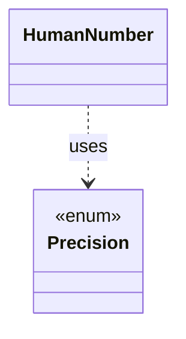

# `HumanNumber`

`io.github.tlaplus.hardening.cli` · class · other · [source](https://github.com/tlaplus/model-checker-hardening/blob/4f182776ab66c4f93ff45cb83dfcd11e34fa32d1/src/main/java/io/github/tlaplus/hardening/cli/HumanNumber.java#L9) · module [cli](../modules/cli.md)

Locale-independent numeric fields; compact counts occupy at most five columns.

The diagram draws 1 of 3 relations; the table lists them all.

| Direction | Relation | Type | Summary |
|---|---|---|---|
| → | uses | [Precision](io.github.tlaplus.hardening.cli.Precision.md) | How a reported value is rendered: exactly for scrollback, or bounded for live screens. |
| ← | depends | [HumanDuration](io.github.tlaplus.hardening.cli.HumanDuration.md) | Formats nonnegative durations as compact day, hour, minute, and second parts. |
| ← | depends | [RunValue](io.github.tlaplus.hardening.cli.RunValue.md) | Unrounded, typed values used both for formatting and change comparison. |
