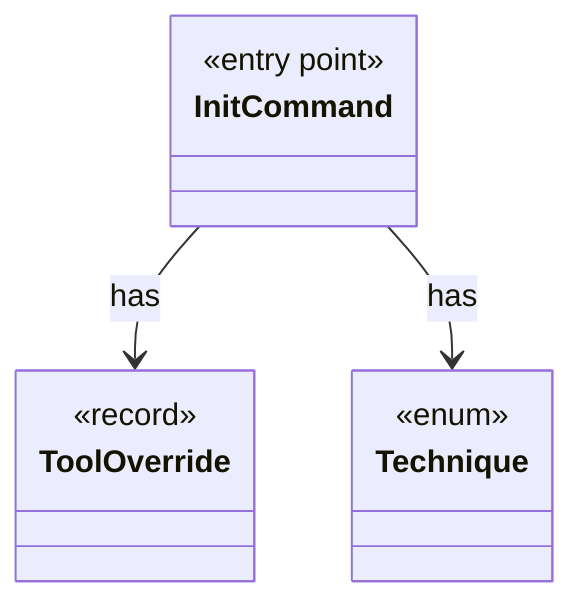

# `InitCommand`

`io.github.tlaplus.hardening.cli` · class · entry point · key · [source](https://github.com/tlaplus/model-checker-hardening/blob/390ea420071a36987998dbae4a6bab1d394188dc/src/main/java/io/github/tlaplus/hardening/cli/InitCommand.java#L34) · module [cli](../modules/cli.md)

`fuzztla init`: writes the configuration of a new corpus, which names the technique every run follows (ADR 0025 §1), and copies its libraries and tool JARs into it (§2, §3).

**Decisions:** [ADR 0025: Self-contained corpora, chosen at `init`](https://github.com/tlaplus/model-checker-hardening/blob/390ea420071a36987998dbae4a6bab1d394188dc/docs/decisions/0025-self-contained-corpora.md)

The diagram draws 2 of 22 relations; the table lists them all.

| Direction | Relation | Type | Summary |
|---|---|---|---|
| → | has | [ToolOverride](io.github.tlaplus.hardening.cli.ToolOverride.md) | One `--tool TOOL=FILE` of `fuzztla init`: the JAR a new corpus copies into ` tools/` in place of the staged one (ADR 0032 §2). |
| → | has | [Technique](io.github.tlaplus.hardening.corpus.Technique.md) | The fuzzing technique a corpus runs: `[workflow] technique`, which `fuzztla init --how` sets (ADR 0025 §1), so every run and every replay decodes and judges its entries the same way. |
| → | depends | [CommandDiagnostic](io.github.tlaplus.hardening.cli.CommandDiagnostic.md) | Formats command failures without coupling diagnostics to picocli. |
| → | depends | [InitialConfig](io.github.tlaplus.hardening.cli.InitialConfig.md) | The configuration `fuzztla init` writes (ADR 0025 §1): the defaults, the shipped known-defect database, the settings that follow from the technique, and fresh seeds (ADR 0026). |
| → | depends | [ConfigException](io.github.tlaplus.hardening.config.ConfigException.md) | Reports invalid contents in a FuzzTLA configuration file. |
| → | depends | [FuzzTlaConfig](io.github.tlaplus.hardening.config.FuzzTlaConfig.md) | Complete configuration of input generation and workflow execution. |
| → | depends | [GenericCheckerConfig](io.github.tlaplus.hardening.config.GenericCheckerConfig.md) | The `[generic]` table (ADR 0033 §1): a model checker that claims compatibility with TLC or Apalache, run as a native process for each input. |
| → | depends | [OperatorLibraryConfig](io.github.tlaplus.hardening.config.OperatorLibraryConfig.md) | Source-only library settings. |
| → | depends | [SeedConfig](io.github.tlaplus.hardening.config.SeedConfig.md) | The `[seeds]` table (ADR 0026): every random seed a run uses. |
| → | depends | [TomlConfig](io.github.tlaplus.hardening.config.TomlConfig.md) | Reads and writes the strict `config.toml` format used by a corpus. |
| → | depends | [ToolJar](io.github.tlaplus.hardening.config.ToolJar.md) | A checker distribution that a corpus copies into its `tools/` directory, so its entries keep being checked, and its libraries typed, with the release they were admitted under (ADR 0025 §3). |
| → | depends | [ToolsConfig](io.github.tlaplus.hardening.config.ToolsConfig.md) | The tools a corpus checks and types with: the JARs of the `[tools]` table (ADR 0025 §3), and the generic checker of the `[generic]` table (ADR 0033). |
| → | depends | [CorpusDirectory](io.github.tlaplus.hardening.corpus.CorpusDirectory.md) | Owns the on-disk layout and integrity checks for one FuzzTLA corpus. |
| → | depends | [CorpusException](io.github.tlaplus.hardening.corpus.CorpusException.md) | Reports an invalid corpus layout or corpus entry. |
| → | depends | [CorpusPath](io.github.tlaplus.hardening.corpus.CorpusPath.md) | A fixed path in the on-disk corpus layout. |
| → | depends | [ExpressionCategory](io.github.tlaplus.hardening.gen.ExpressionCategory.md) | A user-facing category assigned to generated expression forms. |
| → | depends | [InputKind](io.github.tlaplus.hardening.gen.InputKind.md) | What a generator payload decodes to. |
| → | depends | [IrGenerationConfig](io.github.tlaplus.hardening.gen.IrGenerationConfig.md) | Settings for generated TLA+ expressions and modules. |
| → | depends | [AdoptableBase](io.github.tlaplus.hardening.workflow.AdoptableBase.md) | The base corpus of a metamorphic run (ADR 0016 §6). |
| → | depends | [WorkflowException](io.github.tlaplus.hardening.workflow.WorkflowException.md) | Reports an infrastructure or lifecycle failure in a fuzzing workflow. |
| → | depends | [LibraryInstall](io.github.tlaplus.hardening.workflow.library.LibraryInstall.md) | Copies into a new corpus every file its configuration names (ADR 0025 §2, §3), so the corpus keeps the releases it was initialized with: the classpath of the operator library, of the rewrite rules and of the edge guards goes to `tla/`. |
| → | depends | [SpecDecoders](io.github.tlaplus.hardening.workflow.spec.SpecDecoders.md) | Immutable registry of the decoders that turn stored payloads into checkable modules. |
