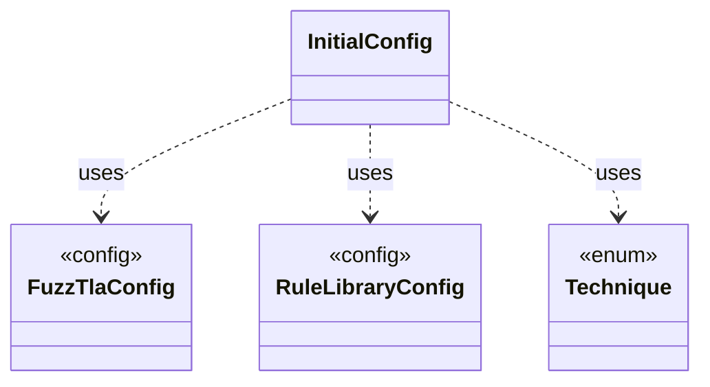

# `InitialConfig`

`io.github.tlaplus.hardening.cli` · class · other · [source](https://github.com/tlaplus/model-checker-hardening/blob/4df6a11e5b4bf93609393935c4cbeceec08cce0c/src/main/java/io/github/tlaplus/hardening/cli/InitialConfig.java#L22) · module [cli](../modules/cli.md)

The configuration `fuzztla init` writes (ADR 0025 §1): the defaults, the shipped known-defect database, and the settings that follow from the technique.

**Decisions:** [ADR 0025: Self-contained corpora, chosen at `init`](https://github.com/tlaplus/model-checker-hardening/blob/4df6a11e5b4bf93609393935c4cbeceec08cce0c/docs/decisions/0025-self-contained-corpora.md)

The diagram draws 3 of 13 relations; the table lists them all.

| Direction | Relation | Type | Summary |
|---|---|---|---|
| → | uses | [FuzzTlaConfig](io.github.tlaplus.hardening.config.FuzzTlaConfig.md) | Complete configuration of input generation and workflow execution. |
| → | uses | [RuleLibraryConfig](io.github.tlaplus.hardening.config.RuleLibraryConfig.md) | A rule module and its weights (ADR 0017 §1), as `[metamorphic]` configures the rewrites of `mt` corpora and `[graph]` the tautological edge guards of ADR 0023 §6. |
| → | uses | [Technique](io.github.tlaplus.hardening.corpus.Technique.md) | The fuzzing technique a corpus runs: `[workflow] technique`, which `fuzztla init --how` sets (ADR 0025 §1), so every run and every replay decodes and judges its entries the same way. |
| → | depends | [ProjectDirectory](io.github.tlaplus.hardening.cli.ProjectDirectory.md) | Locates the FuzzTLA project directory that ships the signature databases and scripts. |
| → | depends | [InputStageConfig](io.github.tlaplus.hardening.config.InputStageConfig.md) | The input stage's occupancy limit and the known-defect databases its admission consults. |
| → | depends | [MetamorphicConfig](io.github.tlaplus.hardening.config.MetamorphicConfig.md) | The `[metamorphic]` table (ADR 0016 §7, ADR 0017 §1): what an `mt` corpus reads besides the generator settings. |
| → | depends | [WorkflowConfig](io.github.tlaplus.hardening.config.WorkflowConfig.md) | Global and per-stage limits for the implemented fuzzing workflow. |
| → | depends | [CheckerSet](io.github.tlaplus.hardening.corpus.CheckerSet.md) | The checker branches a corpus runs: a non-empty set of checking stages, in stage order. |
| → | depends | [CorpusStage](io.github.tlaplus.hardening.corpus.CorpusStage.md) | One implemented stage of the fuzzing pipeline, and the corpus directories it owns. |
| → | depends | [InputKind](io.github.tlaplus.hardening.gen.InputKind.md) | What a generator payload decodes to. |
| → | depends | [RewriteLimits](io.github.tlaplus.hardening.gen.rewrite.RewriteLimits.md) | Bounds of one rewrite (ADR 0016 §2, §7). |
| → | depends | [KnownDefectDatabase](io.github.tlaplus.hardening.signature.KnownDefectDatabase.md) | The known-defect signatures of one invocation, in database order. |
| ← | depends | [InitCommand](io.github.tlaplus.hardening.cli.InitCommand.md) | `fuzztla init`: writes the configuration of a new corpus, which names the technique every run follows (ADR 0025 §1), and copies its libraries and tool JARs into it (§2, §3). |
