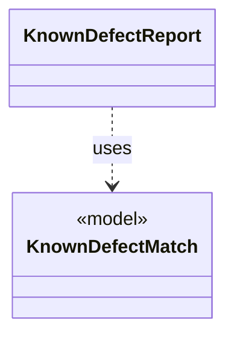

# `KnownDefectReport`

`io.github.tlaplus.hardening.cli` · class · other · [source](https://github.com/tlaplus/model-checker-hardening/blob/12d0a3fd62c72add470e6ee06490c4e3591f490e/src/main/java/io/github/tlaplus/hardening/cli/KnownDefectReport.java#L13) · module [cli](../modules/cli.md)

Renders the known-defect signatures that match one decoded input: each signature's id, description, and references, and the subexpression it matched first, as TLA+.

The diagram draws 1 of 4 relations; the table lists them all.

| Direction | Relation | Type | Summary |
|---|---|---|---|
| → | uses | [KnownDefectMatch](io.github.tlaplus.hardening.signature.KnownDefectMatch.md) | A signature that matches a module, and the outermost subexpression it matched first. |
| → | depends | [EnvelopeReport](io.github.tlaplus.hardening.cli.EnvelopeReport.md) | Renders a decoded corpus envelope and its expression as plain text. |
| → | depends | [KnownDefect](io.github.tlaplus.hardening.signature.KnownDefect.md) | One known-defect signature: a documented tool defect and the IR shapes that trigger it. |
| ← | depends | [PrintCommand](io.github.tlaplus.hardening.cli.PrintCommand.md) | `fuzztla print`: decodes a payload or corpus envelope and renders it, with the known defects it matches. |
