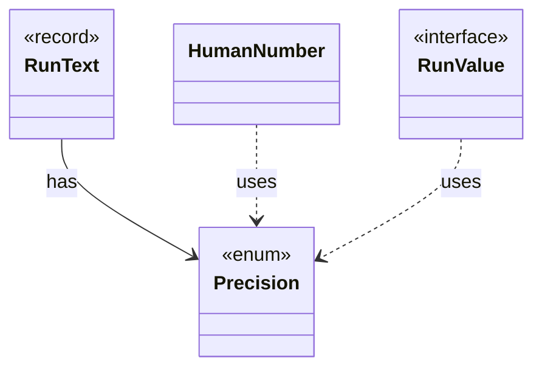

# `Precision`

`io.github.tlaplus.hardening.cli` · enum · other · [source](https://github.com/tlaplus/model-checker-hardening/blob/21262d9d0cc07b5ae4c47c4ee511217c9b88b561/src/main/java/io/github/tlaplus/hardening/cli/Precision.java#L4) · module [cli](../modules/cli.md)

How a reported value is rendered: exactly for scrollback, or bounded for live screens.

The diagram draws 3 of 5 relations; the table lists them all.

| Direction | Relation | Type | Summary |
|---|---|---|---|
| ← | has | [RunText](io.github.tlaplus.hardening.cli.RunText.md) | Shared field formatting; attributed text keeps terminal escapes out of width arithmetic. |
| ← | uses | [HumanNumber](io.github.tlaplus.hardening.cli.HumanNumber.md) | Locale-independent numeric fields; compact counts occupy at most five columns. |
| ← | uses | [RunValue](io.github.tlaplus.hardening.cli.RunValue.md) | Unrounded, typed values used both for formatting and change comparison. |
| ← | depends | [RunTable](io.github.tlaplus.hardening.cli.RunTable.md) | Complete, exact statistics grouped by stage; suitable for scrollback and redirected output. |
| ← | depends | [TerminalProgressDisplay](io.github.tlaplus.hardening.cli.TerminalProgressDisplay.md) | Terminal mechanics of live progress: snapshots, change highlighting, resizing, and screen restoration. |
