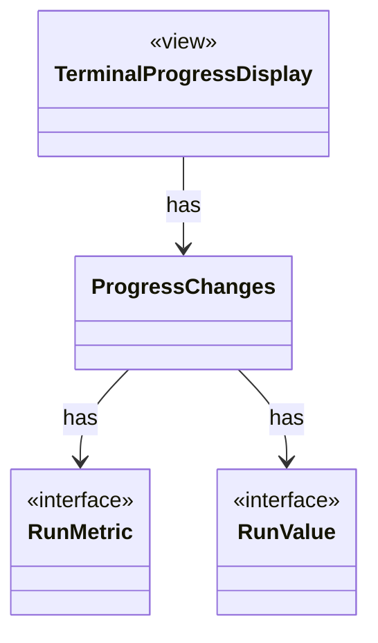

# `ProgressChanges`

`io.github.tlaplus.hardening.cli` · class · other · [source](https://github.com/tlaplus/model-checker-hardening/blob/47a7fcfd71d20c6a404ebf5a8a3e7d9a0e250e9b/src/main/java/io/github/tlaplus/hardening/cli/ProgressChanges.java#L8) · module [cli](../modules/cli.md)

Tracks changes and their direction for one refresh interval, using a caller-supplied monotonic clock.

| Direction | Relation | Type | Summary |
|---|---|---|---|
| → | has | [RunMetric](io.github.tlaplus.hardening.cli.RunMetric.md) | Stable field identity, independent of screen coordinates or formatted text. |
| → | has | [RunValue](io.github.tlaplus.hardening.cli.RunValue.md) | Unrounded, typed values used both for formatting and change comparison. |
| ← | has | [TerminalProgressDisplay](io.github.tlaplus.hardening.cli.TerminalProgressDisplay.md) | Terminal mechanics of live progress: snapshots, change highlighting, resizing, and screen restoration. |
