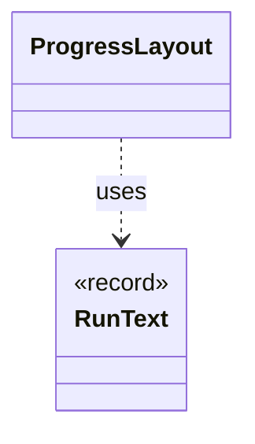

# `ProgressLayout`

`io.github.tlaplus.hardening.cli` · class · other · [source](https://github.com/tlaplus/model-checker-hardening/blob/0b7c167b636088dd43d36713d157e22f7ebd4f79/src/main/java/io/github/tlaplus/hardening/cli/ProgressLayout.java#L15) · module [cli](../modules/cli.md)

Pure, size-bounded flow and table layouts for the same statistics and styles.

The diagram draws 1 of 7 relations; the table lists them all.

| Direction | Relation | Type | Summary |
|---|---|---|---|
| → | uses | [RunText](io.github.tlaplus.hardening.cli.RunText.md) | Shared field formatting; attributed text keeps terminal escapes out of width arithmetic. |
| → | depends | [Glyphs](io.github.tlaplus.hardening.cli.Glyphs.md) | Characters for the live diagram and change markers. |
| → | depends | [RunMetric](io.github.tlaplus.hardening.cli.RunMetric.md) | Stable field identity, independent of screen coordinates or formatted text. |
| → | depends | [RunPalette](io.github.tlaplus.hardening.cli.RunPalette.md) | Capability-aware styles on the terminal's own palette and default background. |
| → | depends | [CorpusStage](io.github.tlaplus.hardening.corpus.CorpusStage.md) | One implemented stage of the fuzzing pipeline, and the corpus directories it owns. |
| → | depends | [CorpusVerdict](io.github.tlaplus.hardening.corpus.CorpusVerdict.md) | A verdict supported by the implemented corpus stages. |
| ← | depends | [TerminalProgressDisplay](io.github.tlaplus.hardening.cli.TerminalProgressDisplay.md) | Terminal mechanics of live progress: snapshots, change highlighting, resizing, and screen restoration. |
