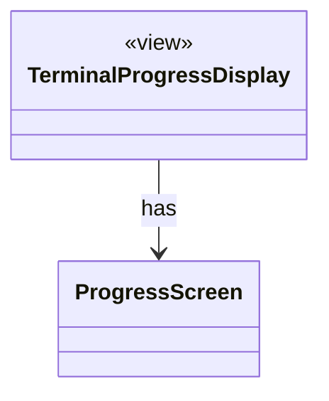

# `ProgressScreen`

`io.github.tlaplus.hardening.cli` · class · other · [source](https://github.com/tlaplus/model-checker-hardening/blob/0b7c167b636088dd43d36713d157e22f7ebd4f79/src/main/java/io/github/tlaplus/hardening/cli/ProgressScreen.java#L11) · module [cli](../modules/cli.md)

Owns the alternate screen: entering it, updating changed rows, and restoring scrollback.

| Direction | Relation | Type | Summary |
|---|---|---|---|
| ← | has | [TerminalProgressDisplay](io.github.tlaplus.hardening.cli.TerminalProgressDisplay.md) | Terminal mechanics of live progress: snapshots, change highlighting, resizing, and screen restoration. |
