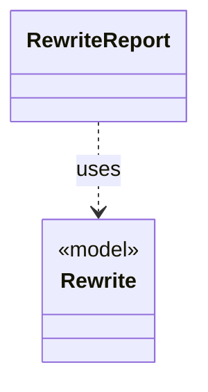

# `RewriteReport`

`io.github.tlaplus.hardening.cli` · class · other · [source](https://github.com/tlaplus/model-checker-hardening/blob/0b7c167b636088dd43d36713d157e22f7ebd4f79/src/main/java/io/github/tlaplus/hardening/cli/RewriteReport.java#L18) · module [cli](../modules/cli.md)

Renders a metamorphic pair for triage (ADR 0016 §8): which side the checkers explore, the rules applied in order, and both sides.

**Decisions:** [ADR 0016: Metamorphic testing](https://github.com/tlaplus/model-checker-hardening/blob/0b7c167b636088dd43d36713d157e22f7ebd4f79/docs/decisions/0016-metamorphic-testing.md)

The diagram draws 1 of 7 relations; the table lists them all.

| Direction | Relation | Type | Summary |
|---|---|---|---|
| → | uses | [Rewrite](io.github.tlaplus.hardening.gen.rewrite.Rewrite.md) | A decoded metamorphic pair: the base the payload's base part decodes to, its rewrite, the orientation, and the rules applied in order. |
| → | depends | [EnvelopeReport](io.github.tlaplus.hardening.cli.EnvelopeReport.md) | Renders a decoded corpus envelope and its expression as plain text. |
| → | depends | [GeneratedSpec](io.github.tlaplus.hardening.gen.GeneratedSpec.md) | The declarations one generated module consists of. |
| → | depends | [Orientation](io.github.tlaplus.hardening.gen.rewrite.Orientation.md) | Which side of a metamorphic pair the checker explores (ADR 0016 §3). |
| → | depends | [FuzzInputModule](io.github.tlaplus.hardening.workflow.spec.FuzzInputModule.md) | Assembles the module checked by the parser and model-checker stages. |
| → | depends | [SpecText](io.github.tlaplus.hardening.workflow.spec.SpecText.md) | Renders an assembled module as the TLA+ source that the parser and TLC consume. |
| ← | depends | [DecodedInputRenderer](io.github.tlaplus.hardening.cli.DecodedInputRenderer.md) | Renders a decoded input independently of picocli command wiring. |
