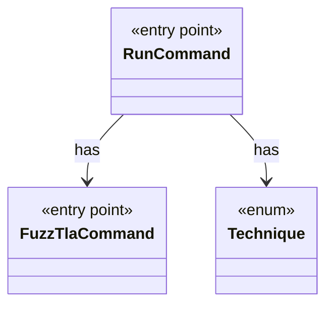

# `RunCommand`

`io.github.tlaplus.hardening.cli` · class · entry point · key · [source](https://github.com/tlaplus/model-checker-hardening/blob/3b201567990514c2a43b90dca521dbe32af37023/src/main/java/io/github/tlaplus/hardening/cli/RunCommand.java#L31) · module [cli](../modules/cli.md)

`fuzztla run`: reads a corpus configuration and runs `WorkflowRunner` with live progress output.

The diagram draws 2 of 18 relations; the table lists them all.

| Direction | Relation | Type | Summary |
|---|---|---|---|
| → | has | [FuzzTlaCommand](io.github.tlaplus.hardening.cli.FuzzTlaCommand.md) | The root `fuzztla` command: registers the subcommands and runs one command line. |
| → | has | [Technique](io.github.tlaplus.hardening.corpus.Technique.md) | The fuzzing technique a corpus runs (`fuzztla run --how`). |
| → | depends | [CommandDiagnostic](io.github.tlaplus.hardening.cli.CommandDiagnostic.md) | Formats command failures without coupling diagnostics to picocli. |
| → | depends | [RunOutput](io.github.tlaplus.hardening.cli.RunOutput.md) | The output of one run: the command's configured writer and an optional live display in front of it. |
| → | depends | [RunShutdownHook](io.github.tlaplus.hardening.cli.RunShutdownHook.md) | Converts JVM shutdown into an interruption and waits for workflow exit persistence. |
| → | depends | [TerminalAcquisition](io.github.tlaplus.hardening.cli.TerminalAcquisition.md) | Acquires a live progress display for one run. |
| → | depends | [ConfigException](io.github.tlaplus.hardening.config.ConfigException.md) | Reports invalid contents in a FuzzTLA configuration file. |
| → | depends | [FuzzTlaConfig](io.github.tlaplus.hardening.config.FuzzTlaConfig.md) | Complete configuration of input generation and workflow execution. |
| → | depends | [MutatorConfig](io.github.tlaplus.hardening.config.MutatorConfig.md) | Generations, the quality gate's selection, and the mutator's share and operators (ADR 0010). |
| → | depends | [TomlConfig](io.github.tlaplus.hardening.config.TomlConfig.md) | Reads and writes the strict `config.toml` format used by a corpus. |
| → | depends | [CorpusDirectory](io.github.tlaplus.hardening.corpus.CorpusDirectory.md) | Owns the on-disk layout and integrity checks for one FuzzTLA corpus. |
| → | depends | [CorpusException](io.github.tlaplus.hardening.corpus.CorpusException.md) | Reports an invalid corpus layout or corpus entry. |
| → | depends | [CorpusPath](io.github.tlaplus.hardening.corpus.CorpusPath.md) | A fixed path in the on-disk corpus layout. |
| → | depends | [WorkflowException](io.github.tlaplus.hardening.workflow.WorkflowException.md) | Reports an infrastructure or lifecycle failure in a fuzzing workflow. |
| → | depends | [WorkflowRunSummary](io.github.tlaplus.hardening.workflow.WorkflowRunSummary.md) | Cumulative corpus statistics and stopping reason after one complete workflow invocation. |
| → | depends | [WorkflowRunner](io.github.tlaplus.hardening.workflow.WorkflowRunner.md) | Runs generation, parsing, TLC, Apalache, conformance aggregation and the quality gate under one CPU budget. |
| ← | depends | [ExportDbCommand](io.github.tlaplus.hardening.cli.ExportDbCommand.md) | `fuzztla export-db`: exports a corpus with `CorpusExport` (ADR 0009). |
| ← | depends | [ShrinkCommand](io.github.tlaplus.hardening.cli.ShrinkCommand.md) | `fuzztla shrink`: reduces a metamorphic counterexample with `MetamorphicShrinker` (ADR 0016). |
