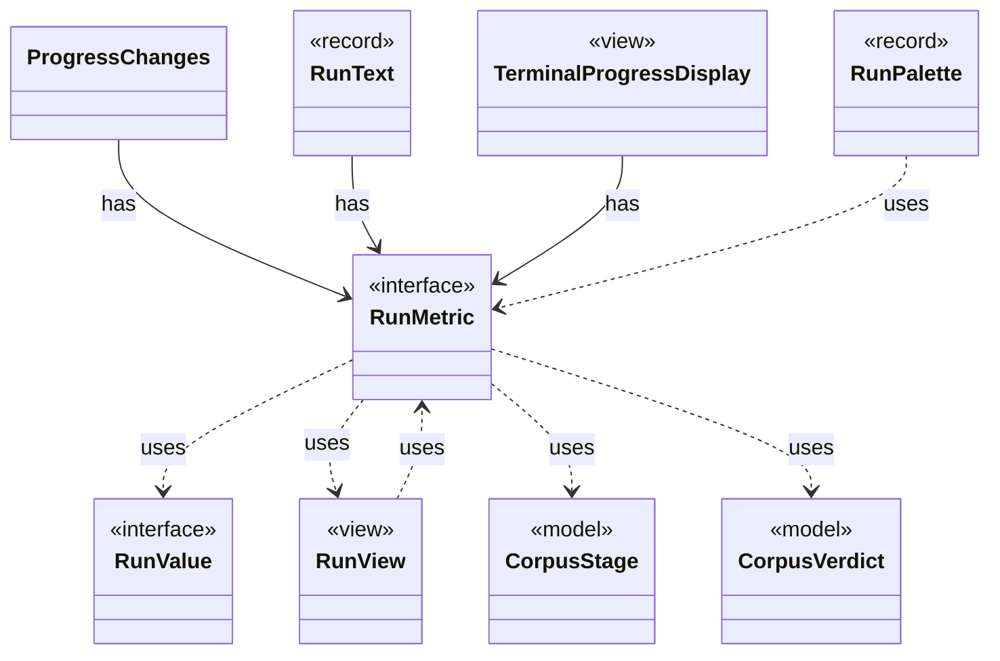

# `RunMetric`

`io.github.tlaplus.hardening.cli` · interface · other · [source](https://github.com/tlaplus/model-checker-hardening/blob/a304ba37155136c3ba79e4f2fb414cbb47d01606/src/main/java/io/github/tlaplus/hardening/cli/RunMetric.java#L11) · module [cli](../modules/cli.md)

Stable field identity, independent of screen coordinates or formatted text.

The diagram draws 9 of 13 relations; the table lists them all.

| Direction | Relation | Type | Summary |
|---|---|---|---|
| ← | has | [ProgressChanges](io.github.tlaplus.hardening.cli.ProgressChanges.md) | Tracks changes and their direction for one refresh interval, using a caller-supplied monotonic clock. |
| ← | has | [RunText](io.github.tlaplus.hardening.cli.RunText.md) | Shared field formatting; attributed text keeps terminal escapes out of width arithmetic. |
| ← | has | [TerminalProgressDisplay](io.github.tlaplus.hardening.cli.TerminalProgressDisplay.md) | Terminal mechanics of live progress: snapshots, change highlighting, resizing, and screen restoration. |
| → | uses | [RunValue](io.github.tlaplus.hardening.cli.RunValue.md) | Unrounded, typed values used both for formatting and change comparison. |
| → | uses | [RunView](io.github.tlaplus.hardening.cli.RunView.md) | The statistics shared by live and final reports, without layout or terminal state. |
| → | uses | [CorpusStage](io.github.tlaplus.hardening.corpus.CorpusStage.md) | One implemented stage of the fuzzing pipeline, and the corpus directories it owns. |
| → | uses | [CorpusVerdict](io.github.tlaplus.hardening.corpus.CorpusVerdict.md) | A verdict supported by the implemented corpus stages. |
| ← | uses | [RunPalette](io.github.tlaplus.hardening.cli.RunPalette.md) | Capability-aware styles on the terminal's own palette and default background. |
| ← | uses | [RunView](io.github.tlaplus.hardening.cli.RunView.md) | The statistics shared by live and final reports, without layout or terminal state. |
| → | depends | [GeneratorAggregate](io.github.tlaplus.hardening.common.GeneratorAggregate.md) | Immutable generation counters shared by persisted statistics and invocation summaries. |
| → | depends | [GeneratorSummary](io.github.tlaplus.hardening.workflow.execution.GeneratorSummary.md) | Cumulative generation statistics decorated with invocation-facing replay and timing fields. |
| ← | depends | [ProgressLayout](io.github.tlaplus.hardening.cli.ProgressLayout.md) | Pure, size-bounded flow and table layouts for the same statistics and styles. |
| ← | depends | [RunTable](io.github.tlaplus.hardening.cli.RunTable.md) | Complete, exact statistics grouped by stage; suitable for scrollback and redirected output. |
