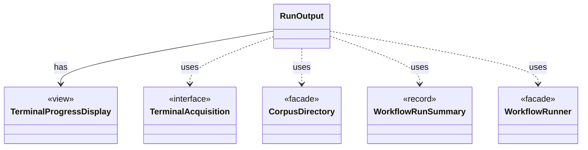

# `RunOutput`

`io.github.tlaplus.hardening.cli` · class · other · [source](https://github.com/tlaplus/model-checker-hardening/blob/12d0a3fd62c72add470e6ee06490c4e3591f490e/src/main/java/io/github/tlaplus/hardening/cli/RunOutput.java#L19) · module [cli](../modules/cli.md)

The output of one run: the command's configured writer and an optional live display in front of it.

The diagram draws 5 of 11 relations; the table lists them all.

| Direction | Relation | Type | Summary |
|---|---|---|---|
| → | has | [TerminalProgressDisplay](io.github.tlaplus.hardening.cli.TerminalProgressDisplay.md) | Terminal mechanics of live progress: snapshots, change highlighting, resizing, and screen restoration. |
| → | uses | [TerminalAcquisition](io.github.tlaplus.hardening.cli.TerminalAcquisition.md) | Acquires a live progress display for one run. |
| → | uses | [CorpusDirectory](io.github.tlaplus.hardening.corpus.CorpusDirectory.md) | Owns the on-disk layout and integrity checks for one FuzzTLA corpus. |
| → | uses | [WorkflowRunSummary](io.github.tlaplus.hardening.workflow.WorkflowRunSummary.md) | Cumulative corpus statistics and stopping reason after one complete workflow invocation. |
| → | uses | [WorkflowRunner](io.github.tlaplus.hardening.workflow.WorkflowRunner.md) | Runs generation, parsing, TLC, Apalache, conformance aggregation and the quality gate under one CPU budget. |
| → | depends | [RunPalette](io.github.tlaplus.hardening.cli.RunPalette.md) | Capability-aware styles on the terminal's own palette and default background. |
| → | depends | [RunTable](io.github.tlaplus.hardening.cli.RunTable.md) | Complete, exact statistics grouped by stage; suitable for scrollback and redirected output. |
| → | depends | [CorpusException](io.github.tlaplus.hardening.corpus.CorpusException.md) | Reports an invalid corpus layout or corpus entry. |
| → | depends | [WorkflowException](io.github.tlaplus.hardening.workflow.WorkflowException.md) | Reports an infrastructure or lifecycle failure in a fuzzing workflow. |
| → | depends | [WorkflowProgress](io.github.tlaplus.hardening.workflow.WorkflowProgress.md) | Best-effort snapshot of cumulative corpus statistics and current pending work. |
| ← | depends | [RunCommand](io.github.tlaplus.hardening.cli.RunCommand.md) | `fuzztla run`: reads a corpus configuration and runs `WorkflowRunner` with live progress output. |
