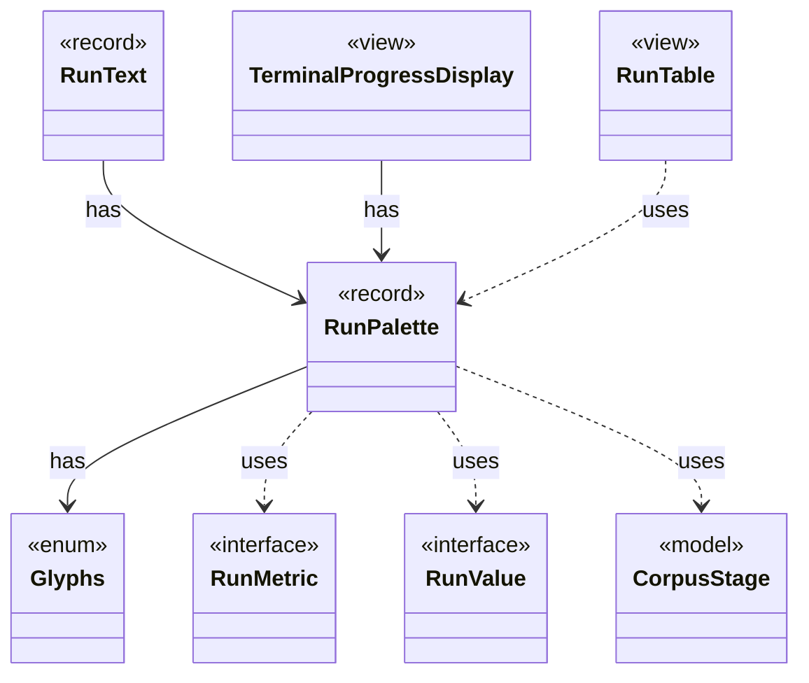

# `RunPalette`

`io.github.tlaplus.hardening.cli` · record · other · [source](https://github.com/tlaplus/model-checker-hardening/blob/4c5cb469fa5cdcada2cd5740bce130b825b35343/src/main/java/io/github/tlaplus/hardening/cli/RunPalette.java#L12) · module [cli](../modules/cli.md)

Capability-aware styles on the terminal's own palette and default background.

The diagram draws 7 of 11 relations; the table lists them all.

| Direction | Relation | Type | Summary |
|---|---|---|---|
| → | has | [Glyphs](io.github.tlaplus.hardening.cli.Glyphs.md) | Characters for the live diagram and change markers. |
| ← | has | [RunText](io.github.tlaplus.hardening.cli.RunText.md) | Shared field formatting; attributed text keeps terminal escapes out of width arithmetic. |
| ← | has | [TerminalProgressDisplay](io.github.tlaplus.hardening.cli.TerminalProgressDisplay.md) | Terminal mechanics of live progress: snapshots, change highlighting, resizing, and screen restoration. |
| → | uses | [RunMetric](io.github.tlaplus.hardening.cli.RunMetric.md) | Stable field identity, independent of screen coordinates or formatted text. |
| → | uses | [RunValue](io.github.tlaplus.hardening.cli.RunValue.md) | Unrounded, typed values used both for formatting and change comparison. |
| → | uses | [CorpusStage](io.github.tlaplus.hardening.corpus.CorpusStage.md) | One implemented stage of the fuzzing pipeline, and the corpus directories it owns. |
| ← | uses | [RunTable](io.github.tlaplus.hardening.cli.RunTable.md) | Complete, exact statistics grouped by stage; suitable for scrollback and redirected output. |
| → | depends | [CorpusVerdict](io.github.tlaplus.hardening.corpus.CorpusVerdict.md) | A verdict supported by the implemented corpus stages. |
| ← | depends | [ProgressLayout](io.github.tlaplus.hardening.cli.ProgressLayout.md) | Pure, size-bounded flow and table layouts for the same statistics and styles. |
| ← | depends | [RunOutput](io.github.tlaplus.hardening.cli.RunOutput.md) | The output of one run: the command's configured writer and an optional live display in front of it. |
| ← | depends | [RunTerminal](io.github.tlaplus.hardening.cli.RunTerminal.md) | Acquires the process stdout terminal for live progress when it is capable. |
