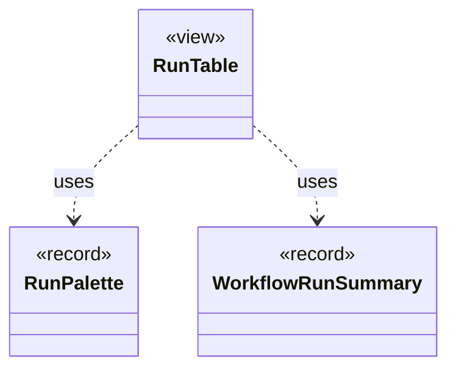

# `RunTable`

`io.github.tlaplus.hardening.cli` · class · view · key · [source](https://github.com/tlaplus/model-checker-hardening/blob/47a7fcfd71d20c6a404ebf5a8a3e7d9a0e250e9b/src/main/java/io/github/tlaplus/hardening/cli/RunTable.java#L14) · module [cli](../modules/cli.md)

Complete, exact statistics grouped by stage; suitable for scrollback and redirected output.

The diagram draws 2 of 9 relations; the table lists them all.

| Direction | Relation | Type | Summary |
|---|---|---|---|
| → | uses | [RunPalette](io.github.tlaplus.hardening.cli.RunPalette.md) | Capability-aware styles on the terminal's own palette and default background. |
| → | uses | [WorkflowRunSummary](io.github.tlaplus.hardening.workflow.WorkflowRunSummary.md) | Cumulative corpus statistics and stopping reason after one complete workflow invocation. |
| → | depends | [Precision](io.github.tlaplus.hardening.cli.Precision.md) | How a reported value is rendered: exactly for scrollback, or bounded for live screens. |
| → | depends | [RunMetric](io.github.tlaplus.hardening.cli.RunMetric.md) | Stable field identity, independent of screen coordinates or formatted text. |
| → | depends | [RunText](io.github.tlaplus.hardening.cli.RunText.md) | Shared field formatting; attributed text keeps terminal escapes out of width arithmetic. |
| → | depends | [RunView](io.github.tlaplus.hardening.cli.RunView.md) | The statistics shared by live and final reports, without layout or terminal state. |
| → | depends | [CorpusStage](io.github.tlaplus.hardening.corpus.CorpusStage.md) | One implemented stage of the fuzzing pipeline, and the corpus directories it owns. |
| → | depends | [CorpusVerdict](io.github.tlaplus.hardening.corpus.CorpusVerdict.md) | A verdict supported by the implemented corpus stages. |
| ← | depends | [RunOutput](io.github.tlaplus.hardening.cli.RunOutput.md) | The output of one run: the command's configured writer and an optional live display in front of it. |
