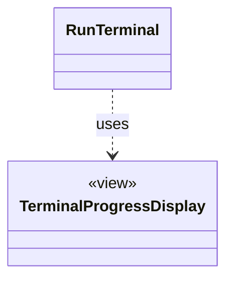

# `RunTerminal`

`io.github.tlaplus.hardening.cli` · class · other · [source](https://github.com/tlaplus/model-checker-hardening/blob/3df8c8564b58e946b95079b671788c8315f98831/src/main/java/io/github/tlaplus/hardening/cli/RunTerminal.java#L11) · module [cli](../modules/cli.md)

Acquires the process stdout terminal for live progress when it is capable.

The diagram draws 1 of 4 relations; the table lists them all.

| Direction | Relation | Type | Summary |
|---|---|---|---|
| → | uses | [TerminalProgressDisplay](io.github.tlaplus.hardening.cli.TerminalProgressDisplay.md) | Terminal mechanics of live progress: snapshots, change highlighting, resizing, and screen restoration. |
| → | depends | [RunPalette](io.github.tlaplus.hardening.cli.RunPalette.md) | Capability-aware styles on the terminal's own palette and default background. |
| ← | depends | [FuzzTlaCommand](io.github.tlaplus.hardening.cli.FuzzTlaCommand.md) | The root `fuzztla` command: registers the subcommands and runs one command line. |
| ← | depends | [TerminalProgressDisplay](io.github.tlaplus.hardening.cli.TerminalProgressDisplay.md) | Terminal mechanics of live progress: snapshots, change highlighting, resizing, and screen restoration. |
