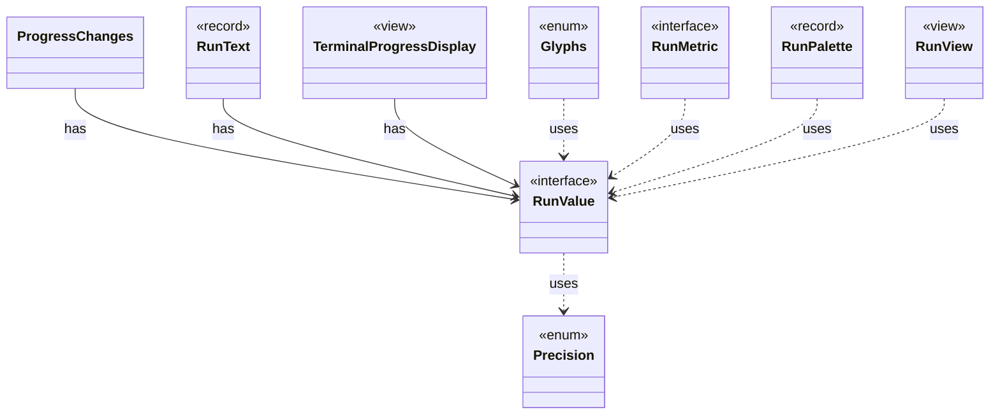

# `RunValue`

`io.github.tlaplus.hardening.cli` · interface · other · [source](https://github.com/tlaplus/model-checker-hardening/blob/918f7db91890f302587d25c76dc7ac189db3d023/src/main/java/io/github/tlaplus/hardening/cli/RunValue.java#L7) · module [cli](../modules/cli.md)

Unrounded, typed values used both for formatting and change comparison.

The diagram draws 8 of 10 relations; the table lists them all.

| Direction | Relation | Type | Summary |
|---|---|---|---|
| ← | has | [ProgressChanges](io.github.tlaplus.hardening.cli.ProgressChanges.md) | Tracks changes and their direction for one refresh interval, using a caller-supplied monotonic clock. |
| ← | has | [RunText](io.github.tlaplus.hardening.cli.RunText.md) | Shared field formatting; attributed text keeps terminal escapes out of width arithmetic. |
| ← | has | [TerminalProgressDisplay](io.github.tlaplus.hardening.cli.TerminalProgressDisplay.md) | Terminal mechanics of live progress: snapshots, change highlighting, resizing, and screen restoration. |
| → | uses | [Precision](io.github.tlaplus.hardening.cli.Precision.md) | How a reported value is rendered: exactly for scrollback, or bounded for live screens. |
| ← | uses | [Glyphs](io.github.tlaplus.hardening.cli.Glyphs.md) | Characters for the live diagram and change markers. |
| ← | uses | [RunMetric](io.github.tlaplus.hardening.cli.RunMetric.md) | Stable field identity, independent of screen coordinates or formatted text. |
| ← | uses | [RunPalette](io.github.tlaplus.hardening.cli.RunPalette.md) | Capability-aware styles on the terminal's own palette and default background. |
| ← | uses | [RunView](io.github.tlaplus.hardening.cli.RunView.md) | The statistics shared by live and final reports, without layout or terminal state. |
| → | depends | [HumanDuration](io.github.tlaplus.hardening.cli.HumanDuration.md) | Formats nonnegative durations as compact day, hour, minute, and second parts. |
| → | depends | [HumanNumber](io.github.tlaplus.hardening.cli.HumanNumber.md) | Locale-independent numeric fields; compact counts occupy at most five columns. |
