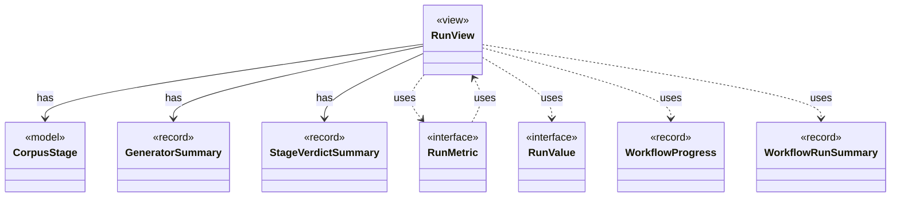

# `RunView`

`io.github.tlaplus.hardening.cli` · record · view · key · [source](https://github.com/tlaplus/model-checker-hardening/blob/21262d9d0cc07b5ae4c47c4ee511217c9b88b561/src/main/java/io/github/tlaplus/hardening/cli/RunView.java#L20) · module [cli](../modules/cli.md)

The statistics shared by live and final reports, without layout or terminal state.

The diagram draws 8 of 12 relations; the table lists them all.

| Direction | Relation | Type | Summary |
|---|---|---|---|
| → | has | [CorpusStage](io.github.tlaplus.hardening.corpus.CorpusStage.md) | One implemented stage of the fuzzing pipeline, and the corpus directories it owns. |
| → | has | [GeneratorSummary](io.github.tlaplus.hardening.workflow.execution.GeneratorSummary.md) | Cumulative generation statistics decorated with invocation-facing replay and timing fields. |
| → | has | [StageVerdictSummary](io.github.tlaplus.hardening.workflow.execution.StageVerdictSummary.md) | Cumulative verdict counters and summed worker elapsed time for one stage. |
| → | uses | [RunMetric](io.github.tlaplus.hardening.cli.RunMetric.md) | Stable field identity, independent of screen coordinates or formatted text. |
| → | uses | [RunValue](io.github.tlaplus.hardening.cli.RunValue.md) | Unrounded, typed values used both for formatting and change comparison. |
| → | uses | [WorkflowProgress](io.github.tlaplus.hardening.workflow.WorkflowProgress.md) | Best-effort snapshot of cumulative corpus statistics and current pending work. |
| → | uses | [WorkflowRunSummary](io.github.tlaplus.hardening.workflow.WorkflowRunSummary.md) | Cumulative corpus statistics and stopping reason after one complete workflow invocation. |
| ← | uses | [RunMetric](io.github.tlaplus.hardening.cli.RunMetric.md) | Stable field identity, independent of screen coordinates or formatted text. |
| → | depends | [CorpusInventory](io.github.tlaplus.hardening.corpus.CorpusInventory.md) | Immutable startup inventory used to seed stage queues and capacities. |
| → | depends | [CorpusVerdict](io.github.tlaplus.hardening.corpus.CorpusVerdict.md) | A verdict supported by the implemented corpus stages. |
| ← | depends | [RunTable](io.github.tlaplus.hardening.cli.RunTable.md) | Complete, exact statistics grouped by stage; suitable for scrollback and redirected output. |
| ← | depends | [TerminalProgressDisplay](io.github.tlaplus.hardening.cli.TerminalProgressDisplay.md) | Terminal mechanics of live progress: snapshots, change highlighting, resizing, and screen restoration. |
