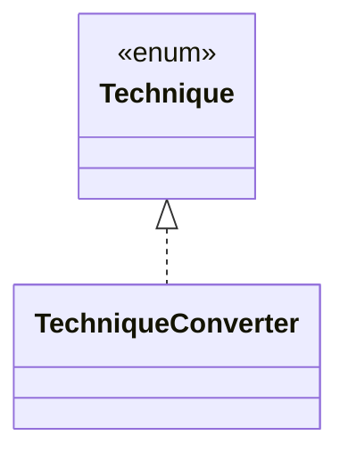

# `TechniqueConverter`

`io.github.tlaplus.hardening.cli` · class · other · [source](https://github.com/tlaplus/model-checker-hardening/blob/21262d9d0cc07b5ae4c47c4ee511217c9b88b561/src/main/java/io/github/tlaplus/hardening/cli/TechniqueConverter.java#L8) · module [cli](../modules/cli.md)

Reads the `--how` option of `fuzztla init` by the technique's encoded name.

| Direction | Relation | Type | Summary |
|---|---|---|---|
| → | implements | [Technique](io.github.tlaplus.hardening.corpus.Technique.md) | The fuzzing technique a corpus runs: `[workflow] technique`, which `fuzztla init --how` sets (ADR 0025 §1), so every run and every replay decodes and judges its entries the same way. |
