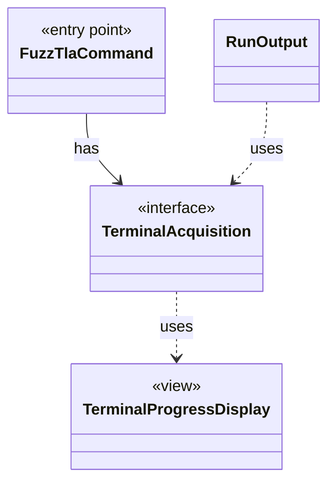

# `TerminalAcquisition`

`io.github.tlaplus.hardening.cli` · interface · other · [source](https://github.com/tlaplus/model-checker-hardening/blob/e180a3892e661e5d7ba7636c4f24a6fca66ded14/src/main/java/io/github/tlaplus/hardening/cli/TerminalAcquisition.java#L10) · module [cli](../modules/cli.md)

Acquires a live progress display for one run.

The diagram draws 3 of 4 relations; the table lists them all.

| Direction | Relation | Type | Summary |
|---|---|---|---|
| ← | has | [FuzzTlaCommand](io.github.tlaplus.hardening.cli.FuzzTlaCommand.md) | The root `fuzztla` command: registers the subcommands and runs one command line. |
| → | uses | [TerminalProgressDisplay](io.github.tlaplus.hardening.cli.TerminalProgressDisplay.md) | Terminal mechanics of live progress: snapshots, change highlighting, resizing, and screen restoration. |
| ← | uses | [RunOutput](io.github.tlaplus.hardening.cli.RunOutput.md) | The output of one run: the command's configured writer and an optional live display in front of it. |
| ← | depends | [RunCommand](io.github.tlaplus.hardening.cli.RunCommand.md) | `fuzztla run`: reads a corpus configuration and runs `WorkflowRunner` with live progress output. |
