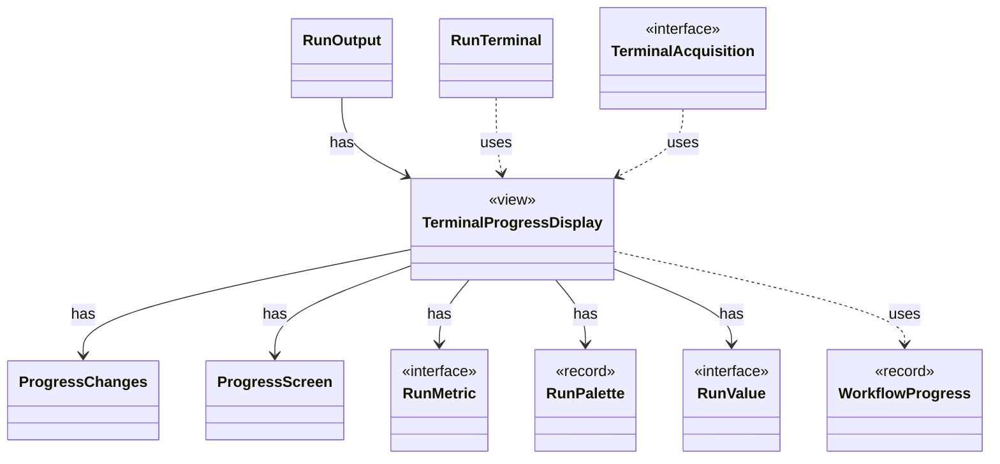

# `TerminalProgressDisplay`

`io.github.tlaplus.hardening.cli` · class · view · key · [source](https://github.com/tlaplus/model-checker-hardening/blob/21262d9d0cc07b5ae4c47c4ee511217c9b88b561/src/main/java/io/github/tlaplus/hardening/cli/TerminalProgressDisplay.java#L16) · module [cli](../modules/cli.md)

Terminal mechanics of live progress: snapshots, change highlighting, resizing, and screen restoration.

The diagram draws 9 of 14 relations; the table lists them all.

| Direction | Relation | Type | Summary |
|---|---|---|---|
| → | has | [ProgressChanges](io.github.tlaplus.hardening.cli.ProgressChanges.md) | Tracks changes and their direction for one refresh interval, using a caller-supplied monotonic clock. |
| → | has | [ProgressScreen](io.github.tlaplus.hardening.cli.ProgressScreen.md) | Owns the alternate screen: entering it, updating changed rows, and restoring scrollback. |
| → | has | [RunMetric](io.github.tlaplus.hardening.cli.RunMetric.md) | Stable field identity, independent of screen coordinates or formatted text. |
| → | has | [RunPalette](io.github.tlaplus.hardening.cli.RunPalette.md) | Capability-aware styles on the terminal's own palette and default background. |
| → | has | [RunValue](io.github.tlaplus.hardening.cli.RunValue.md) | Unrounded, typed values used both for formatting and change comparison. |
| ← | has | [RunOutput](io.github.tlaplus.hardening.cli.RunOutput.md) | The output of one run: the command's configured writer and an optional live display in front of it. |
| → | uses | [WorkflowProgress](io.github.tlaplus.hardening.workflow.WorkflowProgress.md) | Best-effort snapshot of cumulative corpus statistics and current pending work. |
| ← | uses | [RunTerminal](io.github.tlaplus.hardening.cli.RunTerminal.md) | Acquires the process stdout terminal for live progress when it is capable. |
| ← | uses | [TerminalAcquisition](io.github.tlaplus.hardening.cli.TerminalAcquisition.md) | Acquires a live progress display for one run. |
| → | depends | [Precision](io.github.tlaplus.hardening.cli.Precision.md) | How a reported value is rendered: exactly for scrollback, or bounded for live screens. |
| → | depends | [ProgressLayout](io.github.tlaplus.hardening.cli.ProgressLayout.md) | Pure, size-bounded flow and table layouts for the same statistics and styles. |
| → | depends | [RunTerminal](io.github.tlaplus.hardening.cli.RunTerminal.md) | Acquires the process stdout terminal for live progress when it is capable. |
| → | depends | [RunText](io.github.tlaplus.hardening.cli.RunText.md) | Shared field formatting; attributed text keeps terminal escapes out of width arithmetic. |
| → | depends | [RunView](io.github.tlaplus.hardening.cli.RunView.md) | The statistics shared by live and final reports, without layout or terminal state. |
