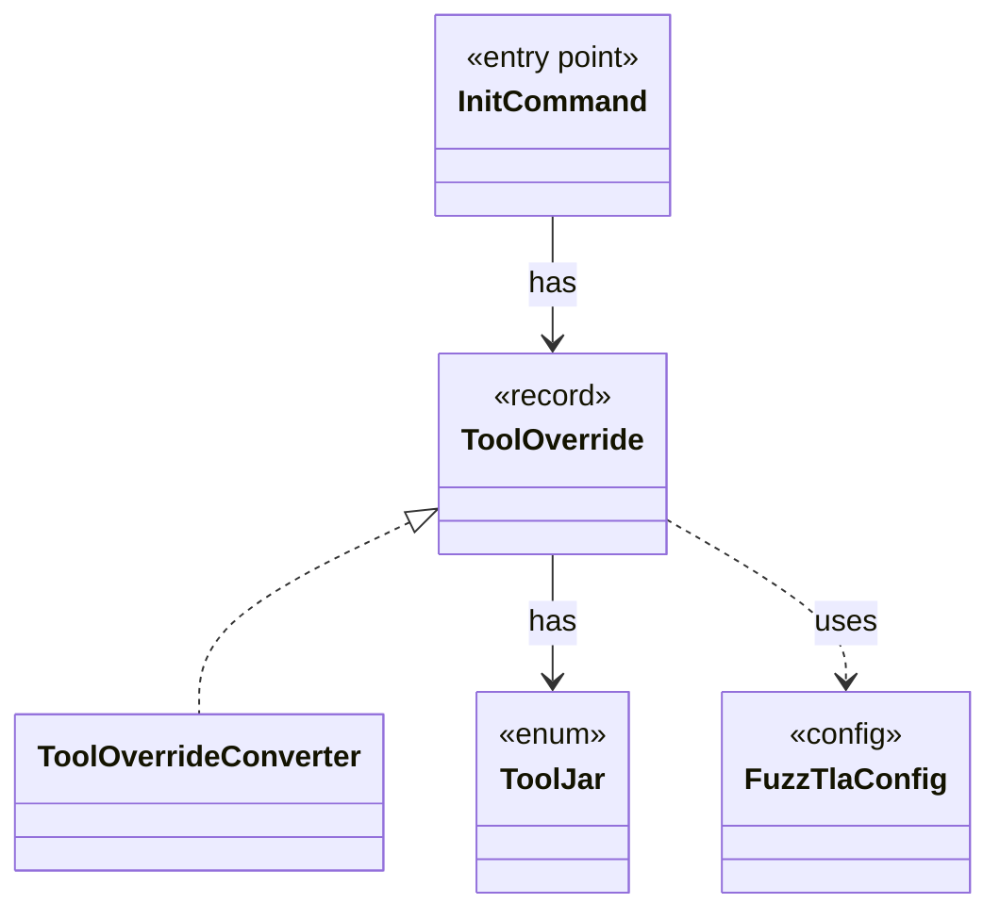

# `ToolOverride`

`io.github.tlaplus.hardening.cli` · record · other · [source](https://github.com/tlaplus/model-checker-hardening/blob/4bb4de908e112f3701f8f30b6bcd32c25707bdd7/src/main/java/io/github/tlaplus/hardening/cli/ToolOverride.java#L18) · module [cli](../modules/cli.md)

One `--tool TOOL=FILE` of `fuzztla init`: the JAR a new corpus copies into ` tools/` in place of the staged one (ADR 0032 §2).

**Decisions:** [ADR 0032: Earlier TLC and Apalache builds](https://github.com/tlaplus/model-checker-hardening/blob/4bb4de908e112f3701f8f30b6bcd32c25707bdd7/docs/decisions/0032-earlier-checker-builds.md)

The diagram draws 4 of 5 relations; the table lists them all.

| Direction | Relation | Type | Summary |
|---|---|---|---|
| ← | implements | [ToolOverrideConverter](io.github.tlaplus.hardening.cli.ToolOverrideConverter.md) | Reads a `--tool TOOL=FILE` option of `fuzztla init`, TOOL being a `[tools]` key. |
| → | has | [ToolJar](io.github.tlaplus.hardening.config.ToolJar.md) | A checker distribution that a corpus copies into its `tools/` directory, so its entries keep being checked, and its libraries typed, with the release they were admitted under (ADR 0025 §3). |
| ← | has | [InitCommand](io.github.tlaplus.hardening.cli.InitCommand.md) | `fuzztla init`: writes the configuration of a new corpus, which names the technique every run follows (ADR 0025 §1), and copies its libraries and tool JARs into it (§2, §3). |
| → | uses | [FuzzTlaConfig](io.github.tlaplus.hardening.config.FuzzTlaConfig.md) | Complete configuration of input generation and workflow execution. |
| → | depends | [ToolsConfig](io.github.tlaplus.hardening.config.ToolsConfig.md) | The tools a corpus checks and types with: the JARs of the `[tools]` table (ADR 0025 §3), and the generic checker of the `[generic]` table (ADR 0033). |
