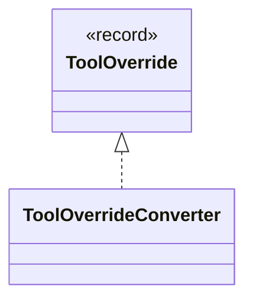

# `ToolOverrideConverter`

`io.github.tlaplus.hardening.cli` · class · other · [source](https://github.com/tlaplus/model-checker-hardening/blob/4bb4de908e112f3701f8f30b6bcd32c25707bdd7/src/main/java/io/github/tlaplus/hardening/cli/ToolOverrideConverter.java#L10) · module [cli](../modules/cli.md)

Reads a `--tool TOOL=FILE` option of `fuzztla init`, TOOL being a `[tools]` key.

The diagram draws 1 of 2 relations; the table lists them all.

| Direction | Relation | Type | Summary |
|---|---|---|---|
| → | implements | [ToolOverride](io.github.tlaplus.hardening.cli.ToolOverride.md) | One `--tool TOOL=FILE` of `fuzztla init`: the JAR a new corpus copies into ` tools/` in place of the staged one (ADR 0032 §2). |
| → | depends | [ToolJar](io.github.tlaplus.hardening.config.ToolJar.md) | A checker distribution that a corpus copies into its `tools/` directory, so its entries keep being checked, and its libraries typed, with the release they were admitted under (ADR 0025 §3). |
