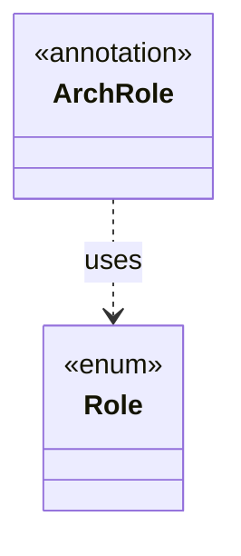

# `ArchRole`

`io.github.tlaplus.hardening.common` · annotation · other · [source](https://github.com/tlaplus/model-checker-hardening/blob/0b7c167b636088dd43d36713d157e22f7ebd4f79/src/main/java/io/github/tlaplus/hardening/common/ArchRole.java#L15) · module [common](../modules/common.md)

Declares the `Role` of a top-level type for the architecture atlas (ADR 0022).

**Decisions:** [ADR 0022: Architecture atlas](https://github.com/tlaplus/model-checker-hardening/blob/0b7c167b636088dd43d36713d157e22f7ebd4f79/docs/decisions/0022-architecture-atlas.md)

| Direction | Relation | Type | Summary |
|---|---|---|---|
| → | uses | [Role](io.github.tlaplus.hardening.common.Role.md) | What a type does in its package, as the architecture atlas shows it (ADR 0022). |
