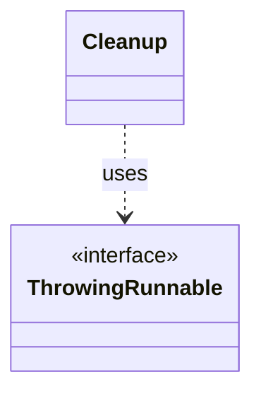

# `Cleanup`

`io.github.tlaplus.hardening.common` · class · other · [source](https://github.com/tlaplus/model-checker-hardening/blob/47a7fcfd71d20c6a404ebf5a8a3e7d9a0e250e9b/src/main/java/io/github/tlaplus/hardening/common/Cleanup.java#L6) · module [common](../modules/common.md)

Best-effort I/O cleanup that retains the original failure and its suppressed diagnostics.

The diagram draws 1 of 5 relations; the table lists them all.

| Direction | Relation | Type | Summary |
|---|---|---|---|
| → | uses | [ThrowingRunnable](io.github.tlaplus.hardening.common.ThrowingRunnable.md) | An operation that takes no value and may fail with a checked exception. |
| ← | depends | [StageScratch](io.github.tlaplus.hardening.corpus.StageScratch.md) | Corpus-owned transient storage for one stage during one workflow invocation. |
| ← | depends | [CorpusExport](io.github.tlaplus.hardening.database.CorpusExport.md) | Exports a corpus to a new SQLite database, as ADR 0009 defines it. |
| ← | depends | [ToolWorkerConnection](io.github.tlaplus.hardening.workflow.worker.ToolWorkerConnection.md) | Child-side connection to the parent's private worker-protocol listener. |
| ← | depends | [WorkerLaunch](io.github.tlaplus.hardening.workflow.worker.WorkerLaunch.md) | Brings one isolated worker up: private scratch storage, a private loopback listener, the child JVM, and an authenticated control connection. |
