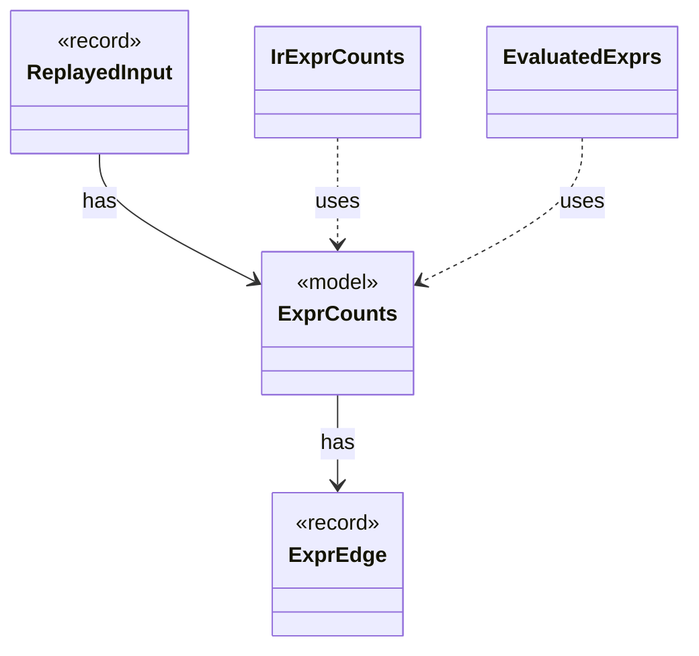

# `ExprCounts`

`io.github.tlaplus.hardening.common` · record · model · key · [source](https://github.com/tlaplus/model-checker-hardening/blob/da386b24fc0ea1f5a200a0d74df0b119a27ca0ba/src/main/java/io/github/tlaplus/hardening/common/ExprCounts.java#L16) · module [common](../modules/common.md)

The size of a piece of TLA+ code, the occurrences of each expression construct in it, and the occurrences of each edge between constructs.

The diagram draws 4 of 7 relations; the table lists them all.

| Direction | Relation | Type | Summary |
|---|---|---|---|
| → | has | [ExprEdge](io.github.tlaplus.hardening.common.ExprEdge.md) | An edge of an expression tree between two constructs: `parent` applied to, or binding, an immediate subexpression that is the construct `child`. |
| ← | has | [ReplayedInput](io.github.tlaplus.hardening.corpus.ReplayedInput.md) | What replaying one stored input shows beyond its envelope. |
| ← | uses | [IrExprCounts](io.github.tlaplus.hardening.signature.IrExprCounts.md) | Counts the size and constructs of the code the tools evaluate, over the walk that signatures match against. |
| ← | uses | [EvaluatedExprs](io.github.tlaplus.hardening.workflow.spec.EvaluatedExprs.md) | Replays a stored input and counts the expression constructs of the code the checkers evaluate: the definitions reachable from `SpecArtifact.entryPoints`. |
| → | depends | [Preconditions](io.github.tlaplus.hardening.common.Preconditions.md) | Shared validation of method and constructor arguments. |
| ← | depends | [EntryRows](io.github.tlaplus.hardening.database.EntryRows.md) | The rows that one decoded corpus entry contributes: its `entry` row, followed by the rows that reference it: one `knownDefect` row per signature, one `mutationOperator` row per operator, one `stage` row per stage record, one `expr` row per expression construct of its replayed input and one `exprEdge` row per edge between constructs. |
| ← | depends | [CoverageFeature](io.github.tlaplus.hardening.workflow.quality.CoverageFeature.md) | One coverage feature of an entry, with the hit-count bucket of its occurrences: a construct or an edge between constructs of its evaluated code (ADR 0013), or a temporal shape of its property (ADR 0028 §3). |
