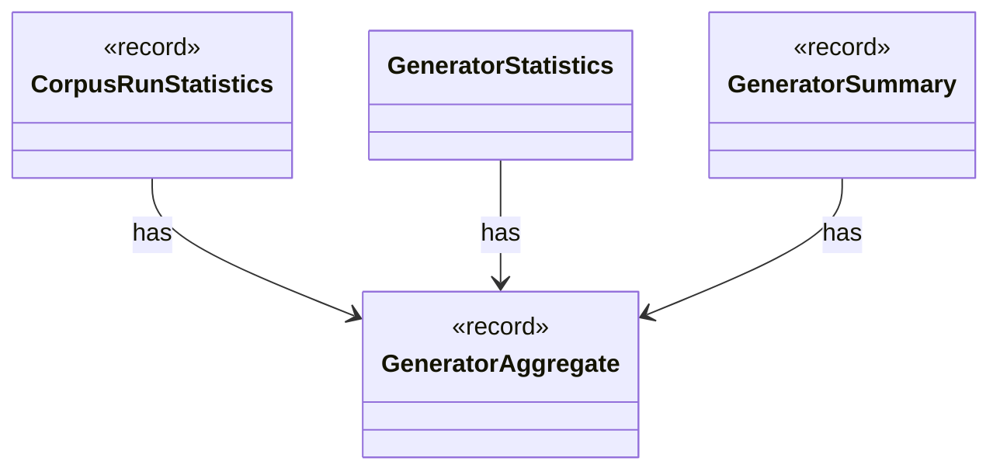

# `GeneratorAggregate`

`io.github.tlaplus.hardening.common` · record · other · [source](https://github.com/tlaplus/model-checker-hardening/blob/e180a3892e661e5d7ba7636c4f24a6fca66ded14/src/main/java/io/github/tlaplus/hardening/common/GeneratorAggregate.java#L15) · module [common](../modules/common.md)

Immutable generation counters shared by persisted statistics and invocation summaries.

The diagram draws 3 of 7 relations; the table lists them all.

| Direction | Relation | Type | Summary |
|---|---|---|---|
| ← | has | [CorpusRunStatistics](io.github.tlaplus.hardening.corpus.CorpusRunStatistics.md) | Durable cumulative statistics that cannot be recovered cheaply from corpus entries. |
| ← | has | [GeneratorStatistics](io.github.tlaplus.hardening.workflow.execution.GeneratorStatistics.md) | Cumulative input-generation counters shared by the generator workers. |
| ← | has | [GeneratorSummary](io.github.tlaplus.hardening.workflow.execution.GeneratorSummary.md) | Cumulative generation statistics decorated with invocation-facing replay and timing fields. |
| → | depends | [Preconditions](io.github.tlaplus.hardening.common.Preconditions.md) | Shared validation of method and constructor arguments. |
| ← | depends | [RunMetric](io.github.tlaplus.hardening.cli.RunMetric.md) | Stable field identity, independent of screen coordinates or formatted text. |
| ← | depends | [CorpusRunStatisticsCodec](io.github.tlaplus.hardening.corpus.CorpusRunStatisticsCodec.md) | Encodes and decodes the aggregate workflow-statistics CBOR document. |
| ← | depends | [WorkflowMetrics](io.github.tlaplus.hardening.workflow.execution.WorkflowMetrics.md) | The cumulative statistics of one workflow invocation: how long each stage has been busy, what input generation has produced, and the total elapsed time carried over from earlier runs. |
